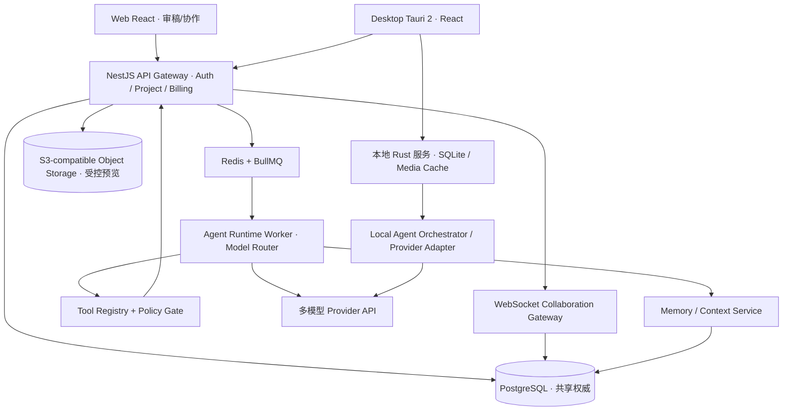

# BETWEEN FRAMES · 序间
## v2.0 最终产品与工程实施规格（GUI × 摄影 Agent × 专业协作 × 服务交易）

> 基线版本：2026-10-15 / `BF-SPEC-2.0`  
> 状态：**研发实施蓝图，非已交付的软件**  
> 目标：摄影创作者的 Figma——以高质量 Photography Agent 为核心能力，在专业 GUI 中完成个人及多人真实创作，再以协作工作流承接专业服务交易。  
> 面向：创始人、产品设计、技术负责人、开发 Agent、质量工程师、商业负责人。  
> 决策优先级：本 v2.0 文档 > 本包 contracts / db / tests > v1.0（可参考迁移）> 旧 HTML Demo（仅视觉/交互参考）。不允许把旧版“无协作、单机终态”约束机械延用到 v2.0。

---

# 0. 执行摘要与不可妥协的产品原则

## 0.1 一句话产品

Between Frames 是一个**摄影创作与协作工作空间**。用户通过专业视觉 GUI 对真实照片进行选择、对比、排序、批注、版本管理；专业 Photography Agent 理解创作意图、历史审美证据和授权协作反馈，能够自主调用工具、多轮比较和编排，并将结果作为可审阅草案直接呈现在画布上。摄影师、编辑、工作室和摄影学校可以围绕同一项目合作。平台未来可撮合付费评片、策展、摄影书编辑等专业服务。

## 0.2 北极星价值

**用户完成一组自己认可、可追溯、可协作、可导出的摄影作品序列。** 不是“聊天轮数”“模型调用量”“自动审美分数”或“社交关注量”。

## 0.3 四条不可妥协原则

1. **Agent 能力是核心产品能力**：必须达到经同题测试验证的同类竞品可用水平，优先保证摄影理解、任务完成率、可靠工具执行和对审美偏好的尊重，不拿“关系网络”掩盖笨拙 AI。
2. **GUI 是专业操作底座**：不要求用户先学会 Prompt。高频精细动作（多选、删改、拖动、对比、缩放）始终可以独立完成，AI 中断不妨碍手工创作。
3. **协作工作空间，而非摄影社区**：无关注、粉丝、动态流、点赞排行、UGC 信息流；关系来自真实项目中的邀请、批注、修改、采纳、专业服务履约。
4. **创作者对作品与关系拥有控制权**：原图版权归属不因上传改变；草案需要审批；权限最小化；项目数据、审美记忆和协作记录可导出；个人记忆不自动共享。

## 0.4 产品业务分层

| 产品层 | 核心对象 | 解决的问题 | 变现候选 |
|---|---|---|---|
| P1：Photography Agent | 任务 / 工具 / 上下文 / 偏好 | 真正提升作品编辑能力 | AI 使用额度、Pro 订阅 |
| P2：Creative Workspace | 项目 / 资产 / 接触印相 / 序列 / 版本 | 专业可视化创作效率 | 个人 Pro |
| P3：Professional Collaboration | 工作区 / 成员 / 评论 / 提案 / 审批 | 多人编辑、教育、工作室工作流 | 席位/工作区订阅 |
| P4：Professional Services | 服务 / 邀请 / 委托 / 里程碑 / 验收 | 付费评片、策展、摄影书编辑 | 交易服务费（验证后） |

## 0.5 非目标与优先级红线

P0 不做：图片社交关注、动态推荐流、匿名公共社区、NFT/代币、通用 AI 绘图、生成式替换真实照片、完整 Lightroom RAW 显影、打印工厂、复杂付款托管自建、模型供应商选择面板、任意外部工具商店、开放 Agent Shell 权限、无人审批地发布/删除原创内容。

---

# 1. 用户、核心 JTBD 与关键业务流程

## 1.1 目标用户优先级

| 用户 | 真实作业 | 成功标准 | 对应商业价值 |
|---|---|---|---|
| P0 独立长期项目摄影师 | 100–1000 张中完成 15–40 张序列 | 真实项目可交付，Agent 建议有意义 | 初期 Pro 订阅 |
| P0 摄影编辑 / 策展人 | 比较提案、批注、优化叙事 | 审稿与版本摩擦显著降低 | 专业协作席位 |
| P1 小型摄影工作室 | 多个项目、客户与合作编辑 | 项目分离、权限、交付、审计 | 工作区订阅 |
| P1 摄影学校 / 工作坊 | 作业、教师评片、学生修订 | 高效批量审阅、形成过程档案 | 教育套餐 |
| P2 专业服务供需双方 | 付费作品评审/出版编辑 | 成交、服务交付、争议可处理 | 订单服务费 |

不要把每个摄影爱好者都当同质用户。首次种子用户优先招募**有正式作品编辑经历、能够评价编排质量**的人。

## 1.2 三条贯穿产品的闭环旅程

**旅程 A：独立摄影师创作**：新建个人项目 → 导入扫描件/数码图 → Contact Sheet 人工初选 → 通过上下文按钮或自然语言委托 Agent → Agent 视觉检索、多轮比较、生成方案 A/B → GUI Diff → 摄影师局部采纳 → 作品序列版本快照 → 导出 PDF 接触印相/图片清单/作品顺序 → 记录经授权的偏好证据。

**旅程 B：邀请专业编辑协作**：个人项目“发布为共享项目”（显式审查资产和权限）→ 邀请编辑邮箱或私密链接 → 编辑无需安装 Mac 客户端，浏览器打开项目 → 指向画面局部批注 → 建立独立编辑提案，不覆盖作者基线 → 作者审阅，单项合并或拒绝 → AI 在项目授权内总结意见分歧，生成新的编辑草案 → 作者审批 → 协作记录沉淀。

**旅程 C：付费专业服务**：摄影师选择明确交付范围（如 60 分钟评片、20 张作品序列建议）→ 选择已有编辑或通过邀请链接购买 → 支付/订单确认 → 服务者只获得订单绑定的项目授权 → 提交批注和编辑草案 → 委托人验收/请求一次修订 → 平台结算并生成可导出的交付记录。**先验证邀请成交，不先建设开放服务市场。**

## 1.3 共同验收示例

给出 240 张生活摄影扫描件，项目目标为“家庭的时间感，不是儿童可爱瞬间”，用户已 Keep 15 张；系统必须可用 GUI 完成纯手工序列，同时 Agent 可以自主（非固定链路）检索目标、比较冲突候选、产出两种 25 张编辑草案，按真实 photo_id 解释不同叙事；合作编辑可提出批注和版本提案，作者在不同设备完成差异合并，所有调整可审计和恢复。

---

# 2. 产品信息架构与 UI/UX 规范

## 2.1 主要导航

- Workspace Home：个人空间、机构空间、最近项目、邀请、订单（后期）。
- Project Workspace：资产、Contact Sheet、Loupe/Compare、Sequence、Draft Review、Comments、History、Agent。
- Memory Studio：个人偏好、证据来源、跨项目授权和删除控制。
- Workspace Admin：成员、角色、共享设置、套餐、席位、审计。
- Services（后期）：服务模板、委托详情、交付、验收、支付。

## 2.2 主编辑器布局

```text
┌────────────────────────────────────────────────────────────────────────────────────┐
│ 序间 /《日常》  当前版本 v24  [搜索] [邀请] [版本] [导出]  [Agent 状态]           │
├───────────────┬───────────────────────────────────────────┬────────────────────────┤
│ 项目树        │ Contact Sheet / Loupe / Compare / Canvas │ Inspector / AI Editor  │
│ 全部照片      │ 网格、分组、缩略图、键盘筛选              │ 照片详情/批注/任务     │
│ 已保留/待定   │                                           │ 任务进度、工具摘要     │
│ 两个草案      │ 选中图像边缘高亮、协作者光标(可关)       │ 方案 A/B、Diff 审批    │
│ 版本/评论     │                                           │ 自然语言输入          │
├───────────────┴───────────────────────────────────────────┴────────────────────────┤
│ Sequence Filmstrip：正式序列 | 当前草案 | 对照基线 | 注释标记 | 快速排序       │
└────────────────────────────────────────────────────────────────────────────────────┘
```

桌面：左 220–280px，中间优先，右 320–400px 可折叠，Filmstrip 120–190px。浏览器 Web 宽屏与 Mac 桌面共享 React 组件；窄屏优先完成审稿/评论，不承诺全功能移动端编辑。

## 2.3 必须实现的 GUI 行为

| 模块 | P0 行为 | 性能 / 一致性要求 |
|---|---|---|
| 网格 Contact Sheet | 虚拟化、缩略图密度、分组、多选、Keep/Reject、星级、过滤 | 500 张滚动不需重渲染全列表 |
| 放大/对比 | 1:1 像素检视、双图同步缩放、左右切换 | 操作即时，无 LLM 阻塞 |
| 作品序列 | 拖拽、键盘改序、复制方案、批量剔除 | 稳定排序、撤销重做、版本存档 |
| AI 草案 | A/B 双方案、局部接受、批量 Diff、理由证据 | Agent 不自动覆盖正式序列 |
| 项目协作 | 邀请、角色、批注锚点、回复、解决、提案合并 | 权限实时生效，离线提示明确 |
| 历史 | 按人/Agent/版本查看操作和恢复点 | 回滚产生新版本，不改写旧历史 |
| 导出 | 图片文件列表、序列清单、PDF Contact Sheet（服务端或客户端） | 导出忠实反映已批准版本 |
| 设置 | 上传范围、云模型、费用控制、记忆授权 | 可审计、默认最小授权 |

快捷键：`K` 保留；`X` 淘汰；`U` 待定；`1–5` 星级；`Space` 放大；`C` 比较；`G` 网格；`S` 序列；`⌘Z` 撤销；`⌘⇧Z` 重做；`⌘K` 命令面板（快捷键均可配置并处理文本输入焦点）。

## 2.4 Agent 的 4 种出现方式

1. **上下文动作**：选择两张照片后“AI 比较叙事价值”，选择一组后“生成两版顺序”；自动携带所选 photo_id，免 Prompt。
2. **任务委托**：自然语言“按人物与空间关系重新整理 30 张作品”；Agent 自主使用工具，但创建 Draft。
3. **协作辅助**：基于获授权的人工评论“概括三位编辑对结尾的分歧，并生成折中方案”；不能把个人私人偏好透露给他人。
4. **弱提醒**：可关闭的非阻断提示；默认不频繁推送。不在用户每次拖拽时请求模型。

**UI 操作准则**：Agent 结果以实际照片、清晰 Diff 和可审阅版本呈现；聊天只是另一种输入方式。必须显示实际执行状态及成本范围，不展示伪造的“推理过程”。

## 2.5 协作交互细节

- 光标/选中范围 Presence 为暂态，默认仅在共享项目打开；可选择隐藏其他人光标。
- 图片评论锚点使用 `photo_id + normalized_x/y`，序列评论锚点使用 `sequence_item_id + revision_id`；被删除照片应显示历史锚点，不漂移到下一张。
- 评论线程拥有 open / resolved / reopened，解决评论不删除历史。添加评论无需改变作品序列版本。
- 合作编辑通过“编辑提案”工作，不与作者对同一正式序列实施无约束并发写入。
- AI 以独立 `agent_actor` 身份显示，所有动作有来源，不假装真人。
- 分享链接默认只读、有到期时间和项目作用域；公开索引与搜索引擎抓取默认禁用。

---

# 3. 系统设计：本地项目与云端共享项目

## 3.1 关键架构决策（替代 v1 的“单机即终态”）

**两种明确的项目模式，不做隐式双主同步：**

- `LOCAL` 个人项目：Tauri Mac 客户端，Rust Domain Service + 本地 SQLite 为权威；原图始终本地，可离线完成 GUI。云端视觉推理仅在明确授权后处理选择的预览图；云端不拥有项目最终状态。
- `SHARED` 协作项目：云端 Project Service + PostgreSQL 是**项目元数据/正式序列/版本/权限的唯一权威**；客户端保存离线缓存和工作草案，但不能将离线更改擅自覆盖共享状态；经服务器重放、ACL 校验、版本冲突审查后再提交。
- 从 `LOCAL` 到 `SHARED` 采用显式 `PromoteProject` 工作流：清单审查 → 选择需要共享的资产/预览图 → 上传 → 校验完整性 → 云端创建共享项目及初始版本 → 本地项目切换为该云项目的缓存/镜像（或留存单独冻结的本地副本），不允许同一项目同时存在两个可写权威。

这是有成本的产品决策：v1 可先做纯本地个人项目；v1.5 再引入云共享。两端复用**领域命令契约和验收测试**，但 Rust/TypeScript 代码实现不假装天然共用同一二进制。若后续扩展性允许，可评估将关键领域规则编译为可复用 Rust 服务；必须提交架构决策记录（ADR）再调整。

## 3.2 目标部署拓扑



**明确分界：** `SHARED` 里 Agent Worker 只经服务端带作用域的业务工具修改 Draft；`LOCAL` 的 Agent 由本地运行时执行并只写本地 Draft；不能直接让大模型调用 SQL 或不受限网络接口。

## 3.3 技术栈（锁定基线）

| 层 | 方案 | 明确理由 |
|---|---|---|
| Web 客户端 | React + TypeScript + Vite + Tailwind + Radix UI | 和桌面共享核心组件、快速审稿无需安装 |
| 桌面客户端 | Tauri 2 + React | 原生大文件访问、离线项目、密钥保护、Mac 优先 |
| UI 状态 | Zustand（本地交互）+ TanStack Query（异步投影） | 避免两个前端 store 同时成为业务权威 |
| 列表交互 | TanStack Virtual + dnd-kit | 高频 GUI 操作，不经模型 |
| 本地领域 | Rust + SQLite + sqlx | 可靠本地事务、文件权限、缓存与导出 |
| 云端 API | NestJS + TypeScript | 多租户后端、类型契约、队列与业务迭代 |
| 云 DB | PostgreSQL + Prisma/迁移（择一迁移工具并冻结） | 共享项目权威、RLS 可作为第二防线 |
| 实时信令 | WebSocket + Yjs（只用于限定协作子文档） | Presence/评论草稿/画布位置自动同步 |
| 异步任务 | Redis + BullMQ | 媒体转码、Agent、通知、索引、重试 |
| 资产存储 | S3-compatible 私有对象存储 | 限时 URL、加密、配额和隔离 |
| AI Runtime | TypeScript Worker + 本地 Rust Runtime Adapter | 工具循环、checkpoint、可替换模型供应商 |
| AI 检索 | PG 全文 + pgvector（上线前基准测试）/本地 SQLite FTS5 | 按项目权限做混合检索 |
| 密钥 | 云端 Secret Manager、桌面 Keychain | 不进浏览器、不进日志 |
| 监控 | OpenTelemetry traces + Sentry 或等价错误系统 | 追踪 task_id/tool_call_id/费用/错误，不存原图 |
| CI | GitHub Actions + Rust test + Vitest + Playwright | 自动领域契约与 GUI/服务验收 |

**技术选型可变的是供应商，不可变的是权限/命令/草案/版本/审批语义。** 依赖具体 SDK 的地方，实施时锁定已测试版本，不在文档里假设永远存在某个指定模型别名。

## 3.4 哪些地方使用 CRDT，哪些绝对不使用

Yjs/CRDT 适用于：临时光标与在线状态、共享画布物件位置、非关键草稿文本、局部批注输入协作；这些可以最终收敛。**正式作品序列、项目权限、审批、版本快照、订单金额与结算状态不靠 CRDT 最终覆盖**，须服务端事务 + 乐观版本控制 + 审计。Yjs Awareness 属暂态 Presence，不能充当持久化团队角色源。

服务端正式写入统一 `expected_revision`，不匹配则 `409 REVISION_CONFLICT`，返回基线 diff / 最新版本 / 推荐 rebase 入口。Agent 和人类都遵循此规则。

## 3.5 媒体处理与存储

1. 原图默认本地，不因进入 Workspace 自动上传完整原图；共享项目明确展示哪些图上传（默认 2048px 长边预览，必要时自定义，不能用于印刷）；元数据去除 GPS 默认开启。
2. 浏览器受邀编辑可看到项目拥有者授权的预览与必要 EXIF；原图下载默认禁用，且不能把“禁用前端下载”误说成无法截屏。
3. 使用私有对象存储、短时效签名 URL、tenant/workspace/project/asset 前缀，严格验证后端权限和对象归属；签名 URL 不存入长期事件日志。
4. 图片下载链接、模型图片引用、缩略图生成结果都跟随权限撤销；既有短期凭证在过期前可能仍有效，要说明边界并设短 TTL。
5. 检查重复（hash）、旋转/色彩配置、TIFF/JPEG 支持；HEIC/RAW 按阶段引入。缩略图和原图分别缓存；每张照片有不可变 `asset_id` 和 `content_hash`，不等同于易变文件路径。
6. 首版不对原图做生成式改写。作品审美判断引用真实的 `asset_id` / `photo_id` / `revision_id`。

---

# 4. 领域模型、命令模型与一致性

## 4.1 核心实体定义

| 分类 | 实体（主键 UUID） | 关键字段 / 关系 |
|---|---|---|
| 身份 | Creator, Identity, Organization | 用户、机构、身份可见范围 |
| 空间 | Workspace, Membership, Invitation | tenant_id、角色、权限、邀请到期 |
| 内容 | Project, Asset, Photo, Collection | owner、visibility、共享预览、图片指纹 |
| 创作 | Sequence, SequenceItem, Version, SelectionState | revision、author、immutable snapshot |
| 协作 | CommentThread, Comment, Anchor, EditProposal, ReviewDecision | 作品锚点、提案 Diff、采纳理由 |
| Agent | AgentTask, ToolCall, ContextSnapshot, AgentDraft, Approval | actor、scope、预算、状态、审计 |
| 记忆 | MemoryEvidence, PreferenceHypothesis, MemoryCorrection, MemoryGrant | 来源、作用域、有效性、授权 |
| 商业 | Plan, Subscription, UsageLedger, ServiceOffer, Engagement, Deliverable, PaymentEvent, Dispute | 额度、发票、订单、履约与争议 |

一个 Creator 可加入多个 Workspace；Workspace 持有多个 Project；Project 下有多版本作品序列、提案、评论。个人记忆属于 Creator，不随其所在 Workspace 默认转移。专业服务订单授权必须显式关联一个 Project 与特定用户角色。

## 4.2 统一命令协议

GUI 和 Agent 都必须调用相同的领域命令概念；共享云项目通过 NestJS `CommandService` 校验后写入，个人本地项目通过 Rust `CommandService` 校验后写入。统一 JSON Schema 和契约测试，杜绝双重语义。关键示例：

```json
{
  "command_id": "cmd_01JABCDEF0001",
  "actor": {"type": "user", "id": "usr_001"},
  "workspace_id": "w_001",
  "project_id": "p_001",
  "expected_revision": 24,
  "kind": "sequence.move_item",
  "payload": {"sequence_id": "seq_001", "item_id": "si_015", "to_index": 7},
  "idempotency_key": "deviceA-35643"
}
```

要求：actor 不能信任客户端自报，服务端从 session/Agent execution principal 确定；项目/实体必须同属同一授权域；校验 expected_revision；事务写业务状态 + audit event + outbox event；同 idempotency_key 对相同内容重复请求返回同一结果，对不同内容拒绝。GUI 乐观显示仅为视图，失败回滚并通知。

## 4.3 核心状态机

`AgentTask`: `queued → planning → running → awaiting_approval / completed`；中途可 `paused`（预算/授权/人工问题）、`cancelled`、`failed`，允许持久化 checkpoint 后恢复，不得从“已完成写入”重新重复副作用。

`EditProposal`: `draft → submitted → changes_requested / partially_accepted / accepted / rejected / obsolete`。草案引用 `base_revision`；任何正式应用都经过 `ApproveProposal`（用户或已明确配置的持权角色），并产生日志和新 revision。

`Engagement`: `requested → accepted → funded → in_progress → submitted → revision_requested / completed → payout_pending → settled`，含取消、退款、争议分支；具体支付 provider 事件才驱动关键财务状态，不能信任客户端“支付成功”。

## 4.4 并发、版本、撤销

- 版本快照不可变；撤销 = 生成反向命令/新版本，而非删除日志。
- Agent 工作期间用户更新正式项目，Agent 可以继续分析快照但提交草案时须明确 `based_on_version`; 发布前检查冲突。
- 两名编辑可以同时有不同 proposal；合并到同一正式 sequence 时需要逐项审阅冲突，不依赖最后写入者获胜。
- 同一张照片出现在不同项目可能共享资产引用，但批注、记忆和授权归属必须隔离。
- 每个命令输出包含 `new_revision`, `event_id`, `affected_ids`；UI 按 revision 单调刷新，忽略旧异步结果。

---

# 5. Agent Runtime：真正自主执行，而不是固定工作流

## 5.1 Agent 角色、授权和职责

单个 `PhotographyEditorAgent` 起步，拥有自主检索、观察、比较、提出与迭代草案的能力；用户委托限定 workspace、project、照片作用域、最大成本和时间。由运行时真正执行权限。不得自由调用 shell、SQL、文件系统全盘访问或任意外部网站。多 Agent 仅在评测证明更优时拆分。

## 5.2 生命周期与执行循环

```text
Task accepted -> validate scope/consent -> build context snapshot
     -> ModelRouter.pick(task, budget, capability, region)
     -> Model generates answer or tool calls
         -> validate schema + auth + budget + revision + idempotency
         -> execute controlled tools -> persist ToolCall + observations
         -> refresh context with actual results -> next model turn
     -> produce one or more AgentDraft / ask focused question
     -> user/authorized reviewer approves selected changes
     -> Domain Command Service applies transaction -> event/outbox
```

**真正的 Agent 验收**：同一目标、不同输入数据或不同工具结果，应允许产生不同工具调用序列；当某次候选检索不足时会主动补充检索；当工具返回 409/401/额度不足时处理正确，绝不假装成功。能在动态循环中决定“继续”“询问用户”“形成草案”“停止”。

## 5.3 Agent 运行时伪代码

```ts
async function runAgent(taskId: string) {
  const task = await tasks.load(taskId);
  const principal = await permission.issueScopedPrincipal(task);
  let state = await checkpoints.resumeOrCreate(task);
  while (state.steps < task.limits.maxSteps) {
    await guard.validate(task, principal, state); // cost, expiry, ACL, cancellation
    const context = await contextBuilder.assemble({task, state, principal});
    const response = await modelRouter.run({task, context, tools: registry.allowed(principal)});
    if (response.kind === "needs_user") return pauseForUser(task, response);
    if (response.kind === "final") return saveDraftAndComplete(task, response);
    for (const call of response.toolCalls) {
      const result = await registry.executeChecked(call, principal, task.limits);
      await events.persistToolObservation(task, call, result);
      state = reducer.next(state, call, result);
      if (result.error?.code === "AUTH_REVOKED") return pauseTask(task, result);
    }
    await checkpoints.save(task, state);
  }
  return pauseTask(task, {code: "STEP_BUDGET_EXHAUSTED"});
}
```

实施必须依供应商协议保留 tool-call ID 与必要的模型响应关联项；异常重试要检查工具副作用和 idempotency，不能因网络超时创建两份草案。模型调用是**外部建议**，不能绕过应用权限。所有第三方 Prompt、图片注释、评论、OCR 均视作不可信内容。

## 5.4 Agent 工具表（分权限）

| 工具 | 权限 | 输入 | 产出 | 约束 |
|---|---|---|---|---|
| `get_project_context` | READ | project_id | goal, version, constraints | workspace 归属 |
| `list_photos` | READ | scope, filter, page | IDs, metadata | 游标分页 |
| `search_photos` | READ | query, scope | candidates + evidence | 只返回有权 asset |
| `inspect_photos` | VISION | photo_ids, questions | visual observations | 数量上限、上传授权 |
| `compare_photos` | VISION | ids, editing_goal | comparative reasons | 项目内有效 ID |
| `get_sequence` | READ | version_id | ordered items | 版本可访问 |
| `retrieve_memory` | MEMORY | creator_id, query, scope | evidence refs | 跨项目权限 |
| `get_comments` | COLLAB_READ | project_id, filter | comments | 按成员权限、脱敏 |
| `create_edit_proposal` | DRAFT_WRITE | base_revision, operations | proposal_id, diff | 不碰正式版 |
| `revise_edit_proposal` | DRAFT_WRITE | proposal_id, operations | proposal_revision | 所有权和预算 |
| `evaluate_sequence` | READ/VISION | sequence/proposal, criteria | issue candidates | 不返回绝对评分 |
| `summarize_review_disagreement` | COLLAB_READ | threads, goal | cited disagreements | 仅已授权评论 |
| `request_feedback` | INTERACT | focused_question | task pause | 需要主观判断时用 |
| `finish_task` | CONTROL | result references | completed result | 必须引用真实对象 |

工具 schema 详见 `contracts/agent-tools.schema.json`；高风险业务命令（批准/删除/发布/支付/外发邀请）**不作为默认 Agent 工具**。

## 5.5 Agent 三档模型服务（普通用户无感知模型）

- `Standard`：平台依据任务类别、能力和成本自动路由；照片粗筛、轻量索引可用便宜的视觉模型。
- `Pro`：复杂策展/争议分析/整组叙事，路由到高能力视觉推理模型；强调效果，不仅是更大 token 上限。
- `BYOK`：P2 研究选项，不作为必须功能；涉及账单、错误和隐私承诺，不承诺首发。

**关键工程原则**：实现 `ModelProvider` 标准接口，Adapter 支持 OpenAI / Anthropic / Gemini 的具体能力与格式；路由基于测量到的质量、价格、延迟和图片处理支持，不硬编码某品牌为永恒最佳。真实上线前由官方文档确认 API 模型可用性与数据处理条款。

## 5.6 Model Router 规则

输入：`task_type, media_count, needs_tool_calls, needs_visual_reasoning, needs_structured_output, user_tier, privacy_policy, region, max_cost, latency_budget`。

**分类**：`INDEX`（OCR/embedding/摘要）、`VISION_OBSERVE`（候选图观察）、`CURATION`（美学与序列）、`AGENT_ORCHESTRATE`（工具规划）、`MEMORY_EXTRACT`、`REVIEW_SUMMARY`。

选择：先按供应商区域/隐私/能力过滤；再从同类任务离线评测得分中选质量达标、成本最低/延迟较低的候选；失败允许同等级模型 fallback，但**不同供应商的图像出境/数据条款必须先获用户授权**，不能静默转交第三方。

异步任务按上限预算估算 token、图片数和费用，实施前要求执行条件确认。真实 token/图片成本由 Adapter 计量、发票核对，不使用未经核实的模型定价常量。

## 5.7 推理与工具调用预算（测试初值，后续实测校准）

单次编辑任务：最多 18 个模型回合 / 48 次工具调用 / 12 分钟 / 80 张上传预览 / 1 美元内部模型调用成本；简单比较任务独立使用更小上限。费用和任务上限由服务器或本地可信 Runtime 执行，用户达到限制时暂停而非默默继续。需要用户同意的图像范围严格前置，不因模型反复请求而扩大。

## 5.8 AI 能力质量评估（不是单纯主观演示）

评测维度：创作意图理解、候选相关度、摄影观察事实准确率、故事结构可信性、多图比较细腻程度、工具成功率、任务完成率、作品版本可靠性、成本/任务、实际摄影师采纳率。对 Photoreka/竞品采用**同一组授权照片、相同任务、盲评**，并记录竞品功能边界、样本量与置信不确定性。

定义三个最低上线门槛（产品内测目标，可随样本修订）：Agent 工具合法调用率 100%；不存在越权正式写入；与固定工作流相比必须有可复现的工具路径自适应案例；至少 10 位目标摄影师完成真实项目，不以模型自评取代用户判断。

---

# 6. 长期记忆与上下文工程（算法级协议）

## 6.1 记忆分层

| 层 | 内容 | 权威 | 默认共享 |
|---|---|---|---|
| L0 即时 GUI 上下文 | 选中照片、焦点、视图、操作前后差异 | 当前客户端 | 不共享个人焦点，在线 Presence 可选共享 |
| L1 项目事实 | 目标、照片、序列、版本、约束、协作反馈 | 项目 Domain DB | 按项目 ACL |
| L2 行为证据 | 用户保留/淘汰/比较/反驳/采纳及语境 | 本地/云项目事件 | 默认作者私有，可授予项目范围 |
| L3 审美假设 | 从 L2 归纳的可修正偏好（项目/作者级） | Memory Store | 仅作者私有，跨项目须授权 |
| L4 协作知识 | 具体项目评论、审稿意见、合作与交付记录 | Workspace DB | 依项目/订单权限；不自动并入个人偏好 |

“长期记忆”不等同于聊天记录。个人偏好可导出/纠正/关闭；协作者私人记忆不会因为参与同一项目被其他人继承。

## 6.2 事件→证据→假设的提取规则

1. **原始事件强制记录**：用户选择 A 而非 B、拖拽顺序、拒绝 Agent 草案、对某张照片书面说明原因等，均携带 `actor, project_id, version_id, operation, timestamp`。
2. **去重和撤销**：同一动作的撤销/恢复在事件日志保留，但不计为独立偏好证据；单次 GUI 点击只产生事实，不立即归纳长期偏好。
3. **区分原因**：删一张照片可能是重复、主题不符、技术缺陷或个人厌恶，未知时标记 `reason=unknown`，不编造用户喜好。
4. **高价值证据**：显式文字反馈、比较时的选择理由、纠正 Agent 的原因；可在低干扰时提示用户确认。
5. **假设归纳**：对同一作用域的多次独立证据，或一次明确且范围清晰的用户陈述，生成 `unconfirmed` 假设并引用 evidence_ids；默认 project-scoped。
6. **作用域提升**：跨项目重用需要用户授权，并在多个项目一致支持或用户显式确认时才升级为 creator-scoped；不能由一次项目内偏好推断永恒风格。
7. **冲突解决**：旧证据与新证据并存，假设状态可 `confirmed / contradicted / corrected / archived`；明确纠正优先于被动行为推断。
8. **删除**：用户删除偏好时，使检索立即失效，异步清除派生 embedding/caches；履约/安全必要审计需与个人记忆分离并说明保留目的，不虚假承诺不可撤回的备份瞬时清空。

## 6.3 Memory Retrieval

检索入口：`(principal, project_id, intent, allow_cross_project, max_items, token_budget)`。

检索流水线：ACL/consent filter → project matching → exact/FTS + embedding retrieval → 证据关联 → conflict/recency/explicitness rerank → token budget truncation。每条返回 `memory_id, claim, scope, evidence_refs, state, retrieved_for_task`，不得仅返回一句没有来源的“你通常喜欢……”。

偏好检索应**只读取授权者的个人记忆**；团队评论属于协作知识，只有在当前项目有权限时检索。项目 A 的老师给学生的评论不得默认用于教师个人 Agent 的跨项目训练。

## 6.4 Context Builder 分层与预算

上下文明确分层：`policy`（系统权限、工具边界）→ `task_brief`（当前请求）→ `project_snapshot`（正式版本与约束）→ `gui_focus`（所选照片等）→ `relevant_memory`（证据引用）→ `visual_observations`（按需图像）→ `tool_execution_summary`（最近实际结果）。

实验性输入预算（非模型最大上下文）：系统政策 1200、任务项目 1500、GUI 600、记忆 1200、照片观察 3500、执行摘要 2000、工具回包 2500、余量 1500 tokens；按项目图片数、图像计费规则、自适应任务长度动态调整。为模型输出预留足够 token，图片成本单列。模型窗口很长不代表必须用完。

压缩规则：超过预算先折叠已完成工具回包，再归并相似观察，最后裁剪低相关记忆；永不丢失用户硬约束、当前 ACL、任务预算、真实 photo_ids、未完成审批与服务端权威版本号。模型不能仅凭压缩摘要认定工具成功，必须由数据库读取最终状态。

## 6.5 任务与记忆评估

- `memory_precision@k`：检索记忆中实际与当前项目有关且证据有效的比例。
- `correction_reuse_error`：被用户纠正后仍被错误当成偏好使用的比例。
- `cross_project_leakage`：未经许可的跨项目信息使用次数，硬目标为 0。
- `context_cost_per_successful_task`：完成有效编辑任务的推理成本。
- `memory_lift`：同一创作者在第 1 个与第 3 个项目中的 AI 协作表现差异，按任务难度控制混杂。

---

# 7. 专业协作系统（Figma for Photography）

## 7.1 工作区角色与权限矩阵

| 操作 | Owner | Admin | Editor | Reviewer | Viewer | Agent |
|---|---|---|---|---|---|---|
| 查看获授权预览 | ✓ | ✓ | ✓ | ✓ | ✓ | 跟随 task scope |
| 标注/评论 | ✓ | ✓ | ✓ | ✓ | — | 草案说明（标记 Agent） |
| 建立编辑提案 | ✓ | ✓ | ✓ | ✓（可配置） | — | ✓（Draft） |
| 修改正式序列 | ✓ | ✓ | 受项目设置约束 | — | — | **禁止** |
| 批准/合并提案 | ✓ | ✓ | 按授权 | — | — | **禁止** |
| 邀请人员/改权限 | ✓ | ✓ | — | — | — | **禁止** |
| 导出原图 | 仅资产授权者 | 依资源授权 | 依资源授权 | — | — | 禁止 |
| 支付/退款/结算 | 具备财务权限者 | 按订单权限 | — | — | — | **禁止** |

`Agent` 不是人类席位，不拥有常设角色。每次运行发短期、项目范围的 task principal，随用户授权立即失效。重要操作支持管理员审计。

## 7.2 邀请与身份

- 工作区与项目两级成员：Membership 与 ProjectGrant 分离；临时服务者通常只加入指定项目。
- 邮件邀请 token 哈希存储、一次性接受、可撤销、有效期、域名/邮箱匹配；允许邀请未注册人员进入 Web 完成低摩擦评片。
- Reviewer 可评论和提出编辑提案，不可删除原图、覆盖正式序列或浏览未授权其他项目。
- 教育场景：教师可以看到授权作业项目，不因此获得学生所有个人摄影库访问权限；课程空间权限和学生私人空间隔离。

## 7.3 共享状态与实时行为

- Presence: WebSocket/Yjs awareness，心跳过期后离线，不把临时光标变成永久社交关系。
- comments: Server authoritative thread state，前端乐观响应；可用协作文本文档编辑草稿，不将 CRDT 作为最终审计库。
- sequence/proposal: command service revision-based transactional writes；所有客户端订阅 `ProjectVersionCommitted`，收到 revision 跳跃时拉取 snapshot，禁止仅按 WebSocket 消息次序臆测状态。
- 资产预览：采用签名链接；受邀编辑浏览器下载图像是正常技术行为，需产品条款说明截图无法绝对防止。
- 离线：`LOCAL` 项目完全可编辑；`SHARED` 离线优先只读 + 私人未提交提案，联网恢复后明确由用户选择合并，不能直接改写共享正式状态。

## 7.4 协作版本策略

`CreateProposal(base_revision)` → 每位编辑独立增改 proposal → `SubmitProposal` → 作者查看 Diff：新增/移除/重排/备注 → `ApplyProposal(selected_changes)`（transaction + expected_revision）→ 产生 immutable ProjectVersion → 通知协作者。

多个评论可通过 Agent 汇总，但汇总必须引用实际评论和作者，不可杜撰“编辑 B 认为……”。用户可以关闭 AI 参与并继续完整协作。

---

# 8. 专业服务市场：先交易工作流，后开放发现

## 8.1 第一阶段服务形态

- 私密订单：摄影师邀请熟悉的编辑，明确费用、交付标准、次数、时限。无需公开个人主页和“粉丝”。
- 产品化服务模板：60 分钟评片 / 25 张选片建议 / 一本摄影书序列编辑 / 6 周课程作品评审。
- 委托进入独立订单项目副本或授权的特定版本，明确资产范围、改稿次数、评价主体和退款规则。
- 验收核心是平台内完成的可核验交付物（编辑提案、批注、作品书草案），不以“聊天记录已经回复”视为交付。

## 8.2 商业状态和财务信任边界

`ServiceOffer → Quote → Engagement → PaymentIntent → Funded → Work → Submitted → Accepted → Payout`。实际支付/结算状态只能由支付服务商已验证 webhook 驱动；订单完成与资金结算可能异步，不能等价。

先调查经营主体所在国家/地区支持的支付平台、跨境结算/KYC/税务/发票要求。境外可评估 Stripe Connect，国内需独立评估合规支付/分账服务；**不得把技术文档当作已完成金融合规评估**。首版允许以外部合法支付方案和手动订单处理进行服务验证，不承诺自建托管账户。

平台收入优先级：个人 Pro（Agent）、Team/School（协作席位/空间）、服务订单费（成交后）。定价在用户访谈和单位经济实验后再冻结，避免按未经验证的市场价开发账单体系。

## 8.3 服务质量与争议

要求服务范围、输出交付、次数、承诺时间、取消规则清晰；服务者身份和作品权属声明；可导出审阅版本和订单日志；争议处理由有权限的工作人员审核，Agent 可辅助归纳但不得自动裁定资金争议。

---

# 9. 前端工程与代码结构

## 9.1 Monorepo 建议

```text
betweenframes/
├── apps/
│   ├── web/                    # Vite React 网页协作 / 移动审稿
│   ├── desktop/                # React + Tauri 2 / 本地媒体与私密模式
│   └── api/                    # NestJS：Auth/Workspaces/Projects/Media/Billing
├── workers/
│   ├── agent/                  # Agent Runtime + Model Router + Eval Hooks
│   └── media/                  # 图片预览/索引/异步任务
├── packages/
│   ├── ui/                     # 共享控件、工作台组件、设计 Tokens
│   ├── contracts/              # JSON Schema、OpenAPI、生成 TS/Rust 类型
│   ├── domain-commands/        # 云端类型/校验；本地 Rust 对照契约
│   ├── prompts/                # 版本化 Prompt + 质量基线
│   └── evaluation/             # 同题 Agent 回归测试
├── crates/local-domain/       # Rust + SQLite / Local 模式
├── infra/                     # IaC / 存储 / 队列 / 监控 / 部署
└── docs/adr/                  # 架构决策记录
```

## 9.2 前端状态归属

- `Zustand`：界面选择、高亮、面板状态、临时拖拽、多图比较缩放。
- `TanStack Query`：网络查询缓存 + revision key，接收服务端 committed event 后失效刷新。
- `Yjs document`：仅白板位置/富文本编辑草稿；不作为正式照片/版本的 source of truth。
- 任何本地组件不得把“Agent 输出 JSON”直接写入正式序列；必须调用业务 API 创建提案并由用户合并。

## 9.3 设计系统基线

视觉：克制、图片为主、减少装饰；深浅色主题；色彩标记只有选中、保留、退回、协作者位置等必要状态。所有操作支持键盘焦点和屏幕阅读器可识别标签。照片区域永远优先于长聊天气泡。

---

# 10. 后端模块、API 与事件

## 10.1 核心 API 分组（示例，最终 OpenAPI 生成）

| 路由 | 方法 | 说明 | 权限 |
|---|---|---|---|
| `/v1/workspaces` | POST/GET | 创建/查询空间 | authenticated |
| `/v1/workspaces/:id/invitations` | POST | 邀请成员 | OWNER/ADMIN |
| `/v1/projects` | POST/GET | 项目读写 | member scoped |
| `/v1/projects/:id/assets/upload-url` | POST | 获取受控上传地址 | upload grant |
| `/v1/projects/:id/commands` | POST | 领域命令分派 | per command |
| `/v1/projects/:id/versions` | GET | 查询版本与差异 | read project |
| `/v1/projects/:id/proposals` | POST/GET | 创建/查询提案 | editor/reviewer grant |
| `/v1/projects/:id/proposals/:pid/apply` | POST | 审批合并 | explicit approval scope |
| `/v1/projects/:id/comments` | POST/GET | 评论/线程 | reviewer+ |
| `/v1/agent/tasks` | POST/GET | 启动/查看任务 | task principal issued |
| `/v1/agent/tasks/:id/cancel` | POST | 取消任务 | initiator/owner |
| `/v1/memories` | GET/PATCH/DELETE | 记忆查阅纠正删除 | owner only |
| `/v1/services/engagements` | POST/GET | 订单/委托 | scoped customer/provider |
| `/v1/billing/webhook/:provider` | POST | 支付回调 | verified signature |

所有端点统一：JWT/session、workspace ACL、rate limit、idempotency、审计；REST 仅为建议传输形式，实施可结合 WebSocket，但不得绕过验证。

## 10.2 核心领域事件

`ProjectCreated`、`PhotoImported`、`ProjectPromoted`、`SequenceVersionCommitted`、`ProposalCreated`、`ProposalSubmitted`、`ProposalMerged`、`CommentAdded`、`InvitationAccepted`、`PermissionRevoked`、`AgentTaskStarted`、`ToolExecuted`、`AgentTaskPaused`、`MemoryCorrected`、`PaymentConfirmed`、`EngagementCompleted`。

事件 Outbox 事务写入，异步推送时 at-least-once 语义，消费者根据 `event_id` 去重。不可因 websocket 掉线丢失版本；重连后先拉 snapshot + 增量。

## 10.3 操作事件字段

`event_id, workspace_id, project_id, actor_type(user|agent|system), actor_id, causation_id, correlation_id, source(command|tool|webhook), base_revision, new_revision, payload_hash, occurred_at`。隐私敏感正文按规则存放业务表，不在可长期留存的遥测中复制。

---

# 11. 隐私、安全、合规与数据主权

- 默认私人项目；公共分享链接严格受控，分享作品不等于允许二次训练。
- 原图与 EXIF/GPS 分离，未授权不传云模型；团队成员的可见权限不得由 Agent 判断。
- 数据处理模式至少有：本地仅人工（不云推理）、项目授权云视觉、共享预览协作；不得误导用户“全部本地”而后台自动上传。
- 私人记忆 `creator_id` 独立于共享项目权限，跨项目/跨用户引用须额外授权；评论是否用于模型推理需说明范围。
- 短期签名下载、对象访问日志、密钥轮换、最小权限、文件类型及内容检验、病毒扫描与速率限制。
- Agent 提示词注入：图像中的文字、文件名、EXIF、外部批注、评论、第三方服务描述均作为不可信数据；服务端绝不把它们提升为权限指令。
- 删除：支持项目/记忆/账户导出与删除；清理对象缓存、向量派生物、缩略图；备份按明确留存周期清理，提供状态与例外说明。
- 沟通：用户可查看自己的 AI 使用量、授权范围、第三方 Provider 类别、当前上传照片数量；组织客户可配置禁用云视觉或禁用跨项目记忆。
- 支付/版权/未成年人影像/跨境数据处理由地区法律评估，不以通用策略替代专门法律意见。

---

# 12. 商业方案与单位经济

## 12.1 SKU（拟议，均须实测定价）

- `Free`：基础 GUI、少量项目/存储、有限 Agent 额度，支持受邀评审。
- `Creator Pro`：较高 Agent 额度、长期审美记忆、多项目与编辑导出。
- `Team / Studio`：工作区席位、共享项目、审计与团队配额。
- `School`：教师/学生角色、作业项目、批量评审；按席位/班级计费验证。
- `Professional Services`：独立订单与履约服务费；首期不承诺完整公开撮合市场。

不向用户暴露底层模型名称作为默认购买项；用“标准编辑”与“深度策展”描述能力等级，但设置页可提供技术透明说明。后台按任务记账，不得将平台内部路由成本随机转嫁给用户。

## 12.2 单位经济

`AI contribution margin = AI 收入 - 模型推理成本 - 索引/存储 - 平台支付/客服可变成本`。

每次任务记录：`tier, task_type, media_count, input/output tokens, vision calls, retries, provider_cost, task_success, acceptance_rate`。共享存储另计算 `GB-month / 图片带宽 / 预览次数`。订单单独统计交易金额、支付服务费、退款、争议及平台净收入。不能用“活跃用户”推算真实毛利。

## 12.3 北极星指标与守护指标

- `SuccessfulProjectCompletionRate`：导入后 30 天内形成并导出至少一个获作者批准序列的项目占比；需区分真实与演示数据。
- `AgentTaskSuccessRate`：在预算/权限内实际创建可审阅有效结果的任务占比。
- `AgentProposalAcceptance`：经人审查后的变更采纳比例（作为辅助，不追求越高越好）。
- `RepeatCollaborationRate`：同一对创作者在独立项目中再次完成实质协作的比例。
- `CollaborativeProjectConversion`：包含真实评论/提案的项目比例，不能只算邀请链接点击。
- `PaidReviewerConversion` / `ServiceFulfillmentRate` / 退款率。
- `SecurityIncidents=0`、跨项目记忆泄漏 0、越权写入 0；故障恢复 RTO/RPO 按试点成熟度确定。

---

# 13. 分阶段研发路线（以验收门槛推进）

不作不负责任的固定工期承诺。初步规划 8 个里程碑，按目标用户实测结果决定是否进入下一阶段。先把高质量 Agent + GUI 做成，再启动协作，而不是先做空工作区和社区。

| 里程碑 | 成果 | 关键工程 | 通过条件 |
|---|---|---|---|
| M0 规格与基座 | ADR、Repo、CI、设计系统、契约 | Tauri/Web React 与 Rust/Node 单元测试 | 依赖版本锁定，CI 全绿 |
| M1 专业 GUI | 本地项目、导入、选片、双图、序列、导出 | SQLite、缓存、统一命令、本地撤销 | 500 张真实图片无 AI 可完整编辑 |
| M2 Agent Runtime | Mock→真实工具循环与 Draft | Registry、Policy、checkpoint、预算、授权 | 反事实工具路径、自主调整、越权 0 |
| M3 高质量摄影 Agent | 多模态比较、深度策展、个人审美记忆 | Provider、Router、Memory/Context/Evals | 专家同题测评达到预设基准、创作闭环 |
| M4 云端共享底座 | Workspace/Invite/Project promotion/Web review | NestJS/Postgres/R2、ACL、链接与迁移 | 可邀请浏览器评审；权限撤销有效 |
| M5 Figma 式协作 | 评论锚点、Proposal、版本、实时 Presence | WS/Yjs 局部、事务/冲突检测 | 双人并发改稿不丢数据或覆盖 |
| M6 团队 / 教育与付费 | 组织、教育权限、订阅、配额 | Billing、Usage、Admin、审计 | 首批付费团队完成真实工作流 |
| M7 专业服务闭环 | 私密付费评片、交付、验收、结算 | Engagement、Payment、Delivery | 真实合规支付订单完整交付 |

## 13.1 各阶段拆解与依赖

**M0**：定义 `ProjectMode`, `Actor`, `CommandEnvelope`, `Approval`, `ToolResult`, `MediaPolicy` 及命名规则；设置 lint/test/build；建立 MockProvider；最小 2 层项目 ACL 测试框架。

**M1**：导入 JPEG/TIFF → 保持原图不变 → 生成 cache → 虚拟 Grid → 筛选/分组/对比 → sequence command + undo/redo → snapshot/export → Demo GUI 对齐；真实用户可在完全断网情况下完成一次项目。

**M2**：搭建单 Agent 受控循环、工具 schema、fake photo fixtures、checkpoint/recover、费用计算、取消；用户选中两图可触发比较 Agent；至少 4 条非固定决策轨迹通过机器验收。

**M3**：图像理解抽样/缓存、低价索引与高能力策展分工、Provider fallback、审美证据和假设检索、质量数据集、摄影专家评审；必须证明 Agent 在真实项目上具有付费价值。

**M4**：新增 Cloud Workspace 权威数据库、身份与邀请、资产预览上传和 project promotion；默认本地作品不上云；设计异步媒体索引、任务通知、权限撤销。

**M5**：浏览器内多人评片、标注、可重放评论、冲突安全的序列提案、审批、Presence；写入审批状态必须事务一致。验证慢网络断连和同位置多人操作。

**M6**：团队与学校空间、座席/角色、用量计量、付费墙、客户支持面板、团队活动审计与组织禁用云视觉策略。

**M7**：手工邀请式服务报价，受控订单项目、支付服务商合法接入、验收与争议处理；只有经真实交易验证后才评估开放专业服务发现页。

## 13.2 阶段交付通用 Definition of Done

每个里程碑必须提交：可运行 Demo/安装包或环境地址、架构 ADR、Schema/migration、自动化测试报告、可复现操作录像/截图、性能和预算数据、权限/失败场景测试、尚未解决风险列表。任何“功能 UI 已出现”不算完成；必须真实写入并重新载入正确数据。

## 13.3 开发 Agent 工作拆单标准

每个 PR 只解决一个可验收的垂直切片（如“受邀 Reviewer 为指定版本添加带坐标批注”）；先写数据/工具契约和红色测试，再实现。不得把模拟模型行为包装成生产 Agent，不得自动合并未经人审核的架构重构。每个里程碑先给测试证据再进入下一项。

---

# 14. 测试、评测、可靠性与上线门槛

## 14.1 必须通过的 20 类验收场景

1. 不配置 AI 仍可完成 200–500 张项目的全部 GUI 选片与导出。
2. Agent 在候选不足时追加检索，而不是固定一次性输出。
3. 工具检索结果变化后，Agent 选择不同后续工具路径。
4. Agent 引用不存在 photo_id 时被拒绝并修正，不产生脏草案。
5. Agent 运行中用户编辑序列 → 草案保留 base_revision → 合并冲突时明确显示差异。
6. Agent 无论 Prompt 如何要求，都不能修改正式序列。
7. 任务取消之后不得发生迟到的写入；恢复后不重复副作用。
8. 工具调用重复传输 idempotency 保证只产生一份草案。
9. 未获图片授权，云模型请求不能获得图像字节。
10. 撤回共享权限后，受邀用户无法继续获取新预览签名 URL 或评论数据。
11. 工具/评论携带 Prompt Injection 内容，不改变系统权限。
12. 用户明确纠正审美假设后，后续任务不得错误重复引用。
13. 个人跨项目记忆没有授权时检索不到。
14. Viewer 无法创建评论或 Proposal，Reviewer 无法批准正式版本。
15. 两名 Editor 基于旧 revision 提交提案，正式合并不丢其他人的修改。
16. WebSocket 掉线并恢复后，版本与评论收敛至权威状态。
17. LOCAL 项目升级 SHARED 后，同一 project 不存在两个可写主版本。
18. 教师只能访问课程授权学生项目，无法读取其私人项目。
19. 支付回调重放不能重复结算；客户端伪造 paid 不生效。
20. 图片导出、项目删除、审美记忆清理与审计保留符合产品告知。

每个测试的输入、预期、负责人、自动化级别写入 `tests/acceptance-matrix.json`。上线 Beta 前增加回归保护：异常照片、超大文件、断网、过期邀请、重复支付事件、供应商模型故障与费用超限。

## 14.2 AI 质量评测

创建不对外泄漏的合法授权测试集：至少 30 个创作任务覆盖纪实、家庭摄影、街头、中画幅胶片、摄影书编排；每个任务有人类专家给出多种可接受答案与定性标准，避免“唯一正确选片”。测量：事实幻觉、工具完整性、用户采纳与用户满意度、专家盲评偏好、完成成本、模型切换回归、审美记忆增益。每次更新模型路由或 Prompt 必须回跑基线。

## 14.3 性能、安全、可靠性

- 低端测试机：M1 本地 500 张 JPEG 的网格滚动与操作性能基线；实际测 CPU/GPU/内存/耗时，不伪造达标数据。
- Cloud：权限变更、Invitation、ProjectGrant、SignedURL、Agent tool scope 必须做完整穿透测试。
- 灾备：数据库每日备份、对象版本及审计恢复演练；共享项目的数据一致性优先级高于光标低延迟。
- 监控：API 延迟分位数、Agent task success/failure/cost、队列积压、图片预览错误、支付 webhook 失败、协作冲突率。

---

# 15. 研发资源、依赖与商业验证

## 15.1 最小团队配置建议

创始人可担任产品/设计/摄影专业评测；另需全栈前端、Rust/桌面工程、云后端/安全、AI 工程与测试能力。独立开发者可由编码 Agent 辅助，但**认证、权限、支付、同步冲突和隐私**应安排人工 code review，不因 AI 生成代码降低上线审查强度。

## 15.2 核心风险登记

| 风险 | 早期验证 | 缓解 |
|---|---|---|
| Agent 比竞品不够聪明 | 真实作品同题盲评 | 提高视觉证据质量、模型路由、专业 Prompt 与评测 |
| GUI 不够专业 | 摄影师真实任务测时 | 虚拟网格、对比/快捷键、无 AI 工作流 |
| AI 成本吞噬订阅毛利 | 每任务 usage ledger | 分层索引、候选筛选、上限与降级 |
| 共享项目权限/版权事故 | ACL、外链、媒体保护测试 | 默认私密、短期签名链接、审计/撤销 |
| 本地-云端双权威冲突 | Promote/回滚演练 | 项目模式单一权威、显式迁移 |
| 关系网络没有价值 | 真实编辑提案、重复协作 | 不做社区，只优化协作任务 |
| 付费服务纠纷 | 私密订单访谈和人工试点 | 清晰 SLA、可核验交付、争议流程 |

## 15.3 阶段商业退出/继续条件

- M3 结束前：至少 10 位摄影师在真实项目完成作品，并能明确指出 AI 产生的有效编辑价值；若 Agent 质量不达标，不应先增加社交/支付功能掩盖问题。
- M5 结束前：至少 5 个真实双人项目完成一轮提案→反馈→合并闭环，重复邀请/复用意愿可观察。
- M6–M7：取得付费团队或真实合法订单，验证单位经济与服务履约；再决定扩大团队。

---

# 16. 交给开发 Agent 的执行约束

1. 阅读本文件及 `docs/EXECUTION-PLAN.md`、`contracts/`、`db/`、`tests/`；先输出当前 Repo 差距分析与 ADR。
2. 严格按 `M0→M1→M2→M3→M4→M5→M6→M7` 实施，不允许自作主张先开发社区或市场展示页。
3. V1 GUI 与 Agent 产品质量优先级高于多人功能；但本地表和云端契约从第一天保留多工作区实体概念。
4. 任何要写项目正式状态的操作，必须通过同一命令处理链路；Agent 禁止直接提交正式版本。
5. 每完成垂直切片先跑测试、展示截图/真实操作记录、报告未完成事项；涉及权限/资金的代码必须人工复核。
6. 不得伪造 Agent 调用或生成“模型正在思考”的虚假日志，Mock 模式必须清楚标注。
7. 对与本规范冲突的技术选择，提交 `adr/` 决策书，说明方案、代价、回滚方案和验收变更，不可静默替换。

---

# 17. 官方资料与边界参考（2026-10-15 核对）

- OpenAI Function Calling / Responses：https://developers.openai.com/api/docs/guides/function-calling
- OpenAI Structured Outputs：https://developers.openai.com/api/docs/guides/structured-outputs?api-mode=responses
- Anthropic Tool Use：https://platform.claude.com/docs/en/agents-and-tools/tool-use/overview
- Yjs 协作语义：https://docs.yjs.dev/；Awareness：https://docs.yjs.dev/api/about-awareness
- Tauri 2 权限：https://v2.tauri.app/plugin/file-system/；更新签名：https://v2.tauri.app/plugin/updater/
- PostgreSQL Row Security：https://www.postgresql.org/docs/current/ddl-rowsecurity.html
- Cloudflare R2 Presigned URL：https://developers.cloudflare.com/r2/api/s3/presigned-urls/
- Stripe Connect（需核对业务主体所在地区适用性）：https://stripe.com/connect

> 技术资料只能证明 API/框架存在，**不能证明 Between Frames 已实现或供应商会满足所有商业、合规和性能需求**。模型、框架和价格会变化，正式发布前应重新核对 SDK、数据留存和可用区域。
