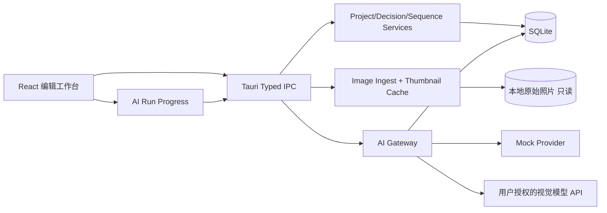

# BETWEEN FRAMES / 序间 — 产品与工程实施规格书

> 文档版本：v0.1.0 · 2026-10-12 · 用途：可直接交给编码 Agent 的产品、设计和工程基准
> 产品定位：面向严肃摄影创作者的本地优先 AI 编辑工作台；核心任务是「从 100–300 张照片，到一套有意图、有节奏的 15–30 张作品序列」。

## 0. 决策摘要

- **面向用户**：独立摄影师、摄影书作者、摄影教育者、纪实/艺术摄影创作者；先从 macOS 用户和胶片摄影师验证，不将产品永远局限于胶片。
- **产品核心**：交互式 Contact Sheet + 人的最终编辑决策 + AI 建议 + 有来源的审美记忆 + 可编辑作品序列。
- **明确不做**：自动修图、滤镜、生成新照片、主观「美学分数」、社交 feed、支付订阅、多人协作、自动训练用户个人模型、摄像头实时拍摄。
- **第一版形态**：macOS 桌面应用，离线基础功能，在线 AI 需明确授权；用户原图始终本地，不自动上传。
- **关键产品原则**：AI 不直接覆盖用户决策；建议是 suggestion，最终状态是 human decision。视觉模型要引用实际看到的照片和项目意图，无法判断要说不确定。
- **验收场景**：真实摄影师导入 200 张 JPEG，写项目意图，获得可回溯的 AI 备选清单；人工选择、两图比较和重新编排；形成一个 20 张的作品序列并导出。

## 1. 信息架构和交互主路径

```text
启动 → 项目列表 → 新建/打开项目
                     ↓
             导入照片（只读引用 + 缩略图缓存）
                     ↓
           Contact Sheet 选片台 ─── 照片详情/比较
                     │               │
                     ├── 项目意图 ←── 用户反馈
                     │
                     ├── AI 建议（可接受/忽略/解释）
                     │
                     ├── 人工保留 / 待定 / 淘汰
                     │
                     ↓
                Sequence Board
              拖动编排、保存版本
                     ↓
              导出 JSON/CSV/接触印相
```

### 页面 P0 项目列表

- 左侧项目卡片：名称、最近修改、照片数、入选数、AI 状态；主动作「新建项目」。
- 空状态引导新建项目并导入；无登录门槛。
- 项目菜单：重命名、复制项目、定位原文件、删除项目（需确认），删除不删除原图。

### 页面 P1 选片工作台（主页面）

- 三栏桌面布局：左侧导航 208px；中心弹性 640px 起；右侧编辑 Inspector 318–340px。
- 中部顶部：项目名、描述、导入、AI 编辑按钮；下方筛选 tabs：全部/保留/待定/淘汰，显示数量。
- Contact Sheet：默认 4–5 列，支持密度切换，显示画幅序号与状态。原比例照片使用 `object-fit: contain` 或缩略图裁切预览切换；**严肃摄影场景不能默认静默裁剪并影响构图判断**。
- 每张图仅保留状态标记和快捷动作；单击选择照片、右侧显示检查视图；双击打开大图；Shift/Cmd 多选加入集合（P1）。
- 底部「已保留序列带」，点击进入 Sequence Board。
- 所有保存动作自动持久化，反馈为低干扰 toast；支持 undo/redo（P1）。

### 页面 P2 作品序列（Sequence Board）

- 只显示被保留的照片；拖拽排序、键盘上/下移动、显示明确序号。
- 右侧 AI 提供序列建议：开场/过渡/核心/呼应/结尾，而不是仅“美学得分”。
- 生成建议**以可预览草稿展示**；用户点击接受才修改实际顺序。
- 支持随时保存 `SequenceVersion`，能够回退到历史版本；初版最多保存最近 20 次快照。

### 页面 P3 两图比较

- 完整大图并排（不是仅缩略图），支持 100% 放大、同步/独立缩放。
- 操作：偏好左张 / 偏好右张 / 不确定；必填理由不合理，保持理由可选。
- 比较是显式偏好数据，**不自动把未选的照片判为淘汰**。

### 页面 P4 审美记忆

- 展示最近决策及理由、用户稳定偏好假设、项目局部偏好。
- 个人倾向卡片必须带证据（例如 12 次比较中的 9 次）和置信程度（定性的“低/中/高”），提供撤销/修正。
- 不能直接写「你喜欢孤独、疏离」而没有可追踪用户证据。

### 页面 P5 导出

- 项目 JSON（含事件、状态、序列及本地路径引用）、选片 CSV、打印接触印相 HTML / PDF（P1）。
- 原始照片默认不复制、不改写；提示导出的 JSON 不含二进制图片。

## 2. 设计系统与视觉要求

**情绪定位**：摄影暗房、胶片接触印相、编辑台、画册排版。不是潮流科技霓虹风，也不仿 Adobe 全家桶。

| Token | 建议值 | 用途 |
|---|---|---|
| background | `#101113` | 主工作区 |
| surface | `#17191B` | 侧栏 |
| surfaceRaised | `#202225` | 卡片、对话框 |
| border | `#303235` | 分割线 |
| textPrimary | `#F0EFE9` | 主要文本 |
| textSecondary | `#92938F` | 次要文本 |
| accent | `#C7BA94` | 品牌重点、当前选择 |
| keep | `#9EB69B` | 人工保留 |
| reject | `#BF8578` | 淘汰提示 |
| serif | Georgia / Songti SC | 大标题与作品主题 |
| sans | system UI / PingFang SC | 操作、标签、正文 |

- 间距体系：4/8/12/16/24/32；按钮高度 36–40；卡片圆角 4–6；不要给图片加过重的 UI 覆盖。
- 重点保留图像面积：宽屏下中央区域优先，右侧检查器可折叠。
- 密度：常规 4 列；窄屏 3/2 列；1000 张图时要虚拟滚动。
- 动效节制：hover 120–180ms，排序有占位反馈，AI 运行有进度与取消。
- Accessibility：键盘可用、图像有 alt、按钮有 aria-label、模态可 Esc、对话框焦点陷阱、重要状态不依赖颜色单独表达。
- 中文优先、预留英文 i18n 结构，避免将 UI 字符串散落在组件中。

## 3. 关键 UX 交互规范

| 操作 | 用户感受 | 数据动作 | 容错 |
|---|---|---|---|
| 导入文件或文件夹 | 分批生成缩略图、明确进度 | 只存路径/元数据/cache，不动原图 | 可取消、失败逐张列明、可重试 |
| K 键 | 保留当前焦点照片 | `PhotoDecision.status=keep` + DecisionEvent | 再次按 K 返回待定，支持撤销 |
| X 键 | 淘汰当前照片 | `status=reject` + DecisionEvent | 可撤销 |
| 左右箭头 | 下一张/上一张 | 修改客户端 selection | 输入框焦点时禁用全局快捷键 |
| C 键 | 对比当前张与下一张 | 进入 compare modal | 禁止比较自身 |
| 两图偏好 | 保留对比判断 | `ComparisonEvent` | 不自动淘汰另一张 |
| AI 初选 | 生成**独立建议草案** | `AIRun`/`AISuggestion` | 取消/失败不修改人工选择 |
| 接受 AI 建议 | 只接受显式选择项 | 写 PhotoDecision human_accept_ai | 可批量撤销 |
| 拖动序列 | 即时插入占位、自动保存 | `SequenceItem.position` + Event | 断电重启不丢失 |
| 重写意图 | 提示会影响下一轮 AI 建议 | 更新项目 revision | 旧 AI run 标记过时 |
| 导出 | 可选 CSV/JSON/打印 | 从持久化快照导出 | 不成功必须明确报错 |

快捷键需在软件内有帮助入口，图片状态不使用「收藏」来替代「作品入选」，因为它们含义不同。

## 4. 技术栈决策

**前端 / 桌面**
- Tauri v2（桌面容器，先 macOS，之后 Windows）。
- React + TypeScript + Vite。
- Tailwind CSS + shadcn/ui 作为可访问的基础控件；编辑台视觉按设计 token 深度定制。
- Zustand 管理 UI 瞬态（焦点、筛选、面板）；TanStack Query 处理持久化查询和失效；dnd-kit 做序列拖放；TanStack Virtual 做大图库虚拟列表。
- Zod：校验 Agent 返回数据和应用 IPC。
- Vitest / React Testing Library / Playwright：单元、交互和端到端。

**桌面后端**
- Rust / Tauri Commands：仅暴露按业务定义的命令，不给前端任意 SQL 或任意文件读写权限。
- `sqlx` + SQLite (WAL 模式) + SQL migrations：项目、图片、状态、事件、序列、AI 运行记录。
- `image` / 平台图像库：生成 320px 网格缩略图、1400px 编辑预览图，处理 EXIF orientation。MVP 先 JPEG/PNG/WebP/TIFF；HEIC/RAW 经过可选平台解码器或后续再做，不能假设 image crate 自动支持。
- `sha256` 或轻量文件指纹用于文件去重；感知哈希 pHash 为 P1，不能将相似照片当作重复文件自动删除。
- `reqwest` HTTP AI Gateway；keyring 系统密钥链保存 API 凭据。所有模型调用发生在 Rust 侧。
- 文件默认在 `AppData/BetweenFrames/` 下仅放 SQLite 和缓存；用户图片保持原目录不动。外部路径授权用系统对话框，按 Tauri 最小权限 scope 配置。

**AI**
- Provider Adapter：`MockProvider` + `OpenAICompatibleProvider`；不将模型具体版本硬编码业务层。
- 带图片输入的多模态模型用于视觉描述、候选编辑及序列；输出采用严格 JSON Schema + Zod 二次校验。
- 模型负责“描述、推理、提出可辩驳的建议”，不负责数据库事务或替用户最终操作。
- 先**不引入** LangChain、向量数据库、微调或多智能体框架。复杂架构后置。

**为什么不是纯 Next.js Web App？** 初始场景是几百张高分辨率本地照片、重复编辑、私人作品，桌面本地优先在性能和隐私上更可控。Web 版可以用于营销页或未来云协作，但不是第一期核心形态。

## 5. 逻辑架构



后端按单机应用组织，无需 Kubernetes、Redis、PostgreSQL。只有真实 B2B 协作/跨设备同步场景验证后，才考虑云端账户与同步系统。

## 6. 数据模型（执行 `docs/schema.sql`）

核心对象：`Project`, `Photo`, `PhotoDecision`, `SequenceItem`, `DecisionEvent`, `ComparisonEvent`, `SequenceVersion`, `AIRun`, `AISuggestion`, `PhotoObservation`, `PreferenceHypothesis`。

关键区分：

1. `AISuggestion` 是某次 AI 的建议，**不能覆盖** `PhotoDecision`。建议更新与人工选择必须是两类数据。
2. `DecisionEvent` append-only：每次用户修改都有证据；当前状态作为可更新投影。
3. `ComparisonEvent` 是 pairwise 偏好，不代表另一张永远不好。
4. `PhotoObservation` 是对照片的可回溯描述，不是审美评分。观察需要 `model_name`,`prompt_version`,`photo_hash` 以判定是否过时。
5. `PreferenceHypothesis` 必须具有 `scope=user/project`,`evidence_event_ids`,`user_corrected`，初期不自动宣称模型已经“理解审美”。
6. 图片引用持久化路径，若用户搬动文件，UI 显示 missing 并提供重新链接，不能把图片消失解释成删除项目。

## 7. IPC 命令契约（伪 TypeScript）

```ts
type PhotoStatus = 'undecided' | 'keep' | 'reject';
type Actor = 'user' | 'ai';
interface PhotoSummary { id: string; projectId: string; index: number; thumbUrl: string; previewUrl?: string; status: PhotoStatus; isMissing: boolean; note?: string; }
interface EditProjectInput { projectId: string; title?: string; brief?: string; expectedRevision: number; }
interface ImportFilesInput { projectId: string; paths: string[]; } // 后端校验路径和权限
interface UpdateDecisionInput { projectId: string; photoId: string; status: PhotoStatus; note?: string; expectedRevision?: number; }
interface StartAIRunInput { projectId: string; targetCount: number; providerId: string; includePhotoIds?: string[]; }
interface MoveSequenceInput { projectId: string; photoId: string; beforePhotoId?: string | null; expectedRevision: number; }
```

最低限度实现：

- `list_projects`, `create_project`, `get_project`, `update_project`, `delete_project`
- `import_photos`, `list_photos`, `relink_photo`, `get_photo_preview`
- `update_photo_decision`, `update_photo_note`, `create_comparison_event`
- `get_sequence`, `move_sequence_item`, `save_sequence_version`, `restore_sequence_version`
- `start_ai_run`, `cancel_ai_run`, `get_ai_run`, `list_ai_suggestions`, `accept_ai_suggestions`
- `list_decision_events`, `list_preference_hypotheses`
- `export_project_json`, `export_project_csv`, `export_contact_sheet_html`

Tauri 事件：
- `import_progress`: `{jobId, completed, total, skipped, failed}`
- `ai_run_progress`: `{runId, step: 'observing'|'shortlisting'|'sequencing'|'done'|'error', completed, total, message}`
- `background_job_error`: `{jobId, code, retriable, message}`

每项操作必须约定失败语义和可恢复性；不能把异常吞掉后仅 toast “成功”。

## 8. AI 系统 v1：不是一个提示词

### 8.1 工作流

1. **意图输入**：用户先写 50–500 字创作意图，允许不写；如未写则 AI 只做中性观察和主题候选，不推断艺术动机。
2. **导入预处理**：EXIF、图像尺寸、缩略图、文件指纹；局部重复聚类（P1）。
3. **观察阶段**：按 8–12 张一批将有限分辨率预览传入模型；每张强制绑定 `photo_id`；返回客观观察标签和低确定性假设。按授权设置发云端。
4. **候选阶段**：输入意图、图片观察、已有用户选择和目标张数，提出推荐候选、每张在序列中的潜在作用。第一轮可以只用图片观察；对最后候选再附预览做视觉复核。
5. **序列阶段**：对选中图片提出 1–2 套编排，每套说明开场、转折、呼应、结束。不能生成原本不存在的照片 ID。
6. **审美记忆阶段**：日志事件 + 理由，以项目内偏好作为优先依据；有重复证据才形成跨项目假设。

### 8.2 云端隐私及成本

- 首次联网分析须确认「哪些照片会被上传到哪个模型服务」及隐私规则；默认关闭云 AI、基础选片工具可完全离线。
- 优先上传缩小后的预览图，不上传原始 TIFF/底片扫描全尺寸文件。允许用户关闭含人物的图片分析或逐批选择。
- AI 请求中不泄露本地完整文件路径、客户信息或 EXIF GPS；给模型使用不含地理敏感数据的稳定图片 ID。
- 每批任务可取消，支持重试、退避、并发限流、额度/预估成本提示；运行记录保存 prompt 版本、输入哈希、模型及 token usage。
- API Key 存在系统安全存储，不能写进 React localStorage、SQLite 明文或日志。
- AI 服务暂不设计为持续索取摄影师图库的云端数据资产；处理完成后本地保存结果。

### 8.3 输出可信性

- 两阶段 Structured Outputs。输出严格符合 `docs/AI-OUTPUT.schema.json`，用户看得到支持某个建议的照片、项目意图和偏好事件。
- 后端检验引用 photoId 存在、建议数与目标匹配、模型不得使用不存在的作品、不能覆盖明确人工“淘汰”。
- AI 出错 / JSON 格式损坏时回滚草案，不修改当前作品状态；失败可重试。
- 置信度不能等同「艺术质量指数」；尽量使用“有依据/证据不足”的语言。
- AI 不能伪称认识用户、了解其全部作品或引用没提供过的摄影师理论。

### 8.4 审美记忆优先路线

- v0：记录 `{user_action, project_context, photo_id, comparison_peer, reason, previous_value, timestamp}`。
- v1：从不同项目的重复成对比较归纳条件化偏好，必须附证据，允许用户纠正。
- v2：在样本足够大且经评估有收益时，训练轻量 reranker / pairwise preference model；**不在 MVP 微调通用视觉模型**。

## 9. 性能、安全与工程边界

- 单项目目标测试量 300 张 20MB JPEG，导入过程中显示进度；避免将原图以 base64 注入 UI 或 SQLite。
- 前端只显示列表中可见缩略图，虚拟滚动；大图在 Inspector 打开时按需加载。
- SQLite transaction 保证状态变更和日志写入一致；排序使用位置事务/乐观版本锁处理竞态。
- 缩略图缓存按磁盘大小清理但不删除项目数据库。原图缺失时仍可显示缩略图并给出“重新定位”。
- 配置 CSP，限制任意外部 URL；Tauri capability 只授权必要对话框、文件路径和 IPC，不允许任意 JS 原生命令。
- 严禁 UI 线程同步扫描整个照片目录；Rust 任务异步，所有长任务可取消。
- 不得在日志中存储图片内容、云端 key、客户个人隐私；错误追踪默认本地。

## 10. 测试与验收

**功能**
- 导入 200 张作品并关闭/重启应用后，状态、备注、序列均一致。
- 原始文件绝不被修改；保存项目和导出结果的 checksum 可核对。
- 已人工淘汰的作品即使 AI 建议保留，也不得被自动修改。
- AI 建议由用户单独接受、部分接受或全部忽略；多次运行不会产生重复记录或污染状态。
- K / X / 箭头 / 比较快捷键有效，在输入框中不误触发。
- 无网/模型限额/取消运行均不破坏已完成项目数据。
- 拖拽排序、保存版本、重新打开项目，顺序必须一致。
- JSON 导出照片文件引用、序列、决策日志；缺失图片可重新链接。

**性能目标（产品假设，需真机基准测量）**
- 常见 M 系列 Mac：200 JPEG 生成缓存 2 分钟内（不包括慢速外置磁盘，不作为跨硬件承诺）。
- Contact Sheet 滚动不卡顿，300 张图时列表内存可控；空闲后 CPU 近零。
- 单一普通状态变更本地响应 < 150ms（95 分位，基于目标测试机）。
- AI 响应存在网络和模型差异，不强制绝对秒数；进度、取消和失败恢复必须可靠。

**用户可用性**
- 新用户不用注册，5 分钟内完成从新建项目到第一次人工选片。
- 3 位真实摄影师能在无指导条件下完成导入、AI 初选、修改、排序、导出。
- 人工编辑过程中的 AI 建议可被忽略，不妨碍传统工作流。

## 11. 六周 Agent 研发路线（单人 Agent + 人工验收）

| 周 | 目标 | 主要任务 | 验收产物 |
|---|---|---|---|
| W1 | 工程地基 | Tauri/React/Rust/SQLite；路由布局；设计 tokens；项目 CRUD；测试框架 | 能启动 macOS 桌面壳，创建并打开项目 |
| W2 | 完整本地选片 | 图片导入、只读路径、缩略图、虚拟网格、照片状态、备注、键盘 | 200 张可导入并在重启后保留状态 |
| W3 | 序列和事件 | 比较、pairwise preference、拖拽排序、Undo、决策事件、导出 JSON/CSV | 无 AI 时完成整条选片工作流 |
| W4 | AI 可替换基础 | MockProvider、AI run/进度/取消、严格 schema、建议独立展示 | 关闭网络亦能通过模拟 AI E2E |
| W5 | 真模型与记忆 | 可配置 AI Provider，图像观察批处理、候选、序列；安全上传许可；偏好事件检索 | 用真实项目生成有引用来源的编辑草案 |
| W6 | 优化试点 | 性能/错误处理、诊断日志、3 位摄影师任务测试、安装包、macOS 签名准备 | 可分发测试版与完整回归测试 |

每周必须通过对应验收后再进入下一阶段。不允许 AI Agent 因为缺少 API Key 就跳过本地核心功能。

## 12. 北极星指标与产品评估

- **核心结果**：有多少真实项目完成了从导入到形成版本化作品序列的闭环（不是打开 App 次数）。
- **编辑价值**：摄影师对最终序列的主观满意度；是否因 AI 建议改变了有价值的取舍；是否愿意在下一项目继续使用。
- **模型诊断**：已接受建议占比、建议改写率、偏好记忆被用户纠正率；不能单独用采纳率衡量艺术质量。
- **商业验证**：20 位核心创作者参与试用，10 位完成一个真实项目，其中至少 3 位愿意为下一项目预付费用（实验门槛、非预测）。

## 13. 质量与来源

- 本仓库 Demo 中，初选逻辑是**确定性规则模拟**；不代表已经实现多模态分析或个人审美建模。
- Demo 的示例图片是 `scikit-image` 随包教学样本加工所得，**只用于功能演示**，正式商业产品必须替换并复核素材版权。
- 技术文档：Tauri v2 Dialog/Capabilities/SQL 官方文档；OpenAI Responses API Structured Outputs。以上为方案依据，具体依赖版本由 Agent 在实施时锁定与验证。
