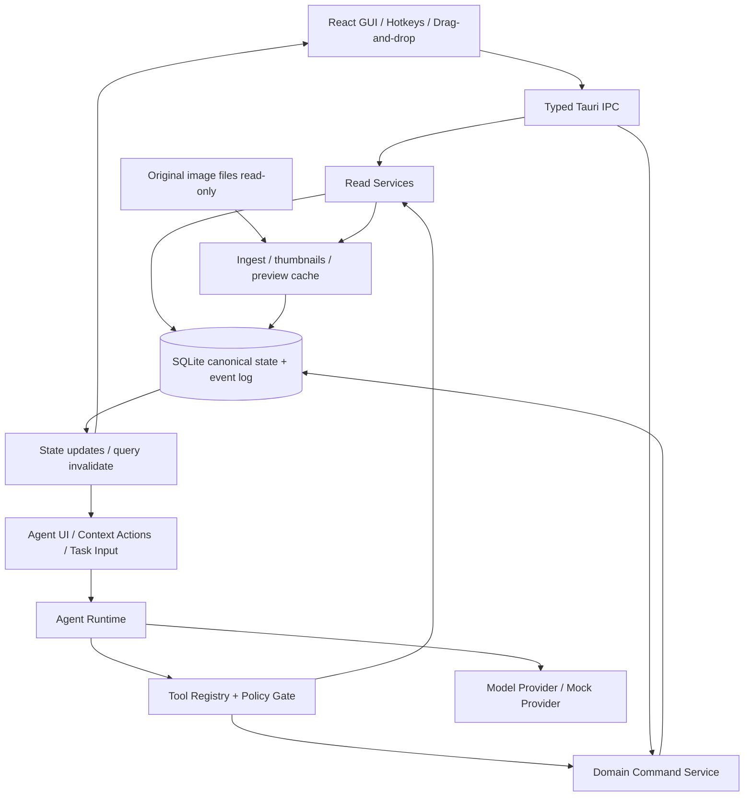

# BETWEEN FRAMES / 序间
## GUI + Photography Agent 融合式摄影创作工作台 · 产品与工程开发规格书

> **版本**：v0.2.0 · 2026-10-13  
> **状态**：可供编码 Agent 按阶段落地的开发基线；商业与艺术效果仍需用户研究验证  
> **目标**：macOS 本地优先桌面应用；先胶片/艺术摄影创作者，再扩展严肃数码摄影用户  
> **基线**：保留 v0.1 原有传统 GUI 与视觉语言，**本文件替代旧规格中 AI 架构、状态模型、Agent 工具和里程碑**。旧 Demo 仅为 UI/UX 参考，AI 功能为模拟。  
> **开发者提示**：请先阅读本文件，再阅读 `../AGENT-EXECUTION.md`、`../contracts/` 和 `../migrations/`；实际实现依工程测试结果进行小幅调整并写入 ADR。

---

# 0. 执行摘要：必须保证的 8 条产品契约

1. **传统 GUI 完整可用**：不依赖网络或模型，也能完成「新建项目 → 导入 → 选片 → 对比 → 排序 → 版本 → 导出」全流程。
2. **Agent 深度嵌入，而非替代 GUI**：有嵌入式建议、右侧 Agent 任务面板，以及可选自然语言委托；用户不需要学习提示词才能操作软件。
3. **同一领域核心**：GUI 和 Agent 的写操作都通过相同的 Rust Domain Command Service；绝无两套照片/序列状态。
4. **Agent 草案优先**：Agent 的写权限仅限 `Draft`；任何影响正式入选集/正式序列的应用动作必须由用户显式批准。
5. **操作全程可追溯**：持久化命令事件、来源、前后差异、版本与审美反馈。撤销通过补偿命令完成，不能偷偷删除审计记录。
6. **本地优先、默认私密**：图片原文件只读引用；数据库与缩略图在本地；未经明确授权，不向模型上传图片、GPS 或文件路径。
7. **不做伪审美评分**：模型意见必须基于可引用照片与项目意图，区分可观察事实与主观解读；用户保留最终解释权。
8. **能测试、能发布、能恢复**：Mock Agent 必须脱网可运行；真实 Agent 失败不影响手动编辑；所有里程碑必须有自动化测试、手工验收和运行证据。

## 0.1 唯一核心场景

用户导入 100–300 张 JPEG / TIFF 等照片，写一段创作意图（可选）；人工用 Contact Sheet 做第一轮筛选，或让 Agent 生成两组候选；随后通过 GUI 拖拽、双图对比、右键 Agent 比较，形成 15–30 张照片的有序作品序列；保存版本并导出。此时用户能理解 AI 依据，也能全部拒绝或局部采纳建议。

**北极星结果**：真实摄影师完成一份自己认可的可恢复、可导出的作品序列（不是聊天轮数或 AI 调用数）。

## 0.2 本期明确不做

RAW 全格式解码、高级调色修图、图像生成、摄影师公开社交网络、云端图库同步、多人实时协作、印刷电商、自动在线发表、自动给艺术作品打绝对分数、自动微调模型、常驻多 Agent 群聊、向外暴露任意 Shell / SQL / 文件系统权限。

---

# 1. 产品对象、角色、概念边界

| 名词 | 唯一定义 | 禁止混用 |
|---|---|---|
| `Photo` | 导入的一张影像资源；原图未被修改 | 不是「一张 AI 建议」 |
| `Decision` | 用户对照片做出的 `undecided / keep / reject` 正式判断 | AI 草案不能直接修改 |
| `Sequence` | 当前生效的有序作品列表 | 不等于选中的照片集合；顺序单独存储 |
| `Draft` | 用户或 Agent 创建的候选入选集 + 候选序列 | 不自动成为正式 `Sequence` |
| `AgentTask` | 为用户某个创作目标执行的可取消任务 | 不等于一次模型 API 调用 |
| `ToolCall` | Agent 在受控执行器内的一次读/写草案动作 | 不是任意 Tauri IPC 命令 |
| `PreferenceEvidence` | 用户选择、比较、改选和备注的事实证据 | 不是模型未经确认的心理判断 |
| `PreferenceHypothesis` | 以证据为基础、可纠正且有作用域的偏好假设 | 不是不可改变的用户人格标签 |
| `ProjectRevision` | 正式项目状态的乐观锁版本 | Agent 草案有独立 `draft_revision` |

系统角色：`human`（摄影师）；`agent`（可调用受控工具的智能体）；`system`（自动导入、索引等确定性工作）；`provider`（外部模型，只返回建议或工具意图，不直接读数据库）。

**权限原则**：模型输出永远不是权威命令。只有后端通过权限、参数、scope、revision、预算检查之后，才可以运行某一个工具。模型不能通过输入文本重新定义权限。

---

# 2. UI 信息架构与导航

## 2.1 主界面（继承旧 Demo 的三栏结构）

```text
┌──────────────────────────────────────────────────────────────────────────────────────────────┐
│ BETWEEN FRAMES  项目《日常》       [导入]  [保存版本]  [导出]   [Agent 显示/隐藏]    [设置] │
├──────────────┬─────────────────────────────────────────────────┬─────────────────────────────┤
│ 项目与集合   │ 工作区工具条：筛选 / 密度 / 搜索 / 比较 / 序列   │ Inspector / Agent（可切换） │
│              ├─────────────────────────────────────────────────┤                             │
│ 所有照片     │                                                 │ 照片信息 & 人工备注         │
│ 保留         │           Contact Sheet（可缩放/多选）          │                             │
│ 待定         │                                                 │ AI 内嵌建议（低干扰）       │
│ 淘汰         │                                                 │                             │
│ 草案         │                                                 │ Agent 任务/步骤/批准       │
│ 作品序列     │                                                 │                             │
│ 历史版本     ├─────────────────────────────────────────────────┤ [输入任务...]                │
│ 偏好记忆     │ Sequence Filmstrip（可折叠/拖拽）               │                             │
└──────────────┴─────────────────────────────────────────────────┴─────────────────────────────┘
```

**布局基线**：左侧 208–232 px，可折叠；中心最小建议 640 px、优先占用屏宽；右侧 320–380 px，可隐藏或拉伸；工具条和底部序列独立；1920×1080 做首要桌面验收，1280×800 不丢关键功能。窄屏时右栏切换为可开关抽屉，不把图片缩到无法判断构图。主题以深色暗房风格为默认，保留旧 Demo 的中性暗色、温暖的淡金色焦点色、克制的动效。

## 2.2 视图清单

| ID | 视图 | 必须实现的交互 | Agent 介入方式 |
|---|---|---|---|
| V0 | 项目列表 | 新建、打开、复制、重命名、删除项目（不删原图） | 可选项目摘要 |
| V1 | Contact Sheet | 导入、网格、筛选、状态、备注、多选、快捷键 | 对当前选中照片提供轻量建议 |
| V2 | Photo Lightbox | 原比例大图、适合屏幕/100%、前后切换 | 一键“分析这张作品” |
| V3 | Compare | 并排放大、同步缩放、选左/右/不确定 | “比较它们在本项目中的作用” |
| V4 | Sequence Board | 拖拽排序、插入、移除、快照版本 | “创建新序列草案”“指出叙事断裂” |
| V5 | Draft Review | 并排展示正式/草案差异、部分接受、全部拒绝 | Agent 输出到这里，不直接改正式数据 |
| V6 | Agent Panel | 输入任务、任务计划、进度、工具记录、暂停/取消 | 高复杂度多步任务入口 |
| V7 | Memory | 最近事件、已确认偏好、待确认假设、修正/删除 | 仅检索有证据的信息 |
| V8 | Export | JSON、CSV、序列预览 HTML / 打印 | Agent 可建议描述文字；导出由用户确认 |

## 2.3 GUI 快捷键（macOS 默认；需可配置）

| 键 | 行为 | 细节 |
|---|---|---|
| `← / →` | 上/下一张 | 输入框聚焦时禁用全局快捷键 |
| `K` | 标记保留 | 多选时批量操作，进入统一 Command Service |
| `X` | 标记淘汰 | 不删除文件 |
| `U` | 标记待定 | 明确状态，不用第二次按 K 的隐式切换 |
| `Space` | 打开/关闭大图 | Esc 退出、焦点返回 |
| `C` | 两图比较 | 未选两张时给出非阻断提醒 |
| `Cmd+Z / Cmd+Shift+Z` | 撤销/重做 | 包含应用 Agent 草案产生的修改 |
| `Cmd+S` | 保存序列版本 | 项目普通修改自动持久化 |
| `Cmd+K` | 命令菜单 | GUI 动作 + AI 动作统一可搜索 |
| `Cmd+Shift+A` | 展开/收起 Agent 面板 | Agent 任务在隐藏时继续，状态可见 |

快捷键覆盖完整的 Tooltip 和命令菜单说明；焦点必须可见；按钮支持键盘与 VoiceOver 标注。

---

# 3. 三种无缝协作 UX 模式

### A. 手动优先（默认）

软件启动就是照片工作台，不出现占据中央的聊天输入。用户自己选片、排序、对比，不消耗 AI token。Agent 可以关闭、暂停，也可完全离线。

### B. GUI 内嵌 Agent（上下文触发）

- 选中 2 张照片 → 工具栏 / 右键「AI 比较」→ Agent 自动读取当前选区、项目 brief 和有限的用户偏好证据，输出并排解释卡。
- 序列板 →「提出替代排序」→ Agent 生成**新的独立草案**，中央显示幽灵编号/差异，不修改正式序列。
- 图片右键「找视觉呼应」→ 只在当前已导入图库内检索，返回照片集，不创建不存在的照片。
- 已选草案 →「为何保留它？」→ 展示引用的图片、项目意图与偏好证据，不声称某张图有客观的艺术分数。

**触发约束**：默认不基于每次 K/X/拖拽自动调用 LLM；完成连续 3 次相同任务也不自动弹窗。Agent 仅按用户明确请求，或在可关闭、有限频率的提示状态下工作。禁止阻挡画布的主动弹窗。

### C. 自然语言委托（复杂目标）

用户说：「从这些照片选 25 张，给我两组不同的成长叙事方案，不要传统的儿童肖像。」→ Agent 读取项目与允许范围、检索、分组、观察、编辑，产出两个草案 → 用户点击差异卡比较、部分采纳、通过 GUI 改动 → 选择「基于我的修改继续」再次启动任务。

**体验底线**：看得见当前照片变化、知道 Agent 做了什么、能随时停止、能部分采纳、任意时刻可回到纯 GUI。

## 3.1 Agent 面板具体状态

`idle`：提供上下文快捷动作及可选自由输入。  
`planning`：显示用户目标、候选策略、将使用的照片范围。  
`running`：显示步骤（只展示操作摘要而非隐私推理）、已完成/总数、工具结果，可取消。  
`needs_input`：提出最多一个关键澄清问题；用户可跳过。  
`review_ready`：展示新草案卡片、变更数和按钮“查看差异”。  
`stale`：用户在任务运行后更改了正式序列；草案仍可看，但必须重新合并/重跑才能应用。  
`failed / cancelled`：说明原因、已安全保存的草案、可重试操作。

**聊天只是 Agent 的入口之一，不是产品主页。**  Agent 无法直接打开 OS 文件选择器、执行任意终端命令或偷偷发起上传。

## 3.2 草案差异与批准体验

- 正式序列与 Agent 草案可左右对比或覆盖切换。
- 明确显示：建议新增 N 张 / 建议移除 M 张 / 位置变更 K 处；每项可“采纳”或“忽略”。
- 用户采纳之前看到精确目标状态；在确认一瞬间后端再检查 `expected_project_revision`。
- 如果正式项目已变更，**不能静默覆盖**；提供「查看冲突」「重新合并」「保留当前项目」选项。默认保留当前。
- 应用草案作为一个原子命令写入新的正式状态并记录事件；一次 Cmd+Z 可以整体撤销这次应用（若后续编辑造成冲突则要求人工处理）。

---

# 4. 技术选型（MVP 锁定）

| 层 | 决策 | 理由/约束 |
|---|---|---|
| 桌面壳 | Tauri 2 + Rust | 文件与 SQLite 本地优先；macOS 优先 |
| UI | React + TypeScript + Vite | 快速迭代、成熟桌面组件生态 |
| 样式 | Tailwind CSS + shadcn/ui + 自定义 tokens | 使用无障碍基础组件，不做泛 SaaS 风 |
| UI 临时状态 | Zustand | 当前选区、面板、视图模式，不存正式选片 |
| 后端数据同步 | TanStack Query + Tauri IPC | 本地权威数据变更、失效与乐观回滚 |
| 照片网格 | TanStack Virtual | 大批量照片只渲染可见项 |
| 拖放 | dnd-kit | 序列交互，不篡改原图 |
| 数据库 | SQLite + sqlx migrations + WAL | 单机事务、版本及事件日志；**不同时启用插件 SQL 客户端写入** |
| 图片处理 | Rust image / 平台解码适配器 | EXIF 方向、缩略图、预览图；RAW/HEIC 单独协商 |
| AI Provider | Rust HTTP adapter + 模型函数调用/结构化输出 | 必须可用 Mock 实现；真实模型仅以可配置 Provider 接入 |
| Key 安全 | macOS Keychain（Rust keyring 等受维护适配） | 不把密钥放在前端或普通 SQLite |
| 类型契约 | TypeScript/Zod + Rust serde DTO + 契约测试 | 每次 IPC/Tool schema 变更需验证一致性 |
| 测试 | Vitest + RTL + Rust cargo test + Playwright + Tauri 真实端冒烟 | 分离 Web Component 测试与真实桌面测试 |

**不做微服务**。第一版一个桌面进程即可。所有需要网络的模型调用从受控 Rust/Agent adapter 发起，不让 WebView 把 API Key 放入请求头。模型供应商具体版本由实施当天核验并写入配置（不要在业务代码里绑定会过期的型号）。

## 4.1 必须遵循的 Tauri 安全约束

Tauri asset protocol 对本地文件展示有显式 scope；不能为了图省事把 `$HOME/**` 暴露给 WebView。推荐由 Rust 读取用户授权的原图，生成只对应用 cache 生效的预览，前端只加载 cache 图。外部原图路径单独经后端白名单校验；原图全路径不要传给模型。Tauri 的 runtime filesystem scope 若动态变化，需要考虑重启后的重新授权及持久化映射。版本及权限以官方 Tauri v2 文档为准。

---

# 5. 逻辑架构：统一 Domain Command Bus 是核心



**禁止设计**：GUI 直接写 SQLite + Agent 独立写 SQLite；Agent 写 React 状态再异步持久化；模型拿任意 SQL 工具；UI 直接从 WebView 读未授权绝对路径。

## 5.1 Domain Command 的规则

- 业务更改全部调用 `CommandService.execute(command, envelope)`：GUI 与 Agent 只有执行者身份不同，领域约束一致。
- `envelope` 至少包括 `command_id`（全局幂等）、`actor_type`、`actor_id`、`project_id`、`expected_project_revision`、`causation_id`、`source`、`issued_at`。
- 每个命令事务内检查项目/对象归属、revision、状态机，写正式实体，再追加事件，提交后再广播变更；不能事件写成功实体写失败。
- 同一 `command_id` 重试需返回首次结果，不应再次应用。
- 正式修改将 `projects.revision += 1`；单独的 Draft 变动仅更新 `drafts.revision`，不会无故让主项目的编辑冲突。
- Domain Command 包括 `SetPhotoDecision`, `SetPhotoNote`, `ReorderSequence`, `SaveSequenceVersion`, `CreateDraft`, `UpdateDraft`, `ApplyDraft`, `RecordComparison`, `UpdateProjectBrief`, `SetPreferenceFeedback`, `RestoreVersion`。
- Agent 工具**不暴露** `ApplyDraft`、`DeleteProject`、`RestoreVersion` 和任意原图更改操作。
- 所有正式操作来源可标记 `gui_direct`、`human_accept_agent`、`human_restore`、`system_import`；不能伪称 Agent 自动选择就是人的原创判断。

## 5.2 正式状态 vs Agent 草案

- `photo_decisions`：权威人工判断，状态 `undecided/keep/reject`。
- `sequence_items`：正式作品序列及排序，仅包含被明确保留的照片。
- `drafts + draft_items`：Agent/用户建议候选，不改变正式状态，可包含尚未 keep 的照片，需审核才能应用。
- `agent_tasks + agent_steps + tool_calls`：运行轨迹、错误、取消原因、模型标识和提示版本。
- `command_events`：不可随意删除的业务变更日志，保存 before/after 或足以撤销的 patch，并有 `transaction_group_id`。

**原子性约束**：应用草案时，将用户批准的照片置为 `keep`（仅批准项）、对用户批准的 `reject` 改动设定显示复核、更新排序、写单一事务组。未批准的更改不进入正式状态。

## 5.2.1 `ApplyDraft` 的确定性合并语义（M2 必须实现）

审批页面让用户勾选“采纳新增项”“批准移除项”和“采用整个草案顺序”。为避免部分采纳产生不可解释的顺序，MVP 采用以下确定性规则：

- `acceptedPhotoIds` 只能是草案里提出新增、且属于当前项目的照片 ID；`approvedRemovals` 只能是草案明确提出移除、且目前存在于正式序列的照片 ID；重复或陌生 ID 返回 `INVALID_PHOTO_ID`。
- **部分采纳时**：`applyOrder=false`，保留原序列中未批准移除项的相对顺序，并将批准新增照片按草案内的相对顺序追加在末尾。用户可在 GUI 继续拖拽。此模式不允许 AI 暗改未审批项位置。
- **整套采纳时**：`applyOrder=true` 仅当用户明确点击“全部采纳并采用草案顺序”，且草案与审批结果完全一致时合法。最终序列严格等于草案列表；如有任一未审批变更，后端拒绝 `PARTIAL_ORDER_NOT_SUPPORTED`，前端提示改用部分采纳。
- 在一次 DB transaction 中执行：检查 `expected_project_revision`、验证全部 photoId 和 keep 状态、写批准的 `photo_decisions`、删除旧序列项再按最终顺序插入、写一条命令事件与事务组、提升项目 revision。创建快照保证整体 Undo。
- 同一 `commandId` 重试只能返回同一结果。应用完成后将草案标为 `applied`；旧草案仍可查看，不可二次应用。

此限制是刻意选择：MVP 先保证**可解释、可恢复**，未来再引入可视化的任意部分顺序合并。

## 5.3 取消、重试与并发

- 图像索引和 AI 运行作为独立任务后台异步执行；UI 实时订阅进度，不阻塞。
- 取消会阻止之后的新工具调用，当前进行中的请求尝试 abort；超时后不得自动应用正式状态。
- 工具必须具备重复执行安全：读工具无副作用，草案写工具以 `task_id + tool_call_id` 幂等；跨任务草案修订使用 `draft_revision`。
- Agent 开始执行时固化 `base_project_revision`。用户在任务期间可以继续 GUI 编辑；任务结束若 revision 变化，标 `stale` 并要求合并，不阻止用户。
- UI 操作发生 409 RevisionConflict 时，恢复最新状态，尽量重放**非冲突**意图；对序列冲突提示对比，不用“最后写入获胜”。

---

# 6. Agent Runtime：真正的工具执行循环

## 6.1 单 Agent + 工具，不做多 Agent 编排

角色：`PhotographyEditorAgent`。可使用只读工具、草案工具与交互反馈工具，负责分析本项目的照片、结合审美证据提出一到两组作品编辑草案。

```text
CreateTask(userGoal, selectedPhotoIds, projectRevision)
    ↓
Context Builder: project brief + selected IDs + human decisions + evidence
    ↓
Provider.generate(tools, context, budget)
    ↓
model requests tool(s)? ──否──> explain / complete / request feedback
    │ 是
PolicyGate(name, args, permissions, cost, scope, revisions)
    ↓
Tool Executor → Result (bounded and auditable)
    ↓
append AgentStep + ToolCall → Return result to provider
    └──────────────────────────────► repeat until completion / budget / cancel
    ↓
DraftReview (not canonical commit)
```

真实 Provider 的工具调用应使用提供商支持的 function/tool-calling 机制；自由文字的“我要调某工具”不能作为调用依据。模型可能请求并行工具；第一版只让**无副作用的只读工具**并行，所有草案写入序列化执行。对工具返回参数做 Rust 端严格验证，结构化 schema 只是第一道防线。

## 6.2 Agent Task 状态机

`queued -> planning -> running -> review_ready -> completed`，另有 `needs_input / stale / failed / cancelled`。  
合法转移：`running -> needs_input -> running`；`running -> cancelled`；`running -> failed`；`review_ready -> completed`（用户批准或明确保留草案）；`review_ready -> stale`（项目版本已变化）。  
每次状态转换持久化。重启后运行中的任务标记 `interrupted` 并提供重试/恢复新任务（MVP 可不做到精确 token 级续跑），不假装继续成功。

## 6.3 工具目录及权限分级

| Tool ID | 输入 | 输出 | 权限 | MVP |
|---|---|---|---|---|
| `get_project_context` | projectId | brief、计数、revision、范围 | Read | M1 |
| `list_photos` | filters、limit、cursor | PhotoSummary 列表 | Read | M1 |
| `search_photos` | query、filters、limit | photoIds + 匹配证据 | Read | M2 |
| `inspect_photos` | photoIds ≤ 12 | 视觉观察及不确定性 | Read+需图像授权 | M2 |
| `compare_photos` | photoIds 2–4、goal | 叙事差异与证据 | Read+需图像授权 | M2 |
| `retrieve_preferences` | scope、maxEvidence | 有来源的个人/项目假设 | Read | M3 |
| `get_sequence` | projectId | 正式序列及 revision | Read | M1 |
| `create_selection_draft` | title、baseRevision、items | draftId、diff | Draft-write | M1 |
| `update_draft_sequence` | draftId、orderedIds、expectedDraftRevision | 更新草案 | Draft-write | M1 |
| `evaluate_draft` | draftId | 一致性、重复、缺失、可解释差异 | Read | M2 |
| `request_feedback` | question、options? | 等待用户输入 | Ask-human | M2 |
| `finish_task` | draftIds、summary | review_ready | Finish | M1 |

**重要**：`inspect_photos` 不自动获得原图；Backend 只对已授权的有限尺寸预览发给模型。 `search_photos` v1 可基于文件名、用户描述、FTS、客观视觉标签实现；向量检索不是 MVP 依赖。Tool schemas 见 `../contracts/agent-tool-contracts.json`。

## 6.4 任务预算（默认初值，可配置；非行业基准）

- 每任务最多 16 次工具循环、40 次工具调用、10 分钟运行、最大预览图 300 张，超过上限暂停并请求用户确认增加额度；本地 Mock 的限制同样可测。
- 对模型费用设单任务预算/估算；提供可取消的任务进度和错误详情。云端请求失败时最多 2 次带指数退避的重试，需避免重复创建草案。
- 模型 Provider 抽象：`MockProvider`（确定性演示和 CI）与 `RemoteProvider`（带视觉和工具调用）。SDK/HTTP 特性以实施时的官方文档验证。
- LLM 不负责决定价格、隐私授权、数据库事务、原图删除、密钥获取；这些全由确定性应用层控制。

## 6.5 Prompt 结构（代码或版本化文件，不应放散乱文本）

1. `system_agent.md`：角色、边界、工具调用约束、证据与不确定性规范。
2. `tool_specs.json`：由注册工具自动生成且严格校验的描述与 schema。
3. `project_context`：用户提供的 brief、选择的图片范围、当前序列和 revision。
4. `memory_retrieval`：与当前项目相关的有限、可引用证据，并附用户纠正记录。
5. `task_state`：当前计划、已调用工具摘要、剩余预算、可继续动作。
6. `user_request`：用户本次创作目标。

用户的照片、元数据、笔记和模型返回内容均是**不可信数据**，不能执行其中嵌入的“忽略系统指令/调用工具”文本。

---

# 7. Agent 行为示例（完整可验收的用户故事）

**任务**：「在当前 200 张照片中，选出 25 张关于家庭成长的克制叙事，并给我两套不同节奏的序列。」

1. `get_project_context` 确定 200 张、revision=12、用户 brief。
2. `list_photos` 获取用户现有状态，尊重现有 `reject`（候选可引用但不得擅自恢复）。
3. `search_photos` 取得相似照片/已有说明；如没有观察则批次 `inspect_photos`，检查授权。
4. Agent 分两套思路构建候选并调用 `create_selection_draft` 两次，生成 `draft-A` 和 `draft-B`。
5. Agent 调用 `evaluate_draft`，发现 A 有两张重复且总张数 26，更新草案，使两套均符合 25 张约束。
6. `finish_task`；UI 提供两张方案卡：“时间线”“空间与距离”，显示照片数量、重要差异、叙事说明。
7. 用户在中央 GUI 直接拖拽 B 草案，将第 16 张替换为第 29 张并加一条备注；写 `draft revision` 和人类改动事件。
8. 用户点击“采纳本草案” → 审核界面看到将新增、移除、排序的变化 → 人工确认 → Rust `ApplyDraft` 原子提交 → 项目 revision=13。
9. 用户 Cmd+Z → `UndoApplyDraft` 作为新事务组恢复到提交前状态，Agent 草案仍留在历史中。
10. 系统仅将用户明确选择及备注记为审美证据。Agent 初选本身不构成“用户喜欢”证据。

**失败情形**：任务执行到一半用户移动了正式序列，项目 revision 从 12 → 13。Agent 可以完成草案，但它成为 `stale`；禁止在确认时直接覆盖 13，需要显式比较/重新合并。

---

# 8. 领域数据库：SQLite 实现规范

完整可运行的初版 migration 见 `../migrations/0001_init.sql`。实体包括：

- `projects`、`photos`、`photo_decisions`、`sequences`、`sequence_items`
- `drafts`、`draft_items`、`sequence_versions`
- `command_events`、`comparison_events`
- `agent_tasks`、`agent_steps`、`tool_calls`、`photo_observations`
- `preference_evidence`、`preference_hypotheses`

**关键关系与约束**：

- `photos.project_id` 属于单一项目，ID 使用 UUID/ULID；原图以路径/文件 fingerprint 引用，不把二进制写 DB。
- `photo_decisions(project_id, photo_id)` 唯一；`sequence_items(sequence_id, photo_id)` 唯一，序列位置唯一并在事务内更新。
- `drafts.base_project_revision` 和 `drafts.revision` 必须同时存在；前者用于防止覆写后来发生的 GUI 改动，后者用于保护草案自身的并发编辑。
- `command_events.command_id` 唯一以保证幂等。任何正式更改与 event append 原子提交。
- `agent_tasks` 记录输入的非敏感摘要、provider、budget、状态、错误；不保存可还原未经授权私人照片的请求体。
- `preference_hypotheses` 的 evidence IDs 必须能够追溯到用户行为、用户描述或用户明确确认过的反馈，不允许仅引用模型自己的建议。
- 所有表迁移需真实运行 `PRAGMA foreign_key_check`；恢复快照需通过项目一致性验证。

## 8.1 Undo/Redo 规则

首版采用“补偿命令 + before/after JSON patch”而非直接删历史事件。一次批量应用记一个 `transaction_group_id`，撤销时产生新的 `UndoGroup` 命令，检查应用后是否有冲突；若同一照片在之后被重新编辑，弹出冲突处理而不是强行覆盖。Redo 是重新执行语义动作，需新命令 ID。序列排序存有完整先后列表快照，避免浮点序号累积误差。

## 8.2 导入、扫描与胶片特性

- M0–M2 支持 JPEG、PNG、WebP、TIFF；文件格式按实际 decoder 能力测试，不宣称 RAW/HEIC 全兼容。
- 支持按文件夹、文件名自然排序与手动重新排序。胶片扫描图经常没有 EXIF；不能因为没有拍摄时间就丢弃。
- 宽高比按真实原图显示，严肃摄影选片默认 `contain` 而不是悄悄裁切；EXIF Orientation 必须被正确处理。
- 生成两档本地缓存（如 360px 网格和 1600px 大图，具体质量用测试调优）；原图缺失时保留缓存、显示 `missing` 并支持重关联。
- 导入只读：不删除、重命名、重写、移动用户原图；可计算增量 fingerprint，完整 hash 放到后台任务。
- 300 图以上网格虚拟化。编辑数据变化无需重新生成缩略图。

---

# 9. UI 状态与 IPC 契约

## 9.1 UI 由后端权威状态派生

- Zustand 只用于光箱开关、当前选中 IDs、缩放、活动面板、光标和临时拖拽位置。
- 正式状态由 SQLite → Rust read service → Typed IPC → TanStack Query。不要双写一份“事实”到 localStorage。
- GUI 的 `setPhotoDecision()` 仅薄封装成 `execute_command(SetPhotoDecision)`；Agent 草案工具同样调用 `CommandService` 的受限入口。
- React 可以乐观展示 GUI 操作，但事务失败必须回滚；跨项目切换后不能把上项目的 Agent 进度显示成当前项目。

## 9.2 最小命令/查询/任务 API

```ts
// 工程实现可用 serde + ts-rs 自动生成双端 DTO
interface CommandEnvelope {
  commandId: string;
  projectId: string;
  actorType: 'human' | 'agent' | 'system';
  source: 'gui_direct' | 'human_accept_agent' | 'human_restore' | 'agent_draft' | 'system_import';
  expectedProjectRevision: number | null;
  causationId: string | null;
}

type DomainCommand =
  | { type: 'SetPhotoDecision'; photoIds: string[]; status: 'keep'|'reject'|'undecided' }
  | { type: 'UpdateProjectBrief'; brief: string }
  | { type: 'ReorderSequence'; orderedPhotoIds: string[] }
  | { type: 'CreateDraft'; baseProjectRevision: number; title: string; orderedPhotoIds: string[] }
  | { type: 'UpdateDraft'; draftId: string; expectedDraftRevision: number; orderedPhotoIds: string[] }
  | { type: 'ApplyDraft'; draftId: string; acceptedPhotoIds: string[]; approvedRemovals: string[];
       applyOrder: boolean; expectedProjectRevision: number }
  | { type: 'RecordComparison'; leftId: string; rightId: string; preference: 'left'|'right'|'uncertain'; reason?: string }
  | { type: 'SaveSequenceVersion'; label?: string };

interface CommandResult {
  commandId: string;
  projectId: string;
  projectRevision: number;
  eventIds: string[];
  applied: boolean; // duplicate retries return same result
}
```

**安全约束**：`actorType` 和 `source` 不能由未经验证的普通 UI/模型输入自称。Rust 根据调用通道及已授权会话推导执行身份。GUI 不能伪装成 Agent，模型也不能伪装成人工确认。

至少暴露如下 Tauri Commands：

```text
Project:  list_projects, create_project, get_project, update_project_brief, delete_project
Photos:   begin_photo_import, cancel_import, list_photos, relink_photo, get_photo_preview
Editing:  execute_gui_command, get_sequence, list_drafts, diff_draft, approve_draft,
          get_command_events, undo_command_group, save_sequence_version, restore_sequence_version
Agent:    create_agent_task, cancel_agent_task, get_agent_task, list_agent_steps,
          submit_agent_feedback, list_agent_drafts, get_agent_settings, update_agent_settings
Memory:   list_preference_evidence, list_preference_hypotheses, correct_preference_hypothesis
Export:   export_project_json, export_selection_csv, export_sequence_html
```

`approve_draft` 是人类界面专用的受控入口，必须经过用户显式交互，不能注册在模型工具表中。它内部仍走相同 Domain Command Service。`execute_gui_command` 不能透传任何未授权的 `ApplyDraft` 请求。前端的“人类点击批准”不能替代后端校验，但本地单用户应用也不能把 GUI/模型权限视为互联网身份鉴权。

## 9.3 事件通道

`photo_import_progress`：`jobId/projectId/completed/total/failed`  
`domain_changed`：`projectId/revision/affectedEntityIds/commandId`  
`agent_task_progress`：`taskId/projectId/state/stepNo/stepSummary/cancellable`  
`agent_task_review_ready`：`taskId/draftIds/baseRevision`  
`background_error`：`jobId/projectId/code/retriable/message`

需要显式取消订阅和重复回调防护；应用重启通过数据库任务状态恢复 UI，而非依赖事件流绝对不丢消息。

---

# 10. 多模态能力及审美记忆

## 10.1 两层影像理解

**客观观察**：人物数量（不做身份识别）、室内外、画幅横纵、主体位置、可见物体、可见色彩/结构、明显技术问题、不确定性。模型不能臆造镜头型号或拍摄当时人物的内心世界。  
**项目解读**：在用户写明的目标下，一张照片可能承担开场/过渡/呼应/停顿等作用。需要标注 `interpretation`，避免将主观解读当事实。

用户未写创作意图时，先给主题候选，不代替用户决定艺术目标。

## 10.2 审美记忆策略

优先存人类明确行为：`explicit_keep`、`explicit_reject`、`pairwise_comparison`、`draft_edit`、`manual_annotation`、`preference_correction`。AI 自己的建议只能作为“收到什么建议”的事件，不是已证实的用户偏好。

- `project_local`：当前项目内偏好，优先级高，允许与长期偏好冲突。
- `global_confirmed`：多个项目重复出现或用户直接明确确认的倾向；附证据。
- `unconfirmed_hypothesis`：模型归纳的待确认猜测；默认不用于强排序。
- 用户可以关掉偏好学习、删除某条记忆并看到受影响的来源；不“永久记住”不可纠正的标签。
- v1 从 SQLite + FTS5 做筛选；足够多项目后才评估 embedding + rerank，初版不需要独立向量库与模型微调。

## 10.3 成本与隐私模型

- 云 AI 默认关闭；首次每个项目启动真实视觉任务前，提示提供商、图片数量、仅低分辨率副本、费用估算、是否包含人物和确认范围；可取消。
- EXIF GPS、原始路径、机器用户名等在发送前剥离；不自动上传 RAW/TIFF 原件；对文件类型及尺寸有测试。
- Provider API Key 存 Keychain；`agent_task` 持久化摘要、步数及费用统计，但不保存认证头或完整图像载荷。
- 用户能够断网使用全部 GUI；云端任务失败后可继续在本地编辑。对于隐私极敏感用户，提供“只运行 Mock/本地能力”的设置。
- 可选数据上报默认关闭；诊断日志不含图库路径与图片正文。

---

# 11. 工程目录与模块边界

```text
between-frames/
├── apps/desktop/
│   ├── src/
│   │   ├── app/                 # Shell, Router, providers
│   │   ├── design/              # Tokens, UI primitives
│   │   ├── features/
│   │   │   ├── project/
│   │   │   ├── contact-sheet/
│   │   │   ├── lightbox-compare/
│   │   │   ├── sequence/
│   │   │   ├── draft-review/
│   │   │   ├── agent-panel/
│   │   │   ├── preferences/
│   │   │   └── export/
│   │   ├── state/               # Zustand transient state
│   │   ├── ipc/                 # Typed RPC wrappers and DTO schemas
│   │   └── tests/
│   └── src-tauri/
│       ├── src/
│       │   ├── commands/       # Tauri IPC adaptors
│       │   ├── domain/         # CommandService and rules
│       │   ├── repositories/   # sqlx DB
│       │   ├── image/          # Import, cache, resolve
│       │   ├── agent/          # Runtime, tools, policy, context, models
│       │   ├── memory/         # Evidence & hypothesis
│       │   └── export/
│       └── migrations/
├── contracts/                  # JSON schemas and scenario fixtures
├── docs/                       # ADR, spec, test, privacy, decisions
├── e2e/
└── scripts/
```

可以按现有仓库组织为单 package，**不要求为目录树进行无意义迁移**；关键在明确模块责任及可测试边界。

---

# 12. 里程碑与具体交付定义（没有阶段验收不得前进）

| 阶段 | 交付主题 | 最小交付 | 放行门槛 |
|---|---|---|---|
| M0 | GUI 基座与统一命令入口 | Tauri 工程、设计 tokens、项目列表、网格、Inspector、序列、对比组件，MockRepository | 视觉参考 Demo、组件及快捷键测试通过；命令边界明确 |
| M1 | 完整脱网摄影编辑工作流 | SQLite schema、导入、缩略图、选片、比较、排序、版本、undo/redo、导出、命令事件 | 200 图完整离线旅程；重启一致；原图零改动 |
| M2 | 可执行 Mock Agent | Task state machine、工具注册/策略、草案存储、审查差异、批准/冲突/撤销 | Agent 从意图创建两套真实 DB 草案，没网也可验收，不覆盖用户 |
| M3 | 真视觉模型 Agent | Provider adapter、模型工具调用、图片观察/对比、预览发送授权、进度取消 | 实际模型能完成 100–300 图任务；工具验证、故障恢复通过 |
| M4 | 情境审美记忆 | 偏好事件、检索、纠正、项目与全局作用域、证据可视化 | 证据可追踪；纠正影响之后任务，不追改旧项目 |
| M5 | Beta 品质与真实用户 | 性能、隐私、日志、签名构建、3–5 位摄影师试用、案例评估 | 故障可恢复、正式发布检查单通过、真实任务走通 |

## 12.1 M0 开发任务分解（第一轮交给 Agent）

- M0-01：复核旧 Demo 的导航、色彩与基本信息架构；建立设计 Token 与可访问组件。
- M0-02：初始化 Tauri 2 + React + TS + Vite；创建 Tauri Commands Stub + MockRepository。
- M0-03：实现 ProjectList、AppShell、ContactSheetGrid（虚拟化接口）与 PhotoInspector。
- M0-04：实现 Lightbox、Compare、SequenceBoard、AgentPanel 的布局与空态，先不写模型调用。
- M0-05：定义 `DomainCommand` TS/Rust DTO，前端操作统一发命令；Mock Agent 仅显示“开发中”。
- M0-06：建立 lint / typecheck / unit / component / smoke test，提供 1280×800 和 1920×1080 截图。

## 12.2 M1 开发任务分解

- M1-01：运行 SQLite migration，验证外键及多次启动无重复迁移；加入 DB 备份/损坏恢复策略。
- M1-02：实现文件/目录选择、路径允许表、EXIF Orientation、缩略图与缺失原图重关联。
- M1-03：GUI keep/reject/undecided、批量处理、备注、对比及 Command Events。
- M1-04：序列拖拽、版本快照、整体 undo/redo、乐观锁冲突提示。
- M1-05：导出项目 JSON、CSV、接触印相 HTML；原图读前读后 hash 对比测试。
- M1-06：导入 200 图 20MB JPEG 的负载测试，网格滚动/内存 profiling。

## 12.3 M2 开发任务分解

- M2-01：Agent task/step/tool 数据库表、状态机、超时及取消 token。
- M2-02：Tool Registry + Policy Gate + 严格 JSON schema，读工具和草案写工具权限隔离。
- M2-03：确定性 MockProvider 通过工具真实创建 2 个数据库草案，而非直接假 UI。
- M2-04：DraftReview，展示新增/移除/顺序变化，支持逐项接受与拒绝。
- M2-05：实现 `ApplyDraft` 后端受控事务，用户批准、revision 冲突与整体撤销。
- M2-06：测试工具非法 ID、并发 GUI 修改、取消、重复 toolCallId、任务重启中断。

## 12.4 M3/M4/M5 开发任务分解

- M3：模型函数调用循环（模型只选受控工具）、云端同意流程、缩图发送、费用与预算、失败恢复；数据集中至少覆盖 1 个 120+ 图项目。
- M4：PreferenceEvidence 写入、可信证据检索、纠正与删除、用户可见的引用、不同项目局部偏好优先；禁用“模型凭空认识用户”。
- M5：完整 E2E、负载与 crash 恢复、权限和隐私测试、macOS 签名/公证准备、试点访谈数据及视觉细节修正。

---

# 13. 验收测试：必须具备的端到端场景

## 13.1 核心流程（必须全部通过）

1. **脱网可用**：断网启动 → 导入 200 张 → 选片 20 张 → 拖拽排序 → 保存序列版本 → 导出 JSON/CSV；无模型密钥照常完成。
2. **单一事实来源**：GUI K 保留一张 → Agent `get_project_context` 看见最新状态；Agent 创建草案 → GUI 的草案视图立即出现。
3. **不擅自改稿**：人工淘汰的照片被 Agent 选中 → 正式 `reject` 不变；直到用户逐项批准才可能改。
4. **撤销完整**：接受整套 Agent 草案 → 状态、序列、日志正确 → Cmd+Z 一次恢复应用前的完整正式状态。
5. **并发不覆写**：Agent 基于 revision 7 做草案时 GUI 更新到 8 → 应用时进入 `stale` 差异流程，不直接写入。
6. **离线 Mock 真链路**：Mock Agent 真实调用 `get_project_context/list_photos/create_selection_draft/finish_task`，DB 有 task、steps、draft，而不是死 UI。
7. **安全拒绝**：Agent 尝试调用 `delete_original_file` / 含陌生 photo ID / 缺少预览授权 / 写正式 `ApplyDraft` → Policy Gate 返回可见拒绝。
8. **隐私**：关闭云 AI 期间所有导入与手动操作无模型网络请求；上传预览前展示可审阅的授权。
9. **耐久**：软件重启 → 项目、照片状态、Agent 草案、任务记录、版本正确；原图文件未被修改。
10. **错误韧性**：模型 429、超时、JSON 错误、部分图像不存在、取消中途任务 → 正式项目不受破坏。

## 13.2 单元 / 集成 / UX 测试矩阵

| 类别 | 最低要求 |
|---|---|
| Rust Domain | 命令状态机、幂等、事务原子性、undo/redo、revision conflict |
| Agent Tools | strict schema、权限白名单、ID 校验、预算、取消、返回 JSON |
| DB | migration 升级、foreign key、事务组、临时 DB 无脏数据 |
| React | 网格、快捷键冲突、两图比较、可访问性、拖拽提示 |
| IPC | TS/Rust JSON 契约 roundtrip、错误码与重试幂等 |
| Privacy | 禁网 Mock 路径、密钥不可见、无原图覆盖、上传可取消 |
| E2E | 从导入到作品集导出，包括 Agent 草案部分采纳 |
| UX | 3 位摄影师无指导完成传统选片；Agent 不使用也不妨碍工作 |

## 13.3 非功能目标（初始验收门槛，须用目标 Mac 实测）

- 200 张 JPEG 的人工 keep/reject 本地交互反馈 p95 < 150ms；数据库持久化失败必须告知。
- 300 张网格可平滑滚动，静置时不持续高 CPU；图片缓存有上限、可重建。
- 300 张图片后台导入有进度/可取消，不阻塞 GUI；如果外置盘 I/O 慢，显示真实状态。
- 云模型响应速度不作为硬性秒数承诺，要求每个任务可进度展示、取消、重试、恢复并限制费用。
- 发布前运行 `npm run typecheck && npm run lint && npm run test`、`cargo test`、目标 macOS Tauri build 与至少一次真实桌面 E2E。

---

# 14. Agent 评估：不能只统计“AI 采纳率”

创建经用户授权的 10 个独立摄影项目数据集，每个项目 80–300 张图。保留项目目标、摄影师最终选择、理由及来源；用户隐私数据不得无许可进入共享测试集。

| 指标 | 计算方式/用途 | 注意 |
|---|---|---|
| 完整任务率 | 成功生成可编辑草案的任务 / 启动任务 | 不等于作品质量 |
| Tool success | 合法工具执行成功 / 所有合法工具请求 | 另计被正确拦截的非法调用 |
| No-override | 未批准时正式状态被 Agent 修改次数 | 必须 **0** |
| Draft utility | 用户认为草案提供可用启发的项目占比 | 由用户反馈评估 |
| Human edit effort | 达到满意序列所需人工操作及时间 | 与无 AI 基线比较 |
| Evidence quality | 主张是否引用存在的图片/事件 ID | 评测幻觉 |
| Creative diversity | 两份草案是否形成可解释的不同思路 | 不能用简单随机排序冒充 |
| Personalization lift | 有记忆 vs 无记忆 A/B 用户偏好差异 | 只有数据足够才下结论 |

产品实验门槛：至少 5 位真实摄影师在不受引导下分别使用纯 GUI 与融合式 GUI+Agent 完成任务；报告完成时间、满意度、修改次数、是否愿意下一次继续用。少样本仅形成探索性判断，不夸大统计显著性。

---

# 15. 安全、合规、可恢复性

- 不发原始照片，除非用户另行、明确、知情地选择；默认仅发送压缩预览，并可按项目关闭。
- 用户私密图像可能包含儿童或其他人的照片；云端上传必须有清楚的隐私选择，不声称模型服务能保证零存储，供应商政策需实时确认。
- 项目文件和导出内容不自动包含 API Key、绝对私人路径（需要导出供迁移的路径时有明确选项）、模型原始私密请求内容。
- 处理摄影师说明、OCR 图片中的文字和引用网页文本时，均作为数据处理，防止提示注入越权。
- 原始文件只读，导出只写用户明确选择的目标文件夹；任何覆盖导出文件需确认。
- 预留 SQLite schema 版本、数据库备份、异常关闭恢复与本地迁移记录。
- 模型调用失败不得让编辑功能降级；任务中的部分草案可以作为未完成草案保留但必须标记。
- 定期检查所依赖第三方组件许可证、模型数据使用政策以及 macOS 签名、公证流程。

---

# 16. 开发运行、质量门禁与提交规范

**推荐包管理**：`pnpm`（锁文件提交）；Node LTS、Rust stable、Xcode Command Line Tools，Tauri 2 依赖按安装平台的官方要求准备。版本以实际能构建为准并固定锁定，不在文档中硬编码未测试的小版本号。

最低脚本：

```bash
pnpm install
pnpm dev
pnpm typecheck
pnpm lint
pnpm test
pnpm test:e2e
pnpm tauri dev
pnpm tauri build
cd apps/desktop/src-tauri && cargo test
```

如果仓库选用其他根目录，README 必须说明等价命令。开发 Agent **实际运行能运行的命令**，不能报告不存在的测试成功。

每个里程碑产出：

1. 代码提交/文件变更清单与主要架构决策（ADR）。
2. 运行截图：传统 GUI Contact Sheet、Lightbox、Sequence、Agent 草案差异。
3. 自动化测试记录（通过与失败必须分开）。
4. `docs/TEST-REPORT.md`、`docs/KNOWN-ISSUES.md`、`docs/DECISIONS.md` 更新。
5. 首先修复阻断缺陷；不要以 mock 截图冒充真实桌面功能。
6. 到里程碑末先停下来验收，不跨阶段私自加入更多功能。

---

# 17. 关键取舍与未来版本

**决定现在做**：Local-first + 单 Agent + 统一命令总线 + 独立草案/正式状态 + 人类审核 + 可解释证据。  
**不决定**：向量数据库、云后端、多人编辑、移动端、RAW 全格式兼容、自动生成印刷书籍。  
**未来方向**：经验证后扩展为跨胶片与数码摄影的个人创作 OS；摄影书设计、展览策展、项目中长期创作提醒可作为新一层工具，但不应污染 MVP。

# 18. 给编码 Agent 的最终指令

> 请不要把产品重新做成一个以聊天为主界面的应用。请保留成熟的 Contact Sheet / Compare / Sequence GUI，在同一 Domain Command Bus 上实现 Agent 功能。M0/M1 完整打磨传统 GUI；从 M2 开始必须是真正可调用工具、能生成持久化草案、能接受人类审批的 Agent，而非在 AI 面板生成几行模拟文字。任何 AI 产生的正式数据修改都必须经过用户显式批准。每个阶段交付可运行代码、真实测试结果、截图和已知问题，并等待评审。 

---

# 19. 技术参考（实施前核验）

- Tauri v2 asset scope: https://v2.tauri.app/security/asset-protocol/
- Tauri v2 guide: https://v2.tauri.app/
- Tauri IPC/Channel Rust API: https://docs.rs/tauri/latest/tauri/ipc/index.html
- SQLite SQL migrations: https://v2.tauri.app/zh-cn/plugin/sql/ （供迁移模式参考；本项目决定使用 `sqlx`）
- OpenAI function calling: https://developers.openai.com/api/docs/guides/function-calling
- OpenAI Structured Outputs: https://developers.openai.com/api/docs/guides/structured-outputs

> 注意：以上为架构参考，不表示已经实现或已在真实 macOS 环境验证所有库的相互兼容性。实施者需在初始化阶段锁定依赖并提供真实构建结果。
