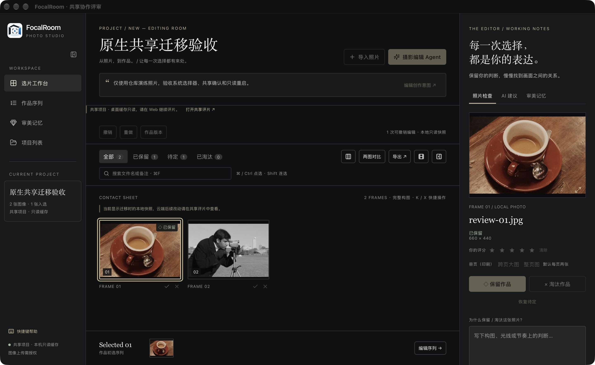
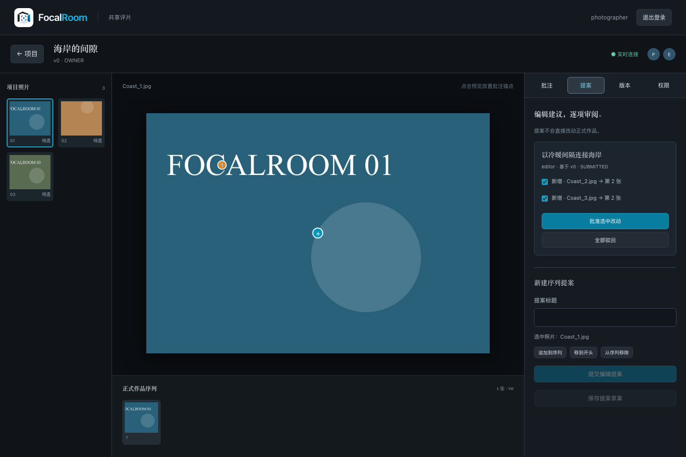

# FocalRoom 详细使用操作说明书

**适用范围：截至 2026 年 10 月 18 日的桌面与 Web 共享评片界面｜文档版本 1.0**

FocalRoom 帮助摄影创作者完成照片初选、细看比较、作品序列编排、AI 建议审阅与私密协作。你可以独立完成整个选片过程，也可以请 Agent 产生草案，或邀请编辑在 Web 提出修改建议。

本手册依据当前实现编写。当前软件属于开发评审版本；截图来自隔离测试项目，其中的照片、账户与项目名称仅用于演示。界面中仍可能出现 Between Frames、序间及旧的内部数据目录名称，它们与 FocalRoom 属于同一项目的历史命名。

**先记住三件事：**

1. 导入只建立照片引用和预览缓存，原图仍在原位置；移动硬盘、改文件名或拔出存储卡会影响原图访问。
2. AI 建议、协作提案与正式作品分开保存。只有你明确采纳或有审批权的成员批准后，才改变正式结果。
3. 共享有两条路径：**共享预览包建立独立副本；迁移为共享项目会冻结桌面正式编辑，之后在 Web 继续工作。**

## 阅读导航

- [1. 选择正确的使用入口](#section-01)
- [2. 安装、启动与使用前准备](#section-02)
- [3. 第一次使用：完成一组作品](#section-03)
- [4. 桌面界面与保存规则](#section-04)
- [5. 新建、管理与归档项目](#section-05)
- [6. 导入照片与重新定位原图](#section-06)
- [7. 网格浏览、筛选与批量选片](#section-07)
- [8. 照片检查器与沉浸审片](#section-08)
- [9. 两图比较](#section-09)
- [10. 作品序列与册页标记](#section-10)
- [11. 撤销、重做与作品版本](#section-11)
- [12. 委托摄影编辑 Agent](#section-12)
- [13. 任务预算、暂停与恢复](#section-13)
- [14. 审阅和采纳 AI 草案](#section-14)
- [15. 真实模型、密钥与图像授权](#section-15)
- [16. 审美记忆与证据管理](#section-16)
- [17. 导出、印刷参考与侧车文件](#section-17)
- [18. 共享方式选择与桌面迁移](#section-18)
- [19. Web 登录与共享包导入](#section-19)
- [20. 邀请、角色与撤销访问](#section-20)
- [21. Web 批注与私人笔记](#section-21)
- [22. Web 提案、审批与历史版本](#section-22)
- [23. 数据保管、存储诊断与备份](#section-23)
- [24. 快捷键速查](#section-24)
- [25. 常见问题与故障处理](#section-25)
- [26. 当前功能边界与支持信息](#section-26)

## 1. 选择正确的使用入口

| 入口 | 适合做什么 | 保存在哪里 | 使用前提 |
|---|---|---|---|
| FocalRoom 桌面应用 | 导入、选片、原图检视、比较、编排、本地 Agent、记忆与导出 | 本机项目数据库和缓存 | 已取得桌面评审包 |
| Web 的 `/shared` 页面 | 登录、共享预览、邀请、批注、提案、审批与历史查看 | 已连接的共享服务 | 共享 API 与 Web 服务可用，账户有权限 |
| 浏览器中的本地工作台示例 | 体验布局、按钮和交互 | 当前页面内存 | 刷新会重置，不能作为真实项目存档 |

桌面本地项目不要求云账户。只有调用真实模型、迁移共享或使用 Web 协作时才需要相应服务。

浏览器地址中的 `127.0.0.1` 或 `localhost` 表示服务运行在当前电脑；把这样的链接发给伙伴，伙伴会连接自己的电脑，无法因此访问你的项目。远程合作需要管理员提供双方可访问的 Web 地址。

### 1.1 项目状态的含义

| 显示状态 | 此时应如何操作 |
|---|---|
| 本地项目 / LOCAL | 在桌面编辑，已保存结果保存在本机 |
| 共享迁移中 / 本地写入冻结 | 在「导出」窗口恢复迁移，或验证云端未提交后取消；先不要继续正式编辑 |
| 共享项目 / 只读缓存 | 在 Web 继续评片；桌面显示迁移时的初始快照 |
| 本机项目缓存 / PROJECT CACHE | 项目列表的通用提示；进入项目后查看准确的共享状态 |
| 浏览器示例 / 内存数据 | 仅作体验，刷新后不保留修改 |

## 2. 安装、启动与使用前准备

### 2.1 启动桌面应用

1. 使用项目方提供的 FocalRoom 应用包；当前验收包名称可能带有「Review」。
2. 可以将应用放入 macOS「应用程序」后打开。
3. 当前评审包尚未完成正式发行签名与公证。只在确认包来源可信后，按 macOS 的提示允许打开；不要为此关闭系统安全保护。
4. 打开后先进入「项目列表」，核对自己正在使用的评审版本。

不同评审包可能使用独立的本地数据目录。换包后列表为空，不一定是原数据丢失；先确认应用标识和对应目录，避免重新建库覆盖旧数据。

### 2.2 准备照片

- 第一次熟悉流程可从几十张 JPEG 开始，再逐步扩大到实际项目。
- 将正式素材保存在稳定、可持续访问的位置，并单独备份原图。
- 从相机卡导入前，要知道应用不会自动把原图复制到电脑。若希望拔卡后继续原图细看，请先自行将照片复制到固定素材目录，再导入。
- JPEG、PNG、WebP、TIFF 可用于常规导入；HEIC、RAW 的解码还取决于当前 macOS 支持与文件类型。
- 不同格式的「导入成功」与「能检视完整原图细节」是两件事，参见第 8 节。

### 2.3 准备共享服务

Web 协作需要管理员提供 Web 评片地址；桌面直接迁移还需要 API 服务地址。不要从示例域名猜测真实服务地址，也不要把模型服务的 API 地址填进共享迁移窗口。

当前仓库具备可运行的独立本地共享评审环境，不代表已有经验证的生产站点。开发人员可参考 [共享服务说明](../between-frames/apps/api/README.md)；摄影创作者通常无需执行数据库或部署命令。

## 3. 第一次使用：完成一组作品

以下练习不依赖 AI 或云服务。

1. **新建项目。** 点击「新建项目」，填写作品名称，例如「周末的海岸」。创作意图可写：「保留人与海岸之间的距离感，选 12 张，以安静的日常收尾。」
2. **导入素材。** 在项目中点击「导入照片」→「选择文件夹」，等待导入完成，检查新增、重复跳过和失败数量。
3. **完成第一轮判断。** 单击照片后按 `K` 保留、`X` 淘汰、`U` 恢复待定。判断后照片不会从硬盘删除。
4. **细看和比较。** 双击照片打开大图；对相近的两张，选中后按 `C` 比较。理由可以写「右图人物更自然，但背景略乱」。
5. **保存判断。** 在检查器填写备注后，点击「保存我的判断」。仅打字还不等于保存备注。
6. **编排作品。** 进入「作品序列」，用拖动把手或「上移 / 下移」调整先后。
7. **留下节点。** 打开「作品版本」，输入「初选 · 12 张」，点击「保存当前版本」。
8. **导出审阅。** 点击「导出」→「接触印相」，使用新文件名保存；打开 HTML 核对张数和顺序。
9. **确认保存。** 完整退出桌面应用再打开，确认已保存的选片、备注和顺序仍在。

完成后，你应得到一个可再次打开的本地项目、一份命名版本及一份可查看的导出文件。之后可按需加入 AI 辅助或多人评片。

## 4. 桌面界面与保存规则

### 4.1 四个主要区域

| 区域 | 主要入口 | 用途 |
|---|---|---|
| 左侧导航 | 选片工作台、作品序列、审美记忆、项目列表、快捷键帮助 | 在项目和不同工作视图间切换 |
| 顶部项目与工具栏 | 项目描述、导入、编辑历史、筛选、搜索、比较、导出 | 管理当前项目与执行常用操作 |
| 中央画布 | 照片网格或作品序列 | 看完整构图、选择照片、调整顺序 |
| 右侧检查器 | 照片检查、AI 建议、审美记忆 | 查看单张信息、填写判断、管理任务与记忆 |

底部序列带显示已保留的照片。可用工具栏按钮收起序列带、检查器及左侧导航；也可切换网格密度，为画面留出更多空间。

### 4.2 哪些操作需要明确保存

- 保留、淘汰、评分和序列调整通过操作直接保存。
- 照片备注需要点击「保存我的判断」。
- 项目名称与意图需要点击「保存项目描述」。
- 作品版本需要填写名称并点击「保存当前版本」。
- Agent 的目标与预算填写完，需要点击相应「开始」按钮才产生新任务。
- Web 提案需要保存为草案或提交；仅在输入框中的内容不等于已经保存到服务端。

出现报错时，以操作结果和页面刷新后的状态为准。输入框内未提交的文字、尚未保存的提案编辑，不应视为可跨退出恢复的数据。

## 5. 新建、管理与归档项目

### 5.1 新建项目

1. 在「项目列表」点击「新建项目」。
2. 可选「空白项目」「家庭摄影书」「街头纪实」「旅行编辑」「作品集初选」。
3. 填写「项目名称」与「你希望这组照片表达什么？」。
4. 点击「创建并打开」。

模板只预填文字，不会替你选照片或锁定工作方式。若已经自己输入名称或意图，再选模板不会直接覆盖已有文字。

建议意图写清主题、氛围、使用场景和取舍标准，例如：

> 为一本小型旅行摄影书初选 20 张。重点是当地生活，不以地标为主；允许人物不正面出现。避免同一场景重复，开头有空间感，结尾安静。

### 5.2 修改项目与标签

进入项目，点击「编辑创作意图」，修改名称、意图和标签，再点击「保存项目描述」。标签用「、」或英文逗号分隔，最多 12 个；保存后可在项目列表按标签筛选。

改变创作意图后，请重新检查已有建议是否仍然适用；已产生的 AI 草案不会因为改了一句话就自动变成新方案。

### 5.3 归档与恢复

1. 返回项目列表，在对应项目卡片点击「归档项目」。
2. 在确认窗口点击「确认归档」。
3. 要找回时，进入列表的「归档项目」，点击对应卡片的「恢复项目」。

归档保留照片引用、备注和决策日志，不删除源照片，也不等于撤销云端其他成员的项目权限。要停止共享访问，请使用 Web 的权限管理。

## 6. 导入照片与重新定位原图

### 6.1 文件与文件夹导入

1. 打开可编辑的本地项目。
2. 点击「导入照片」。
3. 选择「选择照片」或「选择文件夹」。
4. 在系统选择器中确定文件或目录。
5. 查看导入进度及「新增 / 重复跳过 / 失败」统计。
6. 导入结束后点击「完成」。

应用只为工作建立缩略图和编辑预览，保留原始目录中的照片。不要把导入理解为“原图已经备份到 FocalRoom”。

### 6.2 取消与失败重试

- 执行中点击「取消导入」可停止后续处理；已经完成的照片仍留在项目里。
- 有失败项时，查看文件名与失败原因；处理权限、磁盘或格式问题后点击「重试失败照片」。
- 再次导入相同内容会有重复跳过统计；确认结果时同时看新增和跳过数量。
- 取消系统文件选择器不会创建新的照片导入结果。

### 6.3 原图失联

如果看到「原图失联，缓存预览仍可查看」：

1. 检查外置硬盘或相机卡是否已连接。
2. 若文件曾移动，点击检查器中的「重新定位原图」。
3. 在系统选择器选定对应原文件。
4. 重新打开大图确认来源与显示状态。

重新定位会校验关联文件；不要随意选一张同名但内容不同的照片。若源文件已经无法找回，缓存可能仍可用于查看，但不能当作原片恢复或高质量输出的替代品。

## 7. 网格浏览、筛选与批量选片

### 7.1 筛选与搜索

「全部」「已保留」「待定」「已淘汰」切换当前列表；搜索框匹配文件名、已保存备注及照片序号。多个搜索词需要同时匹配。

桌面搜索是已有文本搜索，不会因为输入“海边的人”就自动分析整库像素。Agent 对已有观察事实的检索是另一条流程。

若照片突然“不见了”，先清空搜索并切回「全部」。在「待定」列表把照片设为保留后，它会离开当前筛选，这是筛选结果变化。

### 7.2 单选、多选与范围选择

| 操作 | 结果 |
|---|---|
| 单击照片 | 选择并查看该照片 |
| 按住 ⌘ 点选；其他平台用 Ctrl | 增减选区中的照片 |
| Shift 点选 | 按当前视图顺序选择连续范围 |
| Shift + ← / → | 用键盘扩展选区 |
| ⌘A / Ctrl+A | 选择当前视图中的全部照片 |
| Esc 或「清除选区」 | 清除多选范围 |

全选只针对当前视图：若搜索或筛选已缩小范围，不会自动选中所有隐藏照片。

### 7.3 标记与星级

- `K`：明确设为保留。
- `X`：明确设为淘汰。
- `U`：明确设为待定。
- `1–5`：人工星级。
- `0`：清除人工星级。

有多选时，工作台快捷键作用于当前选区。多选后还会出现「保留选区」「淘汰选区」「选区待定」和「人工评分…」。

**注意作用范围：**右侧单张检查器的按钮修改当前照片；灯箱中的判断也修改当前显示照片。批量操作请使用选区工具或工作台快捷键。

保留状态与星级是两种独立判断。五星不自动等于保留，淘汰也不删除原图。重复按 `K` 是再次设为保留，不会像开关一样切回待定。

## 8. 照片检查器与沉浸审片

### 8.1 保存单张判断

1. 在网格选择照片，打开右侧「照片检查」。
2. 查看文件名、状态、尺寸和预览。
3. 按需评分、保留、淘汰或恢复待定。
4. 在「为什么保留 / 淘汰这张照片？」中写理由。
5. 点击「保存我的判断」。

备注最多 2,000 字符。建议记录可复核的观察，例如“人物与窗框呼应，能接前一张的垂直线”，比“好看”更有助于日后回看和记忆学习。

### 8.2 打开与操作大图

双击网格照片、点击检查器预览，或选中照片后按空格，进入沉浸审片。

- 「适合屏幕」：显示完整构图。
- 「100% 像素」或「100% 预览」：按当前可用显示源检视；必须结合来源说明判断。
- 「− / +」：缩小或放大；图像超出容器后可拖动平移。
- `← / →`：在当前视图的照片范围内翻片。
- `K / X / U`、`0–5`：直接判断与评分。
- 底部胶片条：点击跳到指定照片。
- `Esc`：关闭；焦点在灯箱主体时，空格也可关闭。

### 8.3 正确理解原图与 RAW 预览

| 大图来源提示 | 实际含义 |
|---|---|
| 原图 | 已成功加载支持范围内的源图；100% 按屏幕物理像素计算 |
| RAW 内嵌 JPEG 预览 | 读取了 RAW 中的 JPEG，并未完成 RAW 显影；不代表完整 RAW 分辨率 |
| RAW 派生预览 / 缓存预览 | 当前使用派生图，不能据此判断原片全部细节 |
| 正在校验并加载原图 | 原图读取尚未完成 |
| 原图不可用、无法解码等提示 | 当前可能回退到缓存，应先排查文件与格式 |

当前直通原图检视有文件大小和像素边界；超过边界可能无法完整加载。已实现的 CR2 内嵌预览只覆盖有限格式，不代表所有 RAW 相机文件受支持。

色彩由系统显示管理。当前版本不承诺专业软打样、完整 RAW 显影或印刷色彩管理；决定锐度、色差与最终印刷前，请回到合适的原片处理流程。

## 9. 两图比较

1. 用 ⌘ / Ctrl 点选两张照片。
2. 点击「两图对比」或按 `C`。
3. 用缩放控件检查细节；「同步缩放与平移」默认开启，可取消后独立检视。
4. 可填写「为什么更喜欢它？」。
5. 点击「偏好左张」「偏好右张」或「不确定」。

未恰好选两张时，应用尝试比较当前照片与当前视图下一张；超过两张选中时会要求缩小选区。筛选结果不足两张时，先调整筛选或搜索。

比较会记录偏好与理由，**不会自动改变两张照片的保留或淘汰状态**。比较后如决定采用右图，请再明确保留它。

## 10. 作品序列与册页标记

### 10.1 进入与调整顺序

被保留的照片组成作品序列。点击左侧「作品序列」、按 `S`，或从底部序列带进入。

调整方式：

1. 拖动照片卡片上的把手到目标位置。
2. 使用卡片的「上移 / 下移」。
3. 选择当前照片后按 `↑ / ↓`。
4. 键盘聚焦排序把手时，用空格启动拖动、方向键移动、空格完成；Esc 取消。

拖动照片画面本身通常用于查看/选择；排序请抓把手。每次成功排序都会保存，并可撤销。

### 10.2 从序列移除

把照片改为待定或淘汰，它会离开保留序列，但仍在项目与源目录中。以后再保留时，检查其加入后的顺序。

### 10.3 册页标记

在「照片检查」的「册页（印刷）」中：

- **跨页大图**：印刷参考中独占一个页面区域，以较大的版式展示。
- **整页图**：同样独占一页，以单幅版式展示。
- 再点已选中的标记可取消；默认参考版式每页两张。

这些标记影响「印刷参考」导出，不会裁切或修改源照片，也不等于生成了正式印厂跨页文件。

## 11. 撤销、重做与作品版本

### 11.1 日常编辑回退

点击「撤销 / 重做」，或使用 `⌘Z / ⌘Shift+Z`；其他平台使用 Ctrl。

批量编辑、草案采纳和版本恢复等会按相应编辑组回退。按钮旁显示当前可撤销次数。并非所有管理、授权与删除操作都属于选片撤销历史。

在文本输入框中，撤销优先作用于文字本身。不可撤销的记忆删除、云端撤权以及共享迁移，不应依赖工作台的撤销按钮恢复。

### 11.2 保存命名版本

1. 保存希望纳入版本的备注。
2. 点击「作品版本」。
3. 填写名称，例如「第二轮 · 18 张」「编辑意见前」。
4. 点击「保存当前版本」。

版本用于保留选片、顺序、人工评分与已保存备注。它不是原图、整个数据库或云服务的完整备份。

### 11.3 比较版本

进入「作品版本」→「版本对比」，选择 A 基准版本，以及 B 版本或「当前序列」。查看新增、移除、位置变化及状态/评分/备注变化。

此视图只读，切换 A/B 不会改变作品。

### 11.4 恢复版本

1. 进入「恢复预览」。
2. 选择已保存版本。
3. 核对加入、移出、移位及人工判断变化数量。
4. 点击「确认恢复此版本」。

恢复形成一次可撤销的新编辑。该版本之后导入的照片仍留在项目中，选片状态恢复为待定；不会因为恢复旧版而删除源文件。

## 12. 委托摄影编辑 Agent

### 12.1 先确认当前模式

在右侧「AI 建议」查看提供方说明：

- **本地 Mock**：不调用真实模型，不上传图像，费用为 0。用于体验任务、工具、草案和审批流程；不代表 AI 已看懂照片像素。
- **真实模型**：已配置外部模型服务。云端图像为 0 的任务仍可能把任务目标、文件名、备注等文本上下文发给该服务；“不上传照片”不等于整个任务完全离线。

浏览器内存工作台不能运行桌面本地 Agent。请在桌面本地项目中使用。

### 12.2 发起任务

1. 打开「AI 建议」→「编辑委托与预算」。
2. 在「编辑目标」中说明想完成什么。
3. 设置「目标照片数」（界面范围 1–100）。
4. 如仅处理一部分照片，先在工作台建立选区，再勾选「限制到当前选区」。
5. 展开「任务预算 · 后端执行」核对限额。
6. 点击「开始本地 Mock 任务」「开始编辑任务（不上传照片）」或「开始视觉任务」。
7. 如出现图像授权卡，核对收件服务、型号与张数后再决定。

**选区为空时，即使勾选限制选区，界面也会按整个项目处理。**希望仅处理几张时，先确认括号中的张数大于 0。

示例目标：

> 从当前选区中给出两版 12 张作品序列。一版按时间推进，另一版按光线与人物关系编排。减少相似画面，说明每张照片的作用，以及两版的取舍差异。

目标过大或图库大于观察预算时，Agent 不保证看完全部像素。务必结合步骤、引用和图像用量理解结果覆盖范围。

### 12.3 阅读任务过程

任务详情显示目标、状态、原因、轮数、工具次数、文本估算、图像数量、估算费用、预算计时及最近步骤。可通过「任务记录」切换历史任务。

「待审核」表示有结果需要你审阅，不代表草案已经进入正式作品。「结束审核」用于结束该审核阶段，不代替采纳。

## 13. 任务预算、暂停与恢复

### 13.1 默认预算

以下为当前新建任务的界面默认值，部署或后续版本可能调整。

| 预算项 | 默认值 | 用途 |
|---|---:|---|
| 模型轮次上限 | 16 | 限制推理/工具循环 |
| 工具调用上限 | 40 | 限制可执行工具总次数 |
| 执行秒数上限 | 480 秒 | 限制任务预算计时 |
| 单轮文本估算上限 | 48,000 | 控制单轮上下文规模 |
| 累计文本估算上限 | 500,000 | 控制累计文本使用 |
| 输出估算上限 | 8,192 | 控制单轮输出规划 |
| 云端图像上限 | 0 张 | 默认不上传图像 |
| 费用上限 | 100 美分，即 1 美元 | 应用侧估算限额 |

估算费用、文本估算与服务商真实计费不是同一个数值。用量不明的超时请求可能保留预算或图像配额预留，不能把失败请求理解为“没有发送、没有费用”。

### 13.2 常见状态与处理

| 状态 | 建议操作 |
|---|---|
| 排队中 / 准备上下文 / 执行中 | 查看步骤；需要中止时暂停或取消 |
| 等待答复 | 在「人工答复」输入补充说明并提交 |
| 已暂停 | 阅读暂停原因；预算不足时明确调整后恢复 |
| 已中断 · 可恢复 | 重新打开后核对模型、权限和预算，再恢复 |
| 待审核 | 查看草案差异，决定采纳、丢弃或结束审核 |
| 原任务基线过期 | 先检查当前项目变化；按界面重新比较或新委托 |
| 失败 / 已取消 | 保留错误原因，修正条件后创建新任务 |

### 13.3 暂停、取消和重新委托

- 「暂停任务」请求停止后续执行，保留已完成步骤和检查点；正在进行的外部请求不一定能立即撤回。
- 恢复时，未修改预算用「按已保存预算恢复」；改过预算用「按当前预算恢复」。提高预算需要你明确操作。
- 「取消任务」结束该任务，不回滚已经完成的人工正式编辑，也不撤回已经发送到外部服务的请求。
- 模型角色、端点、有效能力、授权或记忆来源等变更后，旧任务可能拒绝恢复；此时应重新委托，不能靠反复点击恢复绕过。

本机进程未运行时，桌面任务不会继续作为云后台任务执行。当前没有面向普通用户的完整共享云端 Agent 工作流。

## 14. 审阅和采纳 AI 草案

### 14.1 草案差异窗口

在任务产生的草案卡点击「查看草案差异」：

1. 阅读摘要和照片理由。
2. 核对「基线一致」或「基线已过期」。
3. 查看全量替换预计加入、移出、移动的数量。
4. 逐项勾选要接受的照片；默认可能全部勾选，需主动检查。
5. 如有需要，用草案项的 ↑ / ↓ 调整草案顺序。

修改草案顺序尚未改变正式序列。

### 14.2 局部采纳与全量替换

| 方式 | 适用情况 | 结果 |
|---|---|---|
| 采纳所选 N 项 | 只接受部分判断 | 仅修改所选项，其他人工状态和未选照片的相对顺序保留 |
| 替换正式序列 → 确认全量替换 | 已审查完整方案，决定整体采用 | 以全部草案项应用；原保留但未被包含的照片恢复待定，评分和备注保留 |
| 丢弃草案 | 不采用此方案 | 正式作品不因丢弃而改变 |

采纳形成正式编辑，可在工作台撤销。草案已采纳或丢弃后，不能把同一份待审状态当作无限重复执行的按钮。

### 14.3 草案过期

若草案基线与当前项目版本不同，采纳会被禁用。可按「基于当前版本重新比较」更新比较，再重新审阅；若目标、记忆或模型条件改变，应重新委托。

### 14.4 「编辑提案 · v2 审批」区域

某些流程还会显示操作化提案列表：

1. 打开提案；草稿状态先点「提交审批」。
2. 审阅加入、移位和移出序列的操作。
3. 勾选要执行的操作，保留界面填入的「审批 nonce」确认值。
4. 点击「执行所选操作」；全部取消勾选则为「驳回提案」。

nonce 是防止错批旧提案的确认值，不是 API 密钥，不需要自己编造。若不匹配或版本冲突，刷新并重新审阅。该区域与上方「草案差异」是两种结果入口，以实际出现的结果类型操作；不会因列表为空而自动生成提案。

## 15. 真实模型、密钥与图像授权

### 15.1 配置与密钥

服务地址、策展型号、可选观察型号及能力由当前部署配置决定。当前界面不提供完整的供应商切换、能力编辑或自动选模设置。

1. 先向部署人员确认应用实际连接的模型服务。
2. 打开「AI 建议」→「模型与密钥 · 诊断」。
3. 在密码输入框填写与该服务匹配的 API Key，点击「存入钥匙串」。
4. 重启应用后，核对提供方、型号及脱敏尾号。

不要把不同服务的密钥混用。单独保存密钥不会自动更改服务地址。开发配置也可使用环境变量；其优先级与精确能力配置见 [模型能力配置](MODEL-CAPABILITIES.md)。

需要移除时，使用「移除钥匙串密钥」，然后重启。若实例由环境变量提供密钥，移除钥匙串不会清除环境变量配置。

### 15.2 三种图像授权

| 按钮 | 含义 |
|---|---|
| 仅本次任务（N 张） | 仅当前任务向展示的观察服务和型号使用对应配额 |
| 本项目（可撤回，100 张） | 后续符合条件的项目任务可复用剩余授权；不是每次任务各增加 100 张 |
| 禁止云端图像 | 撤回本项目全部服务的图像授权，并把当前编辑预算的图像数设为 0 |
| 取消授权操作 | 不修改授权，不借此次操作启动任务 |

授权上传的是最长边 1,400px 的重编码 JPEG 预览，不含 EXIF/GPS；不上传原始照片文件。查看授权卡中的实际服务地址和型号，不能只依据提供方统称判断。

若策展与观察使用同一服务的不同型号，图像发给观察型号，观察事实再交给策展型号。更换观察服务或型号需重新授权；新任务仅更换策展型号且图像收件人不变时，可能沿用有效项目授权。

### 15.3 主动撤回

打开「模型与密钥 · 诊断」→「管理图像授权」→「禁止云端图像」。即使当前未配置模型或配置失效，该禁止入口仍可使用。

撤回阻止后续发送，不能取回已经发送或已进入处理的请求。清空本机观察缓存也不会删除服务商保存的内容。

### 15.4 配置错误与能力不足

若提示未配置图像观察能力：

1. 需要文字辅助时，将「云端图像上限」设为 0，再检查是否允许发起不上传照片的编辑。
2. 需要视觉观察时，请部署人员核对端点、型号和精确能力配置。
3. 不要用增加预算、重新粘贴密钥或借用旧授权绕过能力错误。

当前不提供完整跨供应商自动回退；拒绝图片授权后仍可继续本地人工工作，真实文字任务是否可运行取决于配置。

## 16. 审美记忆与证据管理

### 16.1 记忆是什么

「审美记忆」记录人工操作证据，并形成可查看、确认和纠正的偏好假设。假设是当前证据支持的线索，不是对你永久审美的定论。

打开方式：左侧「审美记忆」，或右侧同名标签。你可以查看人工选择、比较记录、偏好假设及人工证据。

多做带具体理由的判断，帮助你核对学习依据。Agent 自己的草案和建议不会被当成你已经认同的人工证据；撤销/重做不重复累计同一操作。

### 16.2 管理假设

| 操作 | 结果与适用情形 |
|---|---|
| 查看证据 / 查看反例 | 阅读支持与相反的原始操作和理由 |
| 确认此假设 | 表示你认可当前证据支持的线索 |
| 纠正此假设 → 提交纠正 | 写清误读与适用边界；已纠正假设不再按原结论进入新任务 |
| 停用检索 / 恢复检索 | 暂停或恢复符合条件假设的检索资格 |
| 移除此假设 | 可恢复地移除；用「显示已移除假设」找回 |
| 恢复此假设 | 将已移除记录恢复，实际使用仍取决于其状态与证据 |
| 删除假设 | 确认后物理删除当前记录，不可用工作台撤销，且不会从剩余操作重新生成该已删除假设 |

纠正示例：「我不是一贯偏好逆光；这组照片的主题是夏季傍晚，因此保留了逆光。其他项目不要默认提高逆光照片优先级。」

### 16.3 管理证据与搜索

- 「排除学习」：保留记录，但不让该证据继续参与学习。
- 「恢复参与学习」：恢复该条证据的参与资格。
- 「删除」：确认后删除当前证据记录；引用它的假设会失去该证据，支持引用为空时会退役。
- 「搜索偏好关键词」：输入词语并点击「搜索」；「清空搜索」恢复完整列表。
- 「查看更多证据」：展开更多人工记录。

删除不表示所有命令历史、旧快照、备份及外部服务副本都被安全擦除。临时不想参与学习时，优先使用可恢复的排除或停用。

### 16.4 跨项目本地记忆

默认关闭。勾选「允许离线 Agent 引用其他本地项目记忆」并确认后，离线 Agent 可按需引用其他活跃 LOCAL 项目中已确认、有效且相关的线索。

其他项目线索单独显示为只读，附来源和证据引用。要纠正或停用，请进入来源项目管理。

当前限于本机单一本地作者范围；归档、共享或迁移中的项目及云模型不参与，不应把它理解为跨账户云端作者画像。

### 16.5 缓存清空与任务影响

「清空视觉观察缓存」会清除当前项目本机观察结果及相关检索缓存，不删除照片、人工证据或偏好假设。再次观察可能需要有效授权并重新上传。

记忆、证据与相关授权变化会使正在执行或待恢复的任务暂停或拒绝继续。按提示基于当前记忆重新委托；不会因此自动改变正式选片和作品序列。

## 17. 导出、印刷参考与侧车文件

### 17.1 选择导出类型

打开项目工具栏「导出」：

| 导出按钮 | 内容与用途 | 输出形式 |
|---|---|---|
| 项目 JSON | 项目描述、照片编辑元数据、序列及相应记录，适合完整查看和工程交换 | JSON 文件 |
| 选片 CSV | 全部项目照片的文件名、状态、评分、序列位置、备注等，适合表格核对 | CSV 文件 |
| 接触印相 | 按当前正式序列排列的缩略图与文件名 | 含内嵌图像的 HTML |
| 印刷参考 | 封面、作品序列和册页标记对应的分页参考 | 含内嵌预览的 HTML，可再打印为 PDF |
| 元数据侧车 | 每张照片的编辑元数据与清单；不修改原文件 | 新文件夹，含逐照片 JSON 与 manifest.json |
| 共享预览包 | 共享副本所需清单与重编码预览 | 新文件夹，含 manifest.json、全部 *.preview.jpg 和说明 |

CSV 和侧车覆盖项目照片；接触印相和印刷参考按正式作品序列输出。序列为空时，先保留照片并检查顺序。

### 17.2 保存与核对

1. 先保存备注、完成正式选片与排序。
2. 保持「包含本机文件路径（迁移用途）」关闭，除非明确需要路径引用。
3. 点击导出类型，在系统保存/目录选择器中选位置。
4. 使用新文件名；文件夹导出会在所选父目录下创建独立子文件夹。
5. 查看「已导出」路径和 SHA256 回执。
6. 实际打开导出结果，核对名称、数量、顺序及所需图像是否齐全。

应用不会覆盖已有目标；遇到“目标已存在”请换新名称。文件夹导出若中途失败，可能留下未完成目录；不要将缺文件的目录当作完整交付包。

### 17.3 路径与私密文字

默认不包含本机原图/缓存路径，但项目名称、文件名、备注、创作意图及部分历史文字仍可能包含私人信息。发送 JSON、CSV、印刷 HTML 或侧车前，请检查内容。

勾选路径只增加位置引用，不会把原图打包进去。JSON/CSV/侧车也不是 Lightroom 的原生调色或 XMP 写回流程。

共享预览包使用单独的有限清单：包含照片文件名、选择状态和序列，以及预览文件；不包含个人记忆、原图、本机路径或 GPS。当前共享清单不携带本地完整备注、评分和创作意图，不是无损迁移整个桌面数据库。

### 17.4 将印刷参考存成 PDF

1. 点击「印刷参考」，保存 HTML。
2. 用浏览器打开该文件。
3. 选择浏览器「打印」。
4. 选择「存储为 PDF」或对应 PDF 目标，纸张 A4，横向。
5. 按页面提示开启背景图形；检查打印预览，必要时关闭浏览器自动页眉页脚。
6. 核对分页、完整构图和最后一页，再保存 PDF。

这是排片与沟通参考。当前输出不提供正式出血、装订方案、CMYK 分色或印厂色彩校准。

## 18. 共享方式选择与桌面迁移

### 18.1 先选路径

| 你希望怎样工作 | 选择方式 | 后续在哪里编辑 |
|---|---|---|
| 本地项目继续独立编辑，另建一份让伙伴评片 | 桌面导出「共享预览包」，Web 导入 | 两份项目分别编辑，不自动互相同步 |
| 同一项目正式转到共享服务，由多人围绕云端版本工作 | 桌面「将当前项目迁移为共享项目」 | 迁移完成后在 Web；桌面正式快照只读 |

共享服务接收去元数据的派生预览，最长边不超过 2,048px；已有更小预览不会凭空补出高分辨率。共享授权与模型图像上传授权分开。

### 18.2 导出独立共享副本

1. 桌面「导出」→「共享预览包」。
2. 保留导出的完整目录，不修改清单与预览文件名。
3. 按第 19 节在 Web 导入。

导出不会冻结本地项目。后续本地改动不自动进入已创建的共享副本，Web 修改也不自动回写原本地项目。

### 18.3 将当前项目正式迁移为共享项目

迁移前保存所需备注，留一个命名版本，并按需要导出本地记录。确认你接受云端正式编辑与桌面只读的切换。

1. 打开本地项目 →「导出」。
2. 找到「将当前项目迁移为共享项目」。
3. 填「API 服务地址」和「Web 评片地址」，使用管理员提供的对应地址。
4. 填已注册邮箱和账户密码；当前向导需要该账户拥有自己的云工作区。
5. 阅读并勾选派生预览共享授权。
6. 点击「确认迁移为共享项目」，保持窗口打开。
7. 等待本地冻结、上传、服务端校验和确认完成。
8. 状态变成「已由云端持有写入权威」后，点击「打开共享评片」。

通常填写服务根地址，API 不需要自行再拼接 `/api/v2`，Web 不需要自行拼项目编号；具体以管理员给出的配置为准。公网来源要求 HTTPS；回环 HTTP 只用于本机评审。

*图 1：隔离评审项目迁移后的桌面界面。左侧与顶部显示共享只读，正式续编请进入 Web。*

### 18.4 迁移中断、重启与取消

| 情况 | 应做的事 |
|---|---|
| 超时、网络错误或窗口退出 | 重新打开项目的「导出」，查看共享状态 |
| 显示迁移中 | 使用原服务、原账户恢复；不要假定“超时就是未上传” |
| 需要继续 | 重新输入密码、核对授权，点击「恢复共享迁移」 |
| 想取消 | 点击「验证云端未提交并取消迁移」；只有确认尚未正式提交，才恢复本地编辑 |
| 云端已经提交 | 保持共享状态；不能把它当作未完成迁移取消 |
| 提示绑定改变 | 恢复原服务、账户和工作区；不要换一个账户重新上传同一迁移 |

冻结用于避免桌面与云端同时产生冲突的正式版本。不应通过手改数据库、重建相同项目编号或删除迁移记录来解除。

### 18.5 迁移完成后的桌面

可以查看迁移时的快照并按可用入口导出；正式选片、评分、顺序、导入、Agent 等写入受到限制。桌面**不会自动拉取之后的云端版本**，请在 Web 核对最新序列。

macOS 可通过「打开共享评片」请求系统浏览器打开。若提示无法打开，复制界面提供的地址到浏览器；其他原生平台的此打开方式尚未完整实现。

## 19. Web 登录与共享包导入

### 19.1 账户登录

1. 打开管理员提供的 Web 地址，并进入 `/shared`。
2. 使用账户邮箱和密码登录。
3. 首次使用可点「首次使用，创建账户」，填写姓名、邮箱和密码，再「注册并进入」。
4. 受邀时须使用邀请指定的邮箱；已有其他账户登录时先退出。

密码至少 8 个字符且不超过 1024 字节。当前源码已提供「忘记密码？」、重置密码、邮箱验证与登录后的「发送邮箱验证邮件」，这些账户流程支持中英日韩；已部署版本是否包含本轮功能仍需管理员核对。

1. 找回密码：在登录页点「忘记密码？」，填写注册邮箱后发送。统一受理提示不说明邮箱是否存在，也不保证已投递；检查收件箱和垃圾邮件，每邮箱每小时最多发送 3 次。
2. 重置密码：打开邮件的 30 分钟有效链接，输入并确认新密码，点击「保存新密码」。成功后所有旧会话和其他未使用重置链接失效，需重新登录。
3. 验证邮箱：登录后在项目列表点击「发送邮箱验证邮件」，每 10 分钟最多 3 次。打开 48 小时有效的邮件链接后，仍须点击确认验证；验证不会授予任何项目访问权。
4. 链接打开后会移出地址栏，仅当前页面保留令牌；刷新后请重新打开原邮件。链接失效时重新申请，不向他人发送完整邀请、验证或重置链接。
5. 邮件服务未配置或发送失败时，重发验证显示不可用，不会虚构发送成功。生产需正确的 HTTPS 地址、邮件 Key 和已验证发件域；管理员须完成真实投递验收。

### 19.2 导入共享预览包

1. 在「你的共享项目」点击「导入共享预览包」。
2. 选择目标「工作区」。
3. 选择包内的 `manifest.json`。
4. 在 JPEG 文件选择器一次选中包内**全部** `*.preview.jpg`。
5. 核对标题、照片数量和已选预览数量。
6. 勾选派生预览共享授权。
7. 点击「建立共享副本」，等待逐张上传与校验。
8. 完成后进入项目。

不要上传原始 RAW/JPEG 代替包内预览，不要只选“已保留的几张”；文件数量和名称须与清单一致。该入口创建独立副本，不改变原桌面项目权威。

### 19.3 Web 评片布局

- 左侧「项目照片」：浏览项目全部照片，超过 48 张时翻页。
- 中央：当前照片预览、批注锚点，以及下方「正式作品序列」。
- 右侧：「批注」「提案」「版本」；Owner/Admin 还可见「权限」。
- 顶部：项目名、版本、角色、「实时连接 / 离线只读」和在线成员。

Web 显示的是共享预览，不提供桌面原图 1:1 检视。正式序列超过 48 张时也可独立翻页。

## 20. 邀请、角色与撤销访问

### 20.1 常见角色

| 角色 | 主要可见操作 |
|---|---|
| Owner | 管理自己的工作区项目、授权与提案审批 |
| Admin | 管理相应工作区项目；只授予可信任的管理者 |
| Editor | 评片、评论和提案；审批需单独获得授权 |
| Reviewer | 评论、回复与序列提案；不能自行批准正式修改 |
| Viewer | 只读查看；不能评论、提交提案或使用可写私人笔记 |

工作区角色和项目权限有区别。普通工作区成员不会自动看到所有项目；Owner/Admin 则拥有相应工作区项目管理能力。后台编辑资格与审批资格也是独立权限，不能看到 Editor 字样就认定可以审批。

### 20.2 推荐：只邀请到一个项目

1. Owner/Admin 打开目标项目右侧「权限」。
2. 填写「受邀邮箱」。
3. 选择 Reviewer、Viewer 或 Editor。
4. 点击「生成私密邀请」。
5. 「复制链接」，通过你自己的渠道发送给指定成员。
6. 对方用指定邮箱登录，打开链接并点「接受邀请」。

链接 7 天有效，只能按指定邮箱接受一次。系统当前邀请流程由你手动分享链接，不会仅因生成链接就自动发出邀请邮件。

不要把项目地址当作公开访问授权；即使知道地址，也需要有效账户与项目权限。

### 20.3 工作区邀请

在共享项目首页展开「工作区成员与邀请」，选择管理工作区、成员邮箱和工作区角色，点击「生成工作区邀请」，再自行分享。

邀请普通成员进入工作区后，仍需在具体项目中授予访问。邀请 Admin 会赋予更广的工作区项目管理能力，请根据实际协作范围选择。

### 20.4 单独允许 Editor 审批

在项目「权限」→「项目访问权限」中，对活跃 Editor 勾选「允许审批提案」。取消勾选会取消该独立审批能力；角色变化可能使对方页面要求重新进入。

### 20.5 撤销邀请和访问

- 链接尚未接受：当前生成链接卡可点「撤销此邀请」；当前页面未提供完整的历史邀请管理列表。
- 已加入项目：在项目访问权限中点「撤销访问」。
- 工作区成员：在首页成员管理中点「移除工作区成员」。

**移除工作区普通成员关系不代替项目权限撤销。**如果对方另有独立项目授权，还需进入该项目撤销；若对方以 Owner/Admin 管理权限访问，也须核对其工作区身份。

撤销会阻止后续预览请求并关闭相关实时连接，页面可能清空内容并提示返回列表。已下载、截图或保存到设备的像素无法从对方设备收回。

## 21. Web 批注与私人笔记

### 21.1 在照片上放置批注

1. 在左侧选择照片。
2. 点击中央预览中要讨论的位置，设置「+」锚点。
3. 进入右侧「批注」，填写观察或建议。
4. 点击「发布批注」。

批注与照片及位置关联，显示作者来源。写明“左下角亮斑分散注意力”“这张适合做开场”，有助于伙伴理解。

### 21.2 回复、解决与重新打开

1. 点击批注的「回复」或画面上的批注编号。
2. 填写回复并「发布回复」。
3. 处理完成后点击「标记解决」。
4. 仍需讨论时点击「重新打开」。

是否能解决某条线程由作者身份与角色决定；只读用户不能回复。误进入回复模式时点「取消回复」，再新建独立批注。

### 21.3 私人笔记

「私人笔记」仅用于当前用户在同一项目中自己的窗口同步，不是所有协作者共同编辑的文档，也不修改正式序列。

当前笔记依赖在线连接；重要内容可另行保留。不要把私人笔记描述为端到端加密保险箱，或把页面中尚未同步的文字视为永久存档。

### 21.4 网络变化

看到「离线只读」时，停止提交；本页未提交的提案内容暂时保留，但刷新/关页可能丢失未保存内容。等待「实时连接」恢复后，重新核对版本再提交。

## 22. Web 提案、审批与历史版本

### 22.1 建立序列提案

1. 打开「提案」标签。
2. 在「新建序列提案」填写标题。
3. 左侧选中目标照片。
4. 点击「追加到序列」「移到开头」或「从序列移除」。
5. 对下一张重复选择与操作；误加操作可点操作行的 ×。
6. 点击「保存提案草案」或「提交编辑提案」。

当前 Web 建议构建器提供上述三种按钮，没有完整的任意位置拖拽排片界面。应根据照片是否已在正式序列中选用追加、移动或移除，避免产生不适用的操作。

「从序列移除」移除的是作品编排关系，不删除项目照片和桌面源文件。

### 22.2 保存与修订草案

- 已保存 DRAFT 仅由草案作者查看与修订，未提交前不向其他人公开为待批提案。
- 点「继续编辑草案」，修改标题和操作，再保存或提交。
- 「取消本次修订」清空当前编辑器，不意味着删除已经保存的草案。
- `DRAFT` 为草案，`SUBMITTED` 为已提交评审；界面可能直接显示英文状态。

### 22.3 审批与部分采纳

有审批权限的成员：

1. 打开已提交提案，检查作者、基于的版本与每项变更。
2. 取消不接受项的勾选。
3. 点击「批准选中改动」。
4. 核对正式序列及顶部新版本。

*图 2：使用生成素材的审批示例。两项改动可分别决定是否采用，提案本身不直接覆盖正式作品。*

全部不采用时，点击「全部驳回」，或清空所有勾选后「驳回提案」。驳回不会新增正式作品版本。部分批准后，此提案完成处理，未采纳内容若还要推进，应形成新的提案。

### 22.4 版本冲突

如果看到「基线已变化，原提案保留」：

1. 查看当前正式作品与版本。
2. 使用「以当前版本重建提案」把操作带入新的提案编辑器。
3. 检查每项操作是否仍有必要、是否适用于最新序列。
4. 修改后保存或提交新提案。

重建不会静默批准旧建议。两个人几乎同时审批时，后到的请求可能被拒绝为过期；先刷新，不要重复点击试图覆盖他人结果。

### 22.5 查看正式历史

进入「版本」→「查看版本」，读取该次正式快照中的序列。历史只读，查看旧版不会覆盖当前正式作品。

当前 Web 没有桌面相同的通用撤销/重做和一键恢复旧版按钮。需要调整时，围绕当前版本创建并批准新的提案。

### 22.6 一次完整双人评片示例

1. 作者迁移项目或建立共享副本，邀请编辑为 Reviewer。
2. 编辑在照片上留下批注，作者回复并讨论。
3. 编辑保存一份草案，整理后提交序列提案。
4. 作者逐项采纳其中合理修改，驳回不适用项。
5. 双方核对正式序列新版本，处理并解决相关批注。
6. 在「版本」回看修改前后；继续讨论时形成下一份提案。

此流程不需要给 Reviewer 提案审批权限，也不需要启用云端 AI。

## 23. 数据保管、存储诊断与备份

### 23.1 四类数据分开保管

| 数据 | 保管位置/方式 | 不能替代什么 |
|---|---|---|
| 原图 | 你自己的素材目录、硬盘及备份 | 应用缓存不能替代原图备份 |
| 桌面本地项目 | 对应应用标识的数据目录，含数据库与缓存 | JSON/CSV 导出不等于完整数据库备份 |
| 共享项目 | 当前连接服务的数据库和预览对象 | 桌面迁移时快照不能替代后续云版本备份 |
| 模型密钥 | macOS 钥匙串或部署环境配置 | 不应通过导出、截图或聊天分发 |

当前独立共享评审包使用的目录示例：

`~/Library/Application Support/studio.focalroom.v2sharedreview/BetweenFrames/`

其他评审包可能不同。目录中的旧命名是兼容需要，不要自行重命名后期待应用自动找到它。

### 23.2 本地存储与诊断

1. 「AI 建议」→展开「模型与密钥 · 诊断」。
2. 点击「查看本地存储与诊断」。
3. 查看数据库、WAL、共享内存、图片缓存及迁移前备份。
4. 用「刷新统计」更新；需要反馈时先「检查诊断 JSON」，再「复制诊断信息」。

统计不含原图、导出文件和应用程序本身，不自动发送。显示「至少」「暂不可用」「统计不完整」表示无法完整计数，不能按 0 处理。文件逻辑大小也不等同于物理磁盘占用。

最近备份可能显示完整性巡检结果；「完整性通过」只表示只读快速检查通过，不等于已经恢复演练。当前应用内没有自动恢复入口。

### 23.3 缓存与清理

图片缓存超过配置额度时，被照片引用的缓存不会自动因此全部淘汰；后台孤儿缓存清理不等于用户可随意删除缓存目录。

需要释放空间时，先检查诊断、源图可用性与备份。应用当前没有一个可保证所有项目可恢复的“一键清空并恢复”流程；不要手工删除正在使用的数据库或 WAL。

### 23.4 备份建议

- 原图按你自己的素材备份方案独立保存。
- 需要本地完整项目备份时，完整退出应用后复制对应的整个数据目录，保留可能存在的数据库配套文件；另行保存所需密钥配置。
- 单独复制运行中的 `projects.sqlite` 可能遗漏 WAL 中的更新，不是可靠的完整备份方法。
- 在独立位置验证备份后再处理原目录；应用内目前没有一键恢复向导，恢复前需确认版本和目录对应关系。
- 共享服务的数据库与预览对象需要管理员协调备份和还原；只备份一边不足以恢复完整共享项目。

卸载 .app 通常不会自动删除项目数据，也不会删除源照片。临时本地共享评审环境可能在重新启动时生成新数据库，不能作为长期生产存档。

## 24. 快捷键速查

下表适用于桌面工作台；macOS 使用 ⌘，其他平台对应 Ctrl。当前主要原生验收平台为 macOS，不能据此推断其他平台已完整发行。

| 快捷键 | 功能 |
|---|---|
| K / X / U | 工作台将选区设为保留 / 淘汰 / 待定；灯箱仅当前照片 |
| 1–5 / 0 | 人工评分 / 清除评分 |
| ← / → | 当前视图上一张 / 下一张 |
| Shift + ← / → | 工作台扩展选区 |
| ⌘ / Ctrl 点选 | 增减选区 |
| Shift 点选 | 连续范围选择 |
| ⌘A / Ctrl+A | 选择当前视图全部照片 |
| ⌘F / Ctrl+F | 聚焦照片搜索 |
| C | 比较选中的两张，或当前与下一张 |
| G / S | 网格 / 作品序列 |
| ↑ / ↓ | 在序列视图移动当前照片 |
| ⌘Z / Ctrl+Z | 撤销一次可撤销人工编辑 |
| ⌘Shift+Z / Ctrl+Shift+Z | 重做 |
| ⌘Shift+A / Ctrl+Shift+A | 显示 / 隐藏 Agent 面板 |
| Space | 打开大图；灯箱主体中关闭；排序把手上启动/完成键盘拖动 |
| Esc | 按当前情境关闭对话框、取消拖拽或清除选区 |

输入框、下拉菜单、对话框等获得焦点时，全局工作台快捷键暂停；灯箱有自己的局部快捷键。按键无效时，先确认焦点、项目是否只读及是否有操作进行中。

快捷键帮助请点击左侧「快捷键帮助」。当前没有全局 `?` 打开帮助的实现。

## 25. 常见问题与故障处理

| 现象 | 先检查什么 | 处理方式 |
|---|---|---|
| 刷新后编辑全没了 | 是否处于浏览器内存工作台 | 真实项目改用桌面；Web 共享请进入 /shared |
| 换一个评审包后列表空白 | 应用名称、标识和数据目录 | 找到原包/目录，先备份，不直接覆盖或删除 |
| 导入后拔卡就看不到原图 | 原文件是否只留在存储卡 | 接回卡，或将原图保存固定位置后重新定位 |
| 部分照片导入失败 | 文件权限、外置盘、格式支持 | 看失败列表；处理后重试失败照片 |
| 照片被保留后从网格消失 | 是否筛选“待定”或有搜索词 | 切回全部并清空搜索 |
| 评分和入选数量对不上 | 星级与保留状态独立 | 单独设置保留状态并核对正式序列 |
| 比较后没有自动淘汰另一张 | 比较仅记录偏好 | 回工作台明确设为保留/淘汰 |
| 放大仍不够清晰 | 来源是否为缓存或 RAW 预览 | 读来源提示，核对原片是否可用与受支持 |
| 快捷键无效 | 焦点、模态窗口、只读状态 | 退出输入框/弹窗后再试；共享正式编辑改到 Web |
| 备注退出后没保留 | 是否点了保存我的判断 | 保存后再切项目/退出，报错时不要假定成功 |
| Agent 开始按钮禁用 | 是否有照片、执行中任务或配置错误 | 先解决提示；浏览器示例改用桌面 |
| Agent 没有看完整个图库 | 图像预算、选区与执行步骤 | 缩小任务、检查覆盖；没有观察证据不要认定已看图 |
| Agent 因预算暂停 | 哪项达到上限 | 按需要明确调整预算再恢复，或缩小目标新建任务 |
| 旧任务无法恢复 | 模型、能力、授权、记忆或源状态是否变更 | 保留旧记录，基于当前条件重新委托 |
| AI 草案无法采纳 | 是否基线过期或已处理 | 重新比较并审阅，必要时重新委托 |
| 没有偏好假设 | 是否有足够带理由人工证据、是否有筛选 | 增加可解释人工判断；检查已移除/排除状态 |
| 删除记忆后历史还看得到 | 是否查看命令历史、旧快照或备份 | 删除当前记录不等于安全清除全部副本 |
| 导出报目标已存在 | 保存文件或目录是否重名 | 使用新名称，不覆盖源照片或旧交付包 |
| 共享包导入提示不完整 | 是否选齐清单对应的所有预览 | 重新选 manifest 与全部 *.preview.jpg，保持原名 |
| 桌面迁移超时后不能编辑 | 云端提交结果尚待确认 | 用原绑定恢复或验证未提交再取消 |
| 迁移后桌面内容不更新 | 桌面保存的是初始只读快照 | 进入 Web 查看后续正式版本 |
| 伙伴打不开分享链接 | 是否为 localhost、账户不符或未授权 | 用可访问服务地址，并以指定邮箱接受项目邀请 |
| 已加入工作区但项目为空 | 普通成员缺少项目授权 | 管理员在目标项目单独邀请/授权 |
| Editor 看不到批准按钮 | 没有独立审批授权 | Owner/Admin 在项目权限中允许审批 |
| 提案不能批准 | 基线已更新、离线或权限变化 | 重连并核对最新版本，重建提案或确认角色 |
| Web 显示离线只读 | 服务、网络、WebSocket 连接 | 保持未保存页面，恢复后审阅新基线再提交 |
| 访问被撤销 | 项目授权或角色变更 | 返回列表联系项目负责人，不能靠图片旧链接恢复权限 |
| 邮箱验证/重置链接无法使用 | 部署版本、有效期、是否刷新过页面或已消费 | 重新打开邮件；失效后重新申请，并让管理员核对邮件服务与版本 |

### 25.1 反馈问题时提供什么

建议提供：

1. 应用包名称、版本，桌面或 Web，系统与浏览器。
2. 项目大致照片数量、文件类型、原图是否在外置盘。
3. 最少复现步骤、期望结果、实际结果。
4. 完整错误文字和不含私密内容的截图。
5. 经自己检查后的诊断 JSON；Web 问题补充发生时间与网络状态。

不用发送原图、API Key、密码、Cookie、完整邀请/验证/重置链接或私人备注。必要素材应另行约定范围。

## 26. 当前功能边界与支持信息

以下是本手册与当前可操作界面的边界，避免把实施计划当作已经开放的功能：

- 桌面主要面向 macOS 评审；当前包未完成正式签名、公证和跨平台发行验收。
- 已有原图与有限 RAW 预览检视，尚非完整 RAW 显影、专业色彩工作站或印厂排版软件。
- 本地 Mock 验证流程，真实模型具备受控执行链路；专业摄影质量、完整多供应商适配、自动质量选模与真实账单对账尚未全部验收。
- 语义检索依赖已有观察事实，不是自动看遍整库。当前本地作者记忆不扩展到真实多 Creator 的云端隔离。
- Web 已可进行私密预览、批注、提案、审批与历史查看；桌面共享后仅保留初始只读快照。
- 账户恢复/验证已有前端和本地回归，真实邮件与部署仍需验证。云评论汇总因独立模型发送授权尚未接通而明确拒绝，不能把辅助函数当作完整云 Agent 或已部署的 Redis/BullMQ 队列。
- 邀请仍需手动分享；账户页面可操作不代表当前部署已配置真实邮件并完成投递验收。
- 真实生产部署、对象存储、备份还原、多实例容量及真人协作验证仍需按实际环境验收。
- 团队计费、席位套餐、付费专业服务订单、支付与结算不在当前 M5 用户操作范围内。

### 相关资料

- [模型能力与部署配置](MODEL-CAPABILITIES.md)：供配置模型服务的人员参考。
- [M4/M5 共享协作验收报告](V2-M4-M5-SHARED-AUTHORITY-TEST-REPORT.md)：了解现有验证证据与环境限制。
- [剩余开发计划](V2-REMAINING-PLAN.md)：查看尚未关闭的里程碑要求；新增代码仍需结合当前源码与验收判断。
- [历史 Beta 试用手册](BETA-GUIDE.md)：仅保留历史使用背景，当前操作以本说明书为准。

本说明书不执行照片上传、共享迁移或服务配置。示例操作请在确认素材、服务与授权范围后由使用者实际完成。
