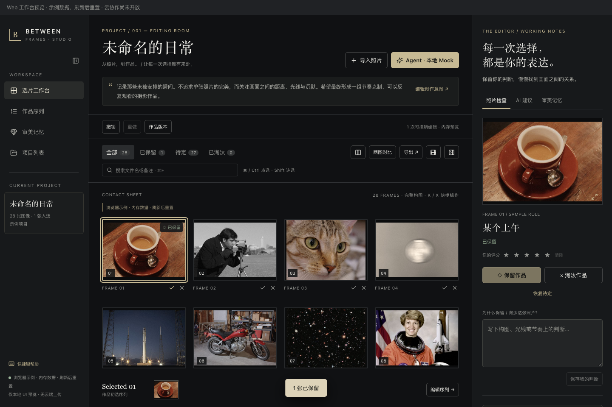
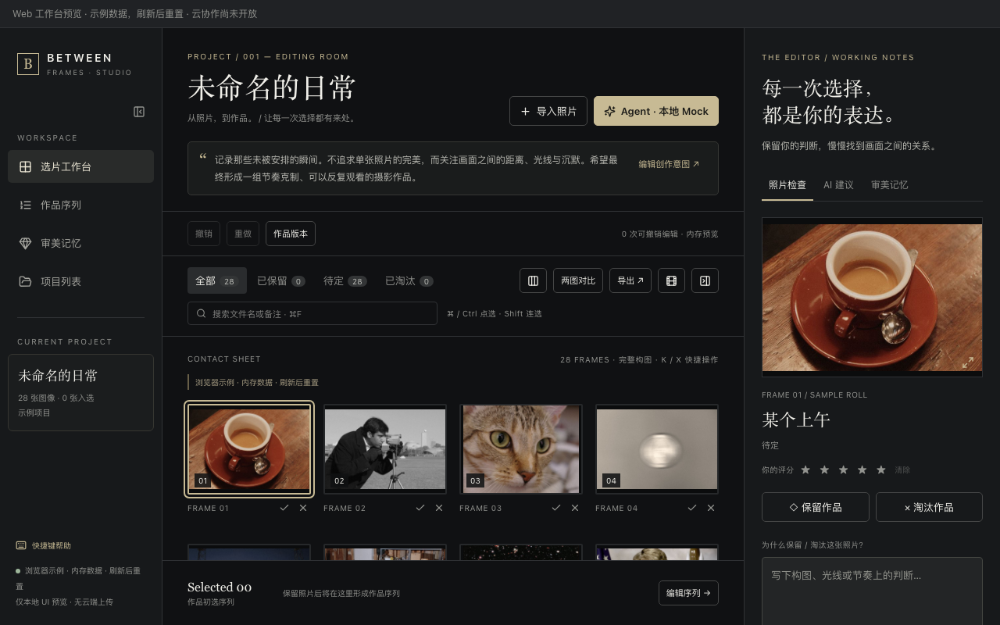

# v2.0 M0 基座实施与本地验收

日期：2026-10-15。当前提交基线：`0a5c71b`，本轮修改尚未提交。范围：M0 工程/契约切片与既有功能保护；整体状态：**partial / 等待架构与 UI/UX 评审**，不自动进入 M1。

## 实施结果

| 切片 | 交付 | 状态 |
|---|---|---|
| 工程组织 | npm workspaces；Desktop/Web 独立 Vite 入口；API/Agent skeleton；共享 UI；纯 Rust local-domain crate | 本地通过 |
| 设计系统与工作台 | 继续使用现有 Tokens、按钮、三栏、虚拟 Grid、检查器与序列；Web 明示示例数据与未开放云协作 | 本地通过 |
| v2 契约 | 9 种严格命令、审批、ToolResult、MediaPolicy、ProjectMode、可信 principal 类型；生成 JSON Schema/Rust kind；拒绝客户端 actor | 本地通过 |
| 权限与权威骨架 | Workspace/Project 归属、角色与能力、Agent 到期与 Draft-only、revision、LOCAL/SHARED 单权威；合法写入仍返回 NOT_IMPLEMENTED | 本地通过；真实 session/共享执行器未实现 |
| 旧数据兼容 | 保持 0001–0010、旧 ID/历史/检查点；临时库外键/回滚/重开与完整旧旅程回归 | 本地通过；新的 creator/workspace/mode 持久化迁移未实施 |
| CI | Git 根目录 GitHub Actions；已验证工具链、锁文件、测试、双构建、独立桌面构建与 artifacts | YAML 已解析；未推送，远端未执行 |
| 验收映射 | 24 条 v2 场景映射到既有证据与缺口，保持 partial/missing | 已记录，不冒充新阶段通过 |

工程入口：[V2-M0-README](../between-frames/V2-M0-README.md)。架构：[ADR 0016](ADR/0016-v2-m0-contracts-and-workspaces.md)。迁移评审方案：[V2-M0-DATA-COMPATIBILITY](V2-M0-DATA-COMPATIBILITY.md)。

## 自动化实测

最终执行 `npm run verify:v2`，退出码 0；独立原生构建退出码 0。

| 检查 | 结果 |
|---|---|
| 旧 GUI/Agent/Memory 契约 + v2 生成一致性 | passed |
| 全部 TypeScript / ESLint | passed |
| 前端单元测试 | 134 passed / 16 files |
| 其中 v2 契约测试 | 77 passed，包含 40 组 TS/Rust 共用命令和 21 组共用权限样例 |
| 原有浏览器 E2E | 16 passed |
| 独立 Web M0 E2E | 1 passed，1440×960 与 1280×800；选片生效、刷新重置、页面错误与外部请求均为 0 |
| Rust | 83 passed；Keychain 写删 1 项跳过；性能基线仍为 ignored |
| Rust 格式与严格 Clippy | passed；另单独检查 local-domain path dependency |
| 真实 Rust/SQLite 后端 E2E | 5 passed；本地临时库与 Mock/本地 HTTP Provider，无真实模型服务 |
| Desktop/Web 生产前端构建 | passed；两个独立 dist |
| Tauri 独立 Debug .app | passed，55.70 MiB，未签名/公证 |
| 依赖保护 | 所有既有 npm 包锁定记录逐项相同；Cargo.lock 仅新增本地 path crate 与引用 |

记录：[完整验证输出](evidence/v2-m0/verify-v2-m0.log)、[原生构建输出](evidence/v2-m0/native-build.log)。

## 原生操作验收

独立应用 `Between Frames V2 Foundation.app`，identifier：`studio.betweenframes.v2foundation`。只在它自己的评审库操作；没有打开原用户或旧 Review 的数据库进行升级。

实测步骤：新建“v2.0 M0 基座验收” → 系统文件夹选择器选择项目 assets → 导入完成 28/28、失败 0 → 保留 frame_01 → 网格、检查器与底部序列同步显示 → 完整退出（工具确认进程 isRunning=false）→ 重启并打开同一项目。

重启后显示 28 张、1 张入选、27 张待定、1 次可撤销编辑。只读比对全部 37 张表逐行一致，10 份 migration 记录保留；28 个源文件 SHA256 一致；AgentTask/ToolCall 均为 0。证据：[原生一致性记录](evidence/v2-m0/native-acceptance.json)。原生界面已通过桌面截图工具观察，磁盘 PNG 截图见下方 Web 同源布局证据。

系统目录定位快捷面板的自动确认没有完成导入；通过系统选择器的最近目录选择 assets 并明确点击 Open 后，真实导入完成。此处区分自动化定位步骤与应用导入结果，不将前一次取消算作成功。

## UI 证据





## 基线修复与回归证据

本轮检测到用户提交 `0a5c71b`，保留其四项评审修复。接入兼容测试额外复现并修复两个边界：

1. 完整表述/带证据数的旧墓碑，在改用关键词存储后仍须有效。读取时统一经既有 keyword 归一化，避免已删除记忆复活；不改数据库。
2. 巡检根目录是符号链接时拒绝遍历；候选文件 metadata 读取失败时也拒绝打开，沿用已有目录隔离语义。

两项均先复现失败再补保护；最终完整回归覆盖。证据：[旧墓碑失败](evidence/v2-m0/compatibility-red.log)、[根目录链接失败](evidence/v2-m0/symlink-root-red.log)、[修复后通过](evidence/v2-m0/compatibility-green.log)。

## 限制与停止点

- v2 云认证、Postgres、媒体上传、Promotion、评论/协作、模型路由、付费功能均未实施；skeleton 和 Schema 不是生产服务。
- v2 dispatcher 只校验并拒绝执行；不提供业务写入、持久化回执、真实资源查询或 session 验证。旧 v1 本地入口承担现有真实功能。
- 新数据库归属/模式迁移只交付评审方案，未增加 migration。结构变更需按会话 AGENTS.md 明确确认后实施；不要把这项标记为已完成。
- npm workspaces 已建立，但旧 src/src-tauri 目录暂保留，属于 ADR 的渐进组织方案，不声称完成全部物理搬迁。
- 沿用本机已验证的 Node 25.8.1 / npm 11.11.0 / Rust 1.94.0，未因 M0 升级核心依赖；正式发布前仍需确定长期支持工具链策略。
- 构建仍有约 600 kB 主 JS、既有 Tauri API 静态/动态导入提示；不通过调高阈值隐藏。签名、公证、性能大图库、真实模型和专家评测未在本轮执行。
- CI 远端运行、架构/迁移方案与 UI/UX 仍待评审。本轮停在 M0，不实施 M1–M7，无 commit/push。

## 原则与复现

通过共享 UI 入口和契约样例复用已有能力，避免重写；提取同一 Rust Schema 校验器，保持单一校验实现与既有错误包装；v2 的 JSON 数学整数及 Unicode 长度具有跨语言样例。将 UI、纯契约、可信权限与实际 I/O 分开；仅建立当前 M0 必需的 skeleton，不安装未来服务依赖。

```bash
cd "开发文档/contact-sheet-ai-demo/between-frames"
npm ci
npm run verify:v2
CARGO_TARGET_DIR=target-v1 npm run tauri -- build --debug --config "src-tauri/tauri.v2-review.conf.json"
```
