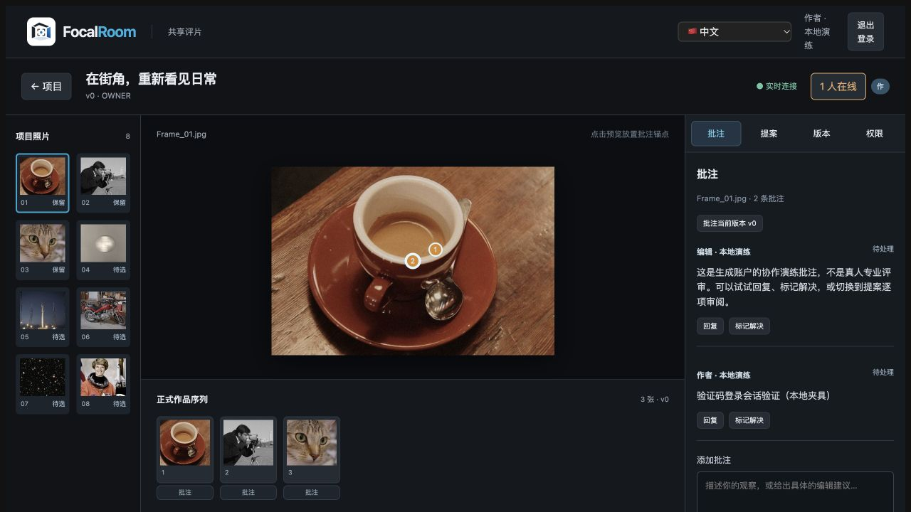

# M4 验证码登录与业务镜像修复验收

日期：2026-10-18。范围：本地源码、隔离 PostgreSQL、实际 API/Web Docker 镜像和浏览器。**没有更新腾讯云生产服务，没有发送真实邮件或调用真实模型，没有执行 git commit/push。**

## 结论

本地验证码登录和业务容器链路通过。不能据此宣布 `team.focroom.cc` 已恢复：本轮只读 SSH 连接返回 `Permission denied (publickey,password)`，未取得远端源码、容器日志或数据库版本。用户转述的生产错误属于排查线索，尚未在服务器复核。

## 从代码确认的问题与修复

| 问题 | 修复 |
| --- | --- |
| COPY 保留源文件 0600、目录 0700，API 切换 node 后不可读 | API 镜像构建时规范源码文件 0644、源码及祖先目录 0755，并设置 node 所有者；Web 静态文件与 Nginx 配置同样规范权限。不递归修改 node_modules，不改宿主原文件权限 |
| 验证码写入不存在的 sessions，前端将 token 当 CSRF，未建立现有 Cookie 会话 | 复用 AuthService 的 fr_sessions、独立 CSRF 和 HttpOnly Cookie；响应不返回裸 session token；新账户同时创建 OWNER 工作区 |
| 验证码 SQL 未登记、与 0009 授权迁移重号 | 新增并登记 0012_magic_login.sql，兼容旧草案表；已登记历史 SQL 字节不变，补应用角色 DML 授权 |
| Math.random、无失败次数上限、并发重复消费、邮件失败仍声称成功 | crypto.randomInt、挑战绑定哈希、事务与邮箱锁；五次失败废止，限流持久化，邮件失败回滚并返回 503；成功消费与创建会话原子提交 |
| Web 表单缺少可靠提交状态和错误流程 | 独立 MagicLogin 组件，四语文案；显式验证按钮、防重复提交、重发清空旧值、更换邮箱；保留找回入口 |
| Compose 未传邮件配置 | 显式传入 Resend key/from；示例不含真实密钥，发送域必须经服务商验证 |
| Cookie 登录后 Agent 面板 GET 误要求 Origin/CSRF | 三个只读查询使用读认证；POST 等写入继续校验 Origin/CSRF，新增回归验证匿名拒绝和无 CSRF 写入拒绝 |

`apps/web/index.html` 与 SharedApp 标题统一为「FocalRoom — 团队协作审稿」。上述权限问题有实测支持；没有证据证明 Docker 层缓存机制本身失效，因此未删除镜像或清理全局缓存。

## 测试与功能验收

| 检查 | 结果与边界 |
| --- | --- |
| PostgreSQL/API 全套 | 52/52，通过；0 skipped。覆盖验证码、账户、角色、队列、存储等；之后针对 GET 修复另跑 agent_worker 4/4（包含已有三项，不叠加计数） |
| 验证码专项 | 12 项包含于上述全套：旧表升级/幂等、归一化邮箱、Cookie/CSRF/登出、现有账户兼容、邮件失败回滚、过期/跨来源、五次失败、重发限流、并发单次消费、会话失败回滚、失败重发保留旧码、并发发送配额 |
| 前端 | 34 文件、237/237 测试通过；新增四项登录表单回归 |
| 静态检查/构建 | Lint、typecheck、Desktop/Web 构建通过；git diff --check 通过。未改 Rust，未重跑原生测试或签名打包 |
| 实际 Docker 权限 | 人为使用 0600 文件、0700 目录作为构建输入；容器 UID 1000 实际导入 server.ts，核对八个关键文件 SHA256 与源码一致 |
| 实际 Docker 数据库/启动 | 新建随机内部网络和独立 PostgreSQL，迁移角色执行 DDL，应用角色以镜像正常 CMD 启动；不是替代业务的哨兵容器 |
| 实际 Nginx/API | 新标题 HTML 200、标志 PNG 200、同源代理未登录接口 401；不再是本地 502。无邮件 key 时请求返回 EMAIL_UNAVAILABLE/503，没有伪造邮件成功 |
| 浏览器 | 127.0.0.1:1432 独立夹具：投递失败停留邮箱页、模拟邮件验证码登录、刷新保留会话、加载八图项目、发布本地测试批注、退出；Agent 面板无原 CSRF 错误 |

Docker 实测 PostgreSQL 为 **16.13 aarch64**，Compose 草案为 16.14；本地 API/Web 镜像是本机架构，不能直接当腾讯云目标镜像。Docker 测试结束仅停止本轮随机容器，保留卷/镜像；未清理其他项目。浏览器使用生成测试账户和样本预览，仅本地模拟投递；不计真实邮件交付或专业质量评审。

## 首轮失败与修复复验

- 抽出登录组件后的未使用 import、邮件函数未使用参数导致类型/Lint 失败，已删除并复验。
- PostgreSQL 最小权限测试仍期待旧迁移列表，首轮全套失败；更新为包含 0012 后全套通过。
- 首次 Docker 虽规范源码子目录，`/app/apps` 等祖先目录仍保留 0700，实测 EACCES；补祖先目录权限后，以相同极端输入重新构建和实测通过。保留首轮日志。
- 浏览器登录后发现 Agent GET 校验来源错误；仅更正只读认证，回归及浏览器重启后重新验收通过。

## 证据与接续

证据目录：[evidence/v2-m4-otp-deployment-fix](evidence/v2-m4-otp-deployment-fix/README.md)。包含最终/首轮失败日志、镜像摘要、源码 SHA256、测试脚本及截图。

本轮期间有外部提交捕获部分编辑，测试时观察到 HEAD `1af1301`；该提交号不代表本聊天执行了提交，也不代替最终源码摘要。新增的其他并行模块不纳入本轮功能验收。

生产接续见 [部署核对与执行方案](V2-M4-OTP-DEPLOYMENT-PLAN.md)。仍需服务器访问、远端版本/迁移与角色核对、生产备份、明确批准后的部署迁移、实际 HTTPS Cookie 和真实邮件验收。M0–M5 整体状态不由本轮局部修复改为完成。
