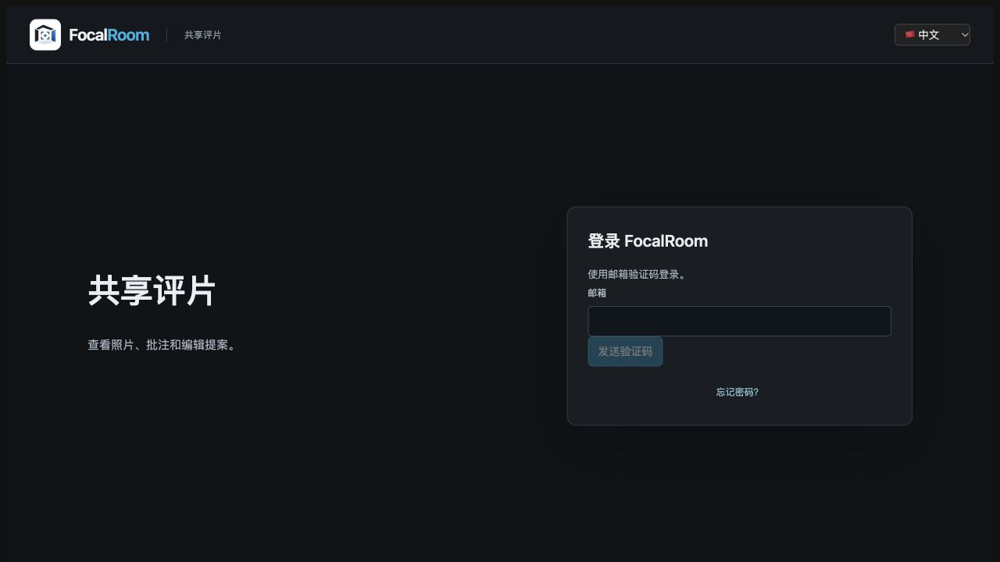

# M4 生产修复部署验收

日期：2026-10-18。用户在具体范围确认后回复「确认部署」。本轮已执行腾讯云 FocalRoom 独立栈的备份、角色/迁移升级、配置修正和 API/Web 替换；不是仅本机冒烟，也不代表 M0–M5 全部完成。

## 结果

[https://team.focroom.cc/](https://team.focroom.cc/) 已从 502 恢复为新登录页「FocalRoom — 团队协作审稿」。系统 curl 保持证书校验，实测公网 HTML 200、匿名 `/api/v2/auth/me` 401/UNAUTHORIZED；IAB 独立打开页面和该 API，均得到对应界面/JSON。

**邮件按批准范围暂不启用。** 没有真实邮件 key，验证码发送返回 EMAIL_UNAVAILABLE/503，不能称真实验证码登录已可用。本次没有创建生产测试账户、项目或作品；登录后业务旅程尚未在真实线上账户验收。



## 已执行的变更

| 项目 | 实际变更与核验 |
| --- | --- |
| 备份 | 停写状态下 PG custom dump 与预览卷完整归档，清单及 SHA256 已生成；dump 的 pg_restore --list 通过。用户0、项目0，预览文件0；没有因空库而跳过备份 |
| 镜像 | 本机冻结上下文构建的 amd64 API/Web 离线传输，119,562,736字节，归档 SHA 与批准记录一致；目标机核对镜像 ID/架构，UID1000 实际导入 server.ts 与读取0012 SQL |
| 角色 | 创建缺失的 focalroom_migrator，使用既有受控配置中的密码；只转移 FocalRoom public 内原18表、2序列及2函数所有权；应用角色认证通过、无schema CREATE，应用/迁移角色均无SUPERUSER/CREATEDB/CREATEROLE |
| 迁移 | 迁移角色显式执行0006、0008、0010、0011、0009、0012；当前登记共8项，全部SHA与冻结镜像SQL逐项匹配；当前26张业务表由迁移角色拥有 |
| 配置 | Origin修正为 https://team.focroom.cc；保留其余.env值并把权限改为0600；新增固定镜像/Origin/邮件变量覆盖YAML，密钥保持为空 |
| 服务 | 仅重新创建API/Web；PG容器ID完全不变，数据库与预览卷保留。API/Web/PG均running；未启动Worker/模型 |

实际镜像：

- `focalroom-release-api:otp-20261018-amd64` → `sha256:dbf00eca3ba2b9329fb822757b9cba37294835f4d4b962e7ed1439ec726f57d5`
- `focalroom-release-web:otp-20261018-amd64` → `sha256:5cc4b4dbed8dc64bc427c097e870e70a96cc13ddd26134054a2944b3e11b2933`

本轮沿用已验认证协议与镜像，不新增依赖或替换框架；配置覆盖单独保存，避免重写旧部署源文件。没有清缓存/镜像、compose down、删除卷、修改旧迁移、重置数据库、git commit/push，也没有修改 openyc、官网、DNS、Tunnel 或 TLS。

## 验收与失败记录

| 验收 | 结果 |
| --- | --- |
| 本机发布前 | amd64两镜像构建、非root导入/摘要、新标题；隔离旧owner升级/失败回滚/幂等/旧行保留/应用DML与DDL边界通过。原52PG、237前端等为前轮本地回归，不冒充本轮生产全量 |
| 服务器回环 | 新标题HTML200、Logo PNG200、匿名鉴权401、带正确Origin的无邮件请求503；没有伪造投递成功 |
| 公网客户端 | 系统curl TLS校验正常：HTML200、新标题、鉴权401/JSON；IAB从502刷新为登录表单，API单独显示UNAUTHORIZED |
| 数据保护 | 用户0、项目0，预览文件/目录清单前后一致；原PG容器和挂载保留；八项迁移SHA一致 |
| 资源/权限 | 部署后盘剩余2,061,029,376字节（约1.92GiB）；.env0600、备份目录0700、备份中的环境文件0600 |

首轮备份脚本使用 Python 3.11 才有的 hashlib.file_digest，服务器为3.10.12，出现AttributeError。流程在数据库/运行服务修改前停止；改为分块SHA256，已验证已知字节和空输入。保留首轮备份/日志，重新生成 backup-verified，随后完成部署；没有掩盖首轮失败。

公网复核另有两项验证环境问题：服务器默认 Python HTTP 客户端回访公网得到403/非JSON，初版脚本误按JSON解析；本机Python证书环境报无法找到本地签发CA。没有关闭证书校验或更改Cloudflare规则，改由系统curl与IAB独立验证200/401，并保留服务器403记录。尚未定位该403的具体访问策略，不能声称所有网络/客户端均可达。

## 发布位置与后续运维

服务器发布目录：`/opt/focalroom/releases/otp-20261018-amd64`。

- 当前覆盖配置：该目录下 `deployment-override.yaml`。
- 有效备份：该目录下 `backup-verified/`。custom dump 47,201字节；完整SHA见证据，备份和.env内容没有复制到仓库。
- 初次未完成备份：`backup/`，另有 `attempt-1-journal.json`，保留用于排障；不能当作最终备份替代品。
- 完成日志：`deployment-journal.json`，记录旧/新容器、镜像和验证。

宿主旧源码和基础Compose保留，实际运行由发布镜像和新增覆盖文件决定。后续运维必须包含两份配置；单独使用旧基础Compose可能选择旧镜像/构建上下文。

```bash
compose=(docker compose --project-name "focalroom-shared-review" --env-file "/opt/focalroom/.env" -f "/opt/focalroom/ops/shared/compose.yaml" -f "/opt/focalroom/releases/otp-20261018-amd64/deployment-override.yaml")
"${compose[@]}" ps
```

该示例仅查看状态，不自动更新。未来迁移、备份/恢复及镜像替换仍须按实际目标审阅。0012后旧镜像可能因严格schema校验拒启；不能直接切旧tag当作已验证回退，也不能删除登记。此生产备份通过格式和清单核验，**本轮没有把它恢复到独立目标演练**。

## 剩余边界

- 安全配置真实邮件服务、验证发送域，并由用户指定接收邮箱后完成真实验证码/刷新/退出验收；当前登录UI可访问但无法实际收取验证码。
- 线上真实项目/邀请/审稿旅程、专业质量与真人双人门槛未被本轮覆盖；Worker/模型未启用。
- 备份恢复演练、容量/多地域可达性、告警与生产安全加固仍需继续。当前基础Compose仍向API容器注入迁移连接变量；已验的是所用数据库角色权限，不能当作运行时迁移凭据隔离已完成。
- 原SSH密码曾进入聊天/历史指南，当前文档清理不撤销历史；管理员需安排轮换，本轮未改变该凭据或重写Git历史。

证据：[evidence/v2-m4-production-deployment](evidence/v2-m4-production-deployment/README.md)。
